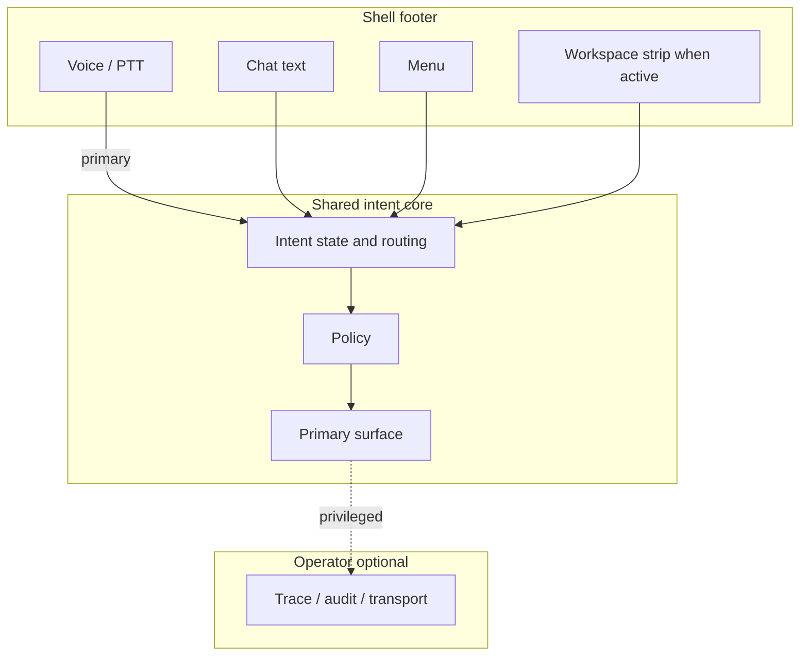

# AMD-2026-007 — Intent Primitive, Shell Affordances, Session Disclosure, Workspace Domain Pack v1, and Primary vs Operator UI

## 0. Status and ratification

| Field | Value |
|-------|--------|
| **Status** | **`ratified`** **v0.2.1** — **2026-04-07** (peer review `reviews/amd_2026_007/round_2/`; motion **`AMD-2026-007-RATIFICATION-MOTION`**). |
| **Ratification** | **Executed:** canonical amendment text reconciled with **Round 2** review target **v0.2.1** (§11.9, POL-SHELL-004–006). **Follow-on:** (1) apply spec deltas listed in §6; (2) confirm policies in §5 in the organization policy index (**[`reference/AIOS_POLICY_INDEX.md`](../reference/AIOS_POLICY_INDEX.md)**); (3) record this AMD id in each affected spec’s `amendment_history`; (4) merge **§11** / **§11.9** references into canonical specs per §6. |

This amendment **does not** itself replace AIOS-SPEC-007 or AIOS-SPEC-008; it **directs** normative text and policy IDs those documents (or successor files) **must** contain after ratification. **§11** is the **core primitive layer**: shell behavior, UI separation, domain pack, and policies **all reference resolved intent**; without §11, implementations drift (routing, UI, voice, policy gaps).

---

## 1. Purpose

Ratify a single, coherent **AI OS shell and Workspace presentation contract** **anchored to a first-class governed intent object** (§11) so that:

1. **Intent** is **normatively defined** and **resolved** through a single lifecycle; **voice**, **chat**, **menu**, and **system triggers** are **expression modalities** into that lifecycle — not parallel ad hoc concepts.
2. **Voice-first** remains the **primary** interaction modality for declaration and steering (see §11.7).
3. **Menu** and **text Chat** remain **required global fallbacks** in the shell for real-world limits (no microphone, user cannot or must not speak, noisy environments, accessibility, preference).
4. **Intent-driven UI** remains **sovereign** for **primary task surfaces** (SPEC-008 UI sovereignty; §11.4): the main canvas reflects **resolved intent state** and **outcomes**, not an omnibus dashboard of unrelated widgets.
5. **User, system, and intent state** are **disclosed composably** (§11.6) — lane, identity provider session, integration adapter health, per-capability readiness, **and** resolved intent — so users and agents can answer “where am I?” and “what is blocked?”
6. **Primary** user experience shows **outcomes and governed affordances**; **operator** experience holds **audit identifiers, raw transport, MCP/JSON-RPC evidence** — not interleaved as the default primary path (§11.4–11.5).
7. **Workspace** capabilities scale through a **typed capability registry** used to **fulfill** resolved intents under policy (§7, §11.8).

---

## 2. Scope

**In scope**

- **Intent definition and execution model** (§11) — the **governed primitive** that routing, UI, policy, and registry **must** share; without it, shell and Workspace rules **lack a single anchor**.
- Shell footer: **Command rail** behavior, **voice ↔ chat** toggle, **Menu**, optional **workspace / governance context strip** when a governed canvas is active.
- **Menu catalog** model (declarative entries, visibility, capability prerequisites, grouping).
- **Composed session summary** model for chrome and agent context (not a duplicate source of truth for business data).
- **Workspace Domain Pack v1** — normative **interfaces and responsibilities** (TypeScript schema in repo; this AMD states requirements).
- **Primary vs operator** surface split for governed integrations.
- **Policy IDs** introduced or reserved for enforcement and traceability.

**Out of scope (explicit)**

- Replacing AIOS-CORE-001 or legal documents.
- Vendor-specific MCP server implementation details (referenced only as “adapter”).
- Automatic merge into application code (implementation follows ratified specs in a separate release process).

---

## 3. Definitions

| Term | Definition |
|------|------------|
| **Intent** | **Normative definition:** §11.1. A structured, governed declaration of a desired outcome; the **core object** that routing, policy, capabilities, and UI **resolve and execute** under this amendment. |
| **Resolved intent** | An intent instance that has passed **resolution** and **validation** (§11.3) and **MAY** proceed to execution; carries **at least** the properties in §11.2. |
| **Primary surface** | The user-facing region where **intent execution and outcomes** are presented (structured cards, next actions, consent for write plane). |
| **Operator surface** | A **privileged** region (drawer, panel, or mode) for **evidence**: audit ids, payloads, MCP traces — default-off for typical users when policy allows. |
| **Shell fallback** | A **global** affordance that does **not** replace intent sovereignty: **Menu** (structured entry to system and domain routes) and **Chat** (text input when voice is impractical). |
| **Composed session summary** | One **read model** aggregating: active governance canvas view (if any), workspace hub context (if any), lane connectivity, Google identity session (where applicable), MCP adapter health signal, per-domain capability readiness, and **last user-visible milestone** (e.g. onboarding step completed). |
| **Capability registry** | Typed catalog of Workspace (and future) capabilities: id, domain, plane (read/draft/write), scopes, policy hooks, UI flags, confirmation requirements. |

---

## 4. Normative decisions (ratified principles)

### 4.1 Voice-first and shell fallbacks

- The system **SHALL** treat **spoken input** as the **primary** modality for intent declaration and steering where the product enables voice.
- The system **SHALL** provide **persistent** shell access to **Menu** and to **switch between voice and text chat** without requiring voice.
- The system **MUST NOT** remove **Menu** or **voice ↔ Chat** from the shell **without** a **documented accessibility and continuity substitute** approved under governance (this amendment or successor).

**Rationale:** Fallbacks are **not** “anti-intent”; they preserve operability under physical and social constraints while keeping intent-driven canvases primary.

### 4.2 Intent sovereignty vs omnibus dashboard

- **Primary** workspace content **SHALL** be driven by **active intent state** and playbooks (AIOS-SPEC-008).
- The system **SHOULD NOT** present an **omnibus dashboard** of unrelated widgets as the default **primary** surface for governed Workspace tasks.
- **Menu** **MAY** expose multiple entry points; entries **SHOULD** be **data-driven** from a **menu catalog** with eligibility rules — not an unbounded ad hoc grid without governance metadata.

### 4.3 Composed disclosure (no ambiguous “connected”)

- The shell **SHALL** separate **at least** these **dimensions** where the product implements them: **Workspace lane / local gate**, **Google identity session** (or declared bearer policy), **MCP adapter health**, **per-domain capability readiness**.
- The system **MUST NOT** collapse these into a single ambiguous label such as “connected” without disclosing **which** dimension failed when support or audit is required.

### 4.4 Workspace presentation (full-stage)

- When a **Workspace** governed canvas is active, the **content region** **SHOULD** use the **available viewport** within shell safe areas (header/footer), not a **centered narrow card** as the **outer** shell for the hub unless a specific accessibility exception is documented.
- When a **workspace context strip** exists in the footer (back, hub switch, operator trace), it **SHALL** **augment** the shell **without** removing §4.1 fallbacks.

### 4.5 Primary vs operator content

- **Resource identifiers** and **raw transport strings** **SHOULD NOT** be the **primary** path for mail and similar flows; **search → structured result → select → read** **SHOULD** be the default happy path.
- **Audit identifiers, raw JSON, MCP method names** **SHALL** be available in an **operator** surface keyed to policy and role.

### 4.6 Capability registry

- New Workspace-facing capabilities **SHALL** be registered with **plane** (read/draft/write), **policy** linkage, and **UI** visibility rules before being exposed as production **primary** affordances.

**Connection to §11:** §4.1 defines **modalities** (**voice**, **chat**, **menu**) for **intent expression** (§11.3.1). §4.2–4.3 require **resolved intent** to drive **primary** surfaces and **composed** disclosure including **intent state** (§11.4, §11.6). §4.5 maps **primary vs operator** to **outcome vs execution trace** (§11.4–11.5). §4.6 registers **capabilities** that **fulfill** intent under **policy** (§11.8).

---

## 5. Policy register (introduced or reserved)

After ratification, these **policy identifiers** **SHALL** be registered in the organization policy index and referenced from specs and code.

| Policy ID | Statement (summary) |
|-----------|---------------------|
| **POL-INTENT-001** | **Resolved intent** **SHALL** conform to **§11.2** minimum properties; routing and UI **SHALL NOT** treat intent as an unconstrained string bag. |
| **POL-INTENT-002** | **Governance** **SHALL** enforce at **intent** resolution and execution per **§11.8** (actor → domain → capability → policy → execution). |
| **POL-INTENT-003** | **Primary surface** **SHALL** comply with **§11.4–11.5** (outcome-first; no raw ids/transport as default). |
| **POL-INTENT-004** | For **time-indexed** domains (at minimum Workspace **mail** and **calendar**), ambiguous or unbounded requests **SHALL** be **temporally grounded** before execution — explicit period, session context, governed default with disclosure, or bounded choice — per **AIOS-SPEC-009** §6.3.1. **MUST NOT** silently run unbounded queries when grounding is required. |
| **POL-INTENT-005** | When a request would return a **materially broad** mail or calendar result set, the system **SHALL** **disclose** approximate scope/volume and **require or apply narrowing** per **AIOS-SPEC-009** §6.3.2. |
| **POL-INTENT-006** | **Unverified** or **policy-sensitive** **execution plans** (**AIOS-SPEC-009** §15) **SHALL** obtain **user approval** or **documented policy auto-approval** before **write-plane**, **multi-step composite**, or **new-plan** execution — see **§15.5** and **§15.7**. |
| **POL-INTENT-007** | **Successful** verified executions **MAY** be **promoted** to **reusable playbooks** per policy (**AIOS-SPEC-009** §15.6); promotion **MUST** be auditable. |
| **POL-SHELL-001** | Preserve global **Menu** and **voice ↔ Chat** fallbacks; removal requires governed substitute. |
| **POL-SHELL-002** | Shell **SHALL** present **composed session summary** dimensions (lane, Google, adapter, capabilities) per product implementation. |
| **POL-SHELL-003** | **Workspace footer strip** **MAY** add domain actions **alongside** §POL-SHELL-001 controls. |
| **POL-SHELL-004** | **Shell state** and **shell routing** controls **SHALL NOT** be registered as **skills** or **tools** in the **capability registry** nor modeled as **domain intent fulfillment** through the **skill** or **domain execution** plane — **§11.9.1**. |
| **POL-SHELL-005** | **Voice** and **non-voice** (chat/menu) paths **SHALL** maintain **capability parity** **within** **documented** shell affordances and **policy** — **§11.9.3**. |
| **POL-SHELL-006** | **Narrow** **engineering bootstrap** exception where the **shell routing plane** must operate before full **registry** coverage — **MUST** be **documented**, **time-bounded** where applicable, and **formalized** or **retired** per **§14** follow-on — **§11.9.4**. |
| **POL-UI-001** | **Primary** surfaces **SHALL** emphasize intent outcomes; **operator** surfaces hold transport/audit evidence. |
| **POL-WS-REG-001** | **Capability registry** **SHALL** gate registration of Workspace capabilities by plane and policy. |
| **POL-WS-UI-001** | **Mail/read** flows **SHALL** default to **cards + selection**, not paste-id as primary. |

Normative detail for each policy **MAY** live in standalone `POL-*.md` files or in **AIOS-SPEC-007** annexes; this AMD **fixes identifiers** and **intent** so drift is detectable.

---

## 6. Required specification deltas (post-ratification)

### 6.1 AIOS-SPEC-008 (Intent Discovery & Onboarding Framework)

**Primary path:** **[`AIOS-SPEC-009`](../specifications/IntentPrimitiveAndExecutionModel.md)** (**Intent Primitive and Execution Model**) is the **canonical ratifiable specification** for the intent primitive. **AIOS-SPEC-008** **SHOULD** **normatively reference** SPEC-009 for definitions, lifecycle, UI contract, and transparency — **or** merge equivalent text while avoiding duplication.

**Merge** (or align) **§3.1 Intent** and lifecycle chapters with **§11** of this AMD and **AIOS-SPEC-009** so that **one** normative intent definition exists — **either** by **reference** to **SPEC-009** **or** by **normative reference**: “Intent primitive and lifecycle **MUST** match **AMD-2026-007 §11** and **AIOS-SPEC-009**.”

**Add** (or merge) a section **Shell affordances and fallback modalities** stating:

- Voice-primary with **Menu** and **Chat** as **documented fallbacks** consistent with §4.1–4.2 of this AMD.
- **Composed session summary** requirement aligned with **POL-SHELL-002** and §3 definitions herein, **including resolved intent** per §11.6.
- Cross-reference **AMD-2026-007** and **Workspace Domain Pack v1** (see §7).

**Update** §18 (Cross-Document Impact) to replace “future shell governance specification/amendment” with a **concrete reference** to **Workspace Domain Pack v1** and this AMD.

**Append** to `amendment_history` in frontmatter.

### 6.2 AIOS-SPEC-007 (Google Workspace Integration Governance)

The file **`specifications/GoogleWorkspaceIntegrationGovernance.md`** **SHOULD** exist as the canonical SPEC-007 (currently referenced by WORKSPACE.md and SPEC-008).

**Add** annexes or sections:

- **UI transparency model** (lane, Google session, adapter, capabilities, **resolved intent** — §11.6).
- **Workspace Domain Pack v1** contract (or **normative reference** to `specifications/WorkspaceDomainPackV1.md` if split).
- **Primary vs operator** presentation rules for integration surfaces.
- **Intent enforcement** for Workspace routes: **POL-INTENT-001**–**007** and **§11.8**; **temporal grounding** for mail/calendar per **AIOS-SPEC-009** §6.3.1–6.3.2; **compilation / approval / promotion** per **AIOS-SPEC-009** §15.
- Policy cross-refs: **POL-SHELL-002**, **POL-WS-REG-001**, **POL-WS-UI-001**.

### 6.3 AIOS-SPEC-006 (UI Component Registry Standard)

**Add** or clarify entries for:

- **Command rail** variants (default / workspace / operator).
- **Operator trace** component class and **forbidden** primary placement for raw transport (per **POL-UI-001**).

### 6.4 Optional standalone: Workspace Domain Pack v1

**May** be authored as **`specifications/WorkspaceDomainPackV1.md`** containing: TypeScript-oriented schema descriptions, menu catalog fields, session summary fields, rail modes, and registry column definitions — **normative** once ratified.

---

## 7. Workspace Domain Pack v1 (normative outline)

This AMD **requires** a **Domain Pack v1** document (standalone or annex of SPEC-007) that **MUST** specify at minimum:

| Area | Requirement |
|------|-------------|
| **Menu catalog** | Stable ids, labels, route/intent targets, **section** group, **visibility** expression, **requiresCapability** references. |
| **Session summary** | Fields for canvas view, workspace hub, lane, googleAuth, adapter, capabilities[], lastMilestone; mapping to shell and optional agent context. |
| **Command rail modes** | `default` \| `workspace` \| `operator` semantics; **MUST** preserve §4.1 fallbacks. |
| **Capability registry** | Rows: id, domain, plane, scopes, policyRef, ui.primaryAllowed, confirmation.required. |
| **Mail read plane** | Structured cards, selection-driven read; **POL-WS-UI-001** compliance. |

**Section numbering:** §§**8–10** are **unused** in this revision so that **§11** remains the canonical **Intent Definition and Execution Model** (peer review label). Future amendments **MAY** insert intermediate sections or renumber; until then, **§11** is the **core primitive** chapter.

---

## 11. Intent definition and execution model (REQUIRED)

This section is **canonical** for this amendment. **SPEC-008** §3.1 and lifecycle text **MUST** align with §11 on ratification (see §6.1). **SPEC-007** **MUST** enforce intent for Workspace integration routes (see §6.2). **POL-INTENT-001**–**007** implement this layer in policy registers (see **AIOS-SPEC-009** §15 for compilation and promotion).

### 11.1 Intent (normative definition)

**Intent** is a **structured, governed declaration of a desired outcome within a domain**, expressed by an **actor**, **resolved** by the system into **permissible actions**, and **executed** through **controlled capabilities** under **policy**.

### 11.2 Intent properties (required)

Every **resolved** intent ready for validation or execution **MUST** contain at least:

```ts
/** Minimal governed shape; field semantics MAY extend in Domain Pack v1. */
interface Intent {
  id: string;
  domain: string;
  outcome: string;
  actor: Actor;
  plane: "read" | "draft" | "write";
  capabilities: string[];
  constraints: string[];
  confidence: number;
}

/** Actor: stable identity and role binding for policy — normative detail in AIOS-SPEC-008 or Workspace Domain Pack v1. */
interface Actor {
  id: string;
  role: string;
}
```

Implementations **MAY** attach additional fields (e.g. playbook id, audit correlation id) **without** violating **POL-INTENT-001**.

### 11.3 Intent lifecycle (normative)

```text
Expression → Resolution → Validation → Execution → Outcome → State update
```

#### 11.3.1 Expression

Intent expression **MAY** originate from:

- **voice** (primary where enabled),
- **chat** (text),
- **menu** (structured shell entry),
- **system trigger** (scheduled, onboarding, or policy-driven).

All expression paths **SHALL** feed **resolution** — they **MUST NOT** bypass **validation** and **policy** for governed actions.

#### 11.3.2 Resolution

- Classify utterance or selection into a **structured intent**.
- Assign **domain** and **outcome**; populate **§11.2** fields to the extent required for the current phase.

#### 11.3.3 Validation

- **Actor** permissions.
- **Policy** enforcement (including scope and confirmation rules).
- **Capability** availability per **capability registry**.

#### 11.3.4 Execution

- **Control plane** and adapter calls as defined for the intent’s **capabilities**.
- **Multi-step orchestration** when the playbook requires it.

#### 11.3.5 Outcome

- **Structured result** returned to the **primary surface** (§11.4).

#### 11.3.6 State update

- **Session state** updated so **intent context persists** across modalities (voice ↔ chat ↔ menu) unless policy clears it.
- **Composed session summary** **SHALL** reflect current **resolved intent** where applicable (§11.6).

### 11.4 Intent-driven UI contract

The **primary surface** **SHALL**:

1. Display **resolved outcome**, not raw tools or transport.
2. Present **structured results** aligned to the intent’s **domain** and **plane**.
3. Offer **next valid actions** derived from **policy** and **capability** state.
4. Reflect **current intent state** (including label or short description when helpful).

The primary surface **MUST NOT** (by default):

- Require **raw resource identifiers** from the user for happy-path flows where structured search/select exists.
- **Expose transport mechanics** (MCP method names, JSON-RPC shapes) as the default primary content.
- Require **manual tool selection** when a **known intent playbook** defines the path.

The primary surface **SHOULD**:

- Show an **intent label** or human-readable summary when it aids orientation (example: `Intent: Review emails requiring response`).

### 11.5 Outcome-first rendering

Upon **successful resolution** of a **known** intent with a defined playbook, the system **SHALL** render the **outcome view** **without** requiring **intermediate manual tool selection** for the default path — unless **policy** explicitly requires a confirmation step.

### 11.6 Transparency requirements

The system **SHALL** disclose:

#### Actor

- **Who** is acting (see **Actor** in §11.2).

#### System state

- **Lane** (e.g. Workspace gate),
- **Auth** (e.g. Google / session policy),
- **Adapter** (integration health),
- **Capabilities** (readiness per domain).

#### Intent state

- **Resolved intent** (summary or id per product UX),
- **Confidence** (optional display when material).

#### Operator trace

- **Audit**, **raw payload**, and **transport** evidence **SHALL** remain **available** in the **operator surface** — **not** primary by default (aligns with §4.3 and §4.5).

### 11.7 Voice-first AI (normative)

**Voice-first AI** is a system where **intent** is **continuously captured**, **resolved**, and **updated** through **conversational interaction**, with **UI** acting as a **supporting surface** for clarity, consent, and rich review — **not** the sole or mandatory control mechanism for declaration and steering.

### 11.8 Governance enforcement model

Governance **SHALL** operate at the **intent** level:

```text
Intent
  → Actor validation
  → Domain validation
  → Capability resolution
  → Policy enforcement
  → Execution
```

Routing, UI, registry, and audit **SHALL** remain **traceable** to this chain (**POL-INTENT-002**).

### 11.9 Shell state controls vs skills and voice parity (REQUIRED)

This section governs **shell-state** and **shell routing** only. **Domain** intent lifecycle, execution semantics, **PolicyRecord**, and **execution plans** remain **canonical** in **AIOS-SPEC-009** — see **§11.9.2**.

#### 11.9.1 Routing plane vs capability execution plane (POL-SHELL-004)

- **Shell** **state** transitions and **shell** **routing** (command rail, voice/chat/menu chrome, session-local shell routing, workspace context strip that does not **fulfill** a **resolved Workspace domain outcome**) **SHALL** route on the **shell control / routing plane** under **shell authority** and **POL-SHELL-004**–**POL-SHELL-006**.
- **Shell** **controls** **SHALL NOT** be modeled as **skills** or **tools** in the **capability registry** for **domain** **fulfillment**; the **registry** **SHALL** exclude shell-only controls from **domain** **skill** **namespaces** where **POL-SHELL-004** applies.
- **POL-SHELL-004** **SHALL** be **testable** (e.g. registry rules, routing metadata, or conformance checks) — **not** advisory only.

#### 11.9.2 Non-duplication with AIOS-SPEC-009 (domain intent)

- **§11.9** **governs** **shell-state** semantics and **shell routing** **only**.
- **AIOS-SPEC-009** remains the **canonical** specification for **domain** **intent** lifecycle, **resolution**, **validation**, **execution**, **PolicyRecord**, **execution plans**, **§15** compilation — **§11** above and **§11.1–§11.8** define the **intent primitive** at the **AMD** layer; **§11.9** **SHALL NOT** restate **AIOS-SPEC-009** **§2–§4** or **§15** as a second normative source — **implementations** **SHALL** treat **SPEC-009** as the **domain** locus for those rules.

#### 11.9.3 “Documented” shell affordances (POL-SHELL-005)

- **“Documented”** means: the affordance is **listed** in **AIOS-SPEC-006** (or successor **UI registry**), **Workspace Domain Pack v1** **menu catalog**, **this amendment §5**, or an explicit **policy annex** filed under governance **after ratification** (format detail **MAY** follow without narrowing the **§11.9.3** **minimum**).
- **Voice parity** (**POL-SHELL-005**): where **voice** and **chat/menu** both exist for the **same** **shell** **control**, **parity** **SHALL** hold **within** **documented** **shell** **affordances** — **not** an unbounded guarantee across **domain** **capabilities** governed by **AIOS-SPEC-009**.

#### 11.9.4 Engineering bootstrap (POL-SHELL-006)

- Where **routing** **plane** **bootstrap** is required **before** full **registry** **hygiene**, **POL-SHELL-006** **allows** a **narrow** **documented** **exception** — **MUST** be **tracked** for **closure** or **formalization** per **§14**.

---

## 12. Relationship to other amendments

| Document | Relationship |
|----------|----------------|
| **AMD-2026-005** | Workspace model & governed interface surfaces — this AMD **refines shell and presentation** without revoking scope class or intent taxonomy decisions. |
| **AMD-2026-006** | Workspace plane / integration ratification (per WORKSPACE.md reference) — **complementary**; **SHOULD** be cross-reviewed so SPEC-007 and policy IDs do not conflict. |

If **AMD-2026-006** is ratified first, **merge** policy tables and **deduplicate** Workspace policy namespaces in the index.

---

## 13. Implementation alignment (repository)

The following implementation areas **SHOULD** converge to this AMD after spec merge (non-exhaustive):

- `src/components/shell/CommandRail.tsx`, `commandRailTypes.ts` — rail modes and fallbacks.
- `src/components/shell/ShellIdentityBar.tsx` — composed disclosure.
- `src/App.tsx` — `AppMode` vs `govCanvas` composition; menu catalog source.
- `src/workspace/workspacePolicy.ts`, `intentRegistry.ts` — registry and planes.
- `src/overlays/WorkspaceHubSurface.tsx` — full-stage layout.

**Non-normative:** File paths may change; specs and policies remain source of truth.

---

## 14. Ratification checklist

- [x] Governance / triangulated peer review complete (**Round 2** `reviews/amd_2026_007/round_2/`; **READY_FOR_RATIFICATION** per gate report).
- [x] Ratification motion executed (**`AMD-2026-007-RATIFICATION-MOTION`**, **2026-04-07**).
- [x] This AMD **`status`** set to **`ratified`**, **`version`** **v0.2.1**, **`ratification_target`** set; **§11.9** and **POL-SHELL-004**–**006** present in **§5**.
- [ ] Policy register (§5) **fully** reflected in master policy index rows (**POL-SHELL-004**–**006** detail — index lists identifiers; **verify** annex links as needed).
- [ ] SPEC-008 updated per §6.1 (**§11** / **§11.9** alignment).
- [ ] SPEC-007 file present and updated per §6.2 (or explicit defer with dated exception).
- [ ] SPEC-006 updated per §6.3 or defer documented.
- [ ] Domain Pack v1 document exists per §6.4 / §7.
- [ ] **`amendment_history`** on **child specs** updated per §6 merges.

---

## Appendix A — Intent and fallback flow (informative)



---

**End of AMD-2026-007 v0.2.1 (ratified).**
