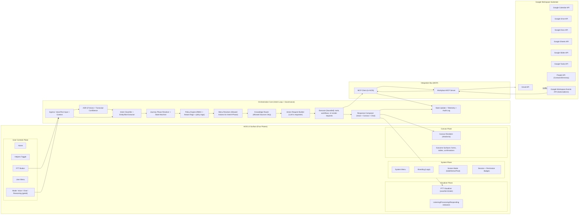

# Formal AIOS Specification and Node Architecture for a Sovereign Rebuild

## Executive summary

This report proposes a formal **AI Operating System (AIOS)** specification and **node-architecture** document structure that can be mapped from an existing monorepo and then **recreated in a sovereign rebuild** (portable, policy-governed, minimal-bloat, and environment-independent). The design assumes your current system intentfully separates responsibilities (intent loop, governance/control planes, voice/PTT, canvas rendering) and uses **Google Workspace via an MCP server** as the “OS app suite substrate,” while preventing the language model from directly accessing external systems.

The architectural cornerstone is an **intent loop** that deterministically routes every interaction through: **intent classification → journey phase → policy enforcement → menu resolution → bounded execution → outcome update**, ensuring the system never “guesses the best tool.” This aligns with your stated outcome-driven approach: roles and agents are aligned to shared intent (e.g., customer intent “check-in” and agent role “check-in agent”), with skills bound to actions and actions bound to outcomes.

Key recommendations in this report:

- Treat MCP as the standardized integration layer for external systems (data/tools/workflows), and implement your own “workplace MCP server” so the system is grounded in Google Workspace capabilities while remaining policy-bounded. MCP is explicitly designed to standardize how AI applications connect to external systems and provide tools/context. citeturn5view6turn5view5  
- Formalize **four UI planes** (System Plane, Visualizer, Canvas, User Controls) and keep them **state-driven** by orchestration and policy (not by ad hoc UI logic).  
- Define a strict **Node Contract** (JSON Schema included) so each node declares: intents, roles, skills, allowed actions, knowledge sources, UI components, voice modes, expected outcomes, performance budgets, telemetry hooks, and policy tags. This enables reproducibility, testability, and anti-bloat loading.  
- Implement a governance model with: a versioned **policy registry**, centralized enforcement middleware, refusal/escalation rules, and audit logging aligned with widely used security guidance (e.g., OWASP logging guidance and comprehensive tool-invocation logging for MCP setups). citeturn4search2turn4search8turn4search1  
- Use **shadcn/ui** as the canonical Canvas component system by maintaining a **component registry contract** and validating UI generation against whitelisted schema. The shadcn CLI and registry features are built for distributing source-based UI blocks/components across projects. citeturn5view3turn13view0turn12view0turn5view4  
- Produce a repo-to-architecture mapping artifact (template included) and a phased migration plan with gating criteria, owners, and acceptance tests.

Scope note: you requested this be “based on the existing repo,” but repo specifics are not provided here; therefore, the report supplies **fillable templates, schemas, and mapping processes** that you can apply to your current repository during the mapping phase.

## AIOS reference architecture

### Architectural intent

The AIOS architecture is designed to behave like an operating system: it exposes a controlled interaction surface (UI planes), a governed execution core (orchestration + intent loop), and a standardized integration bus (MCP) that allows external capabilities without giving the language model direct authority.

MCP (Model Context Protocol) is described as an open-source standard for connecting AI applications to external systems (data sources, tools, workflows), enabling consistent integration patterns across AI apps. citeturn5view6turn5view5

### Reference architecture diagram



This diagram encodes several rules that should be made explicit in your spec:

- The **language model is not the execution authority**; it produces requests that must pass policy and be executed by bounded subsystems.  
- The **UI planes are driven by orchestration state**, which is “OS-like” behavior (the UI reflects and constrains what the system is doing, rather than acting as a pile of always-on features).  
- MCP is the integration bus; it standardizes how tools/context are exposed to the AIOS and is suitable for building a workplace MCP server that fronts Google Workspace. citeturn5view6turn5view5  

## Intent loop specification

### Definitions and invariants

In the AIOS, the intent loop is the primary control structure. It creates determinism by ensuring that every interaction follows the same sequence of classification and governance steps before any action is possible.

Core definitions:

- **Intent**: a canonical label for what the user is trying to accomplish *right now* (e.g., `check_in`, `schedule`, `request_support`, `pay_invoice`).  
- **Journey phase**: where the user is in a broader lifecycle (e.g., Discovery → Consideration → Conversion → Post-sale → Support).  
- **Role**: a participant identity in the interaction (at minimum: `customer` and `agent`, though “agent” may be subdivided into operational roles like `check_in_agent`, `support_agent`, `billing_agent`).  
- **Outcome**: the measurable result of execution (e.g., “reservation checked in,” “calendar event created,” “email sent”).  
- **Action**: a bounded system operation (including read operations).  
- **Skill**: a reusable capability bundle that performs or assists actions (e.g., “reservation_lookup,” “calendar_booking,” “form_generation”).

Invariants:

- **No intent → no action.** If intent cannot be classified confidently, the system must clarify or route to a safe fallback.  
- **No policy allow → refusal or escalation.**  
- **No required knowledge access → “safe partial” response** (explain what’s missing, present alternate path, or escalation).  
- **The UI is a projection of state**; it must not “unlock” actions that policy does not allow.

### Flow and decision points

A robust intent loop includes explicit decision points and thresholds. Suggested structure:

1. **Ingress**  
   Collect input stream(s): voice audio (PTT), chat text, UI events, and session context.  
   - Decision: if voice mode is selected and permitted, run ASR; otherwise treat input as text.

2. **ASR confidence gating (voice path)**  
   - `asr_confidence >= 0.85`: proceed normally  
   - `0.65 <= asr_confidence < 0.85`: proceed but label as “low-confidence transcript,” encourage confirmation steps for write actions  
   - `asr_confidence < 0.65`: fallback to chat input or “tap-to-confirm” UI summary before classification  
   (Thresholds are implementation choices; the spec should require that the system declare them and test them.)

3. **Intent classification**  
   Compute top intents with confidence distribution and extract slots/entities required for execution (e.g., date/time, identifiers).  
   - `intent_confidence >= 0.75`: accept intent  
   - `0.55 <= intent_confidence < 0.75`: accept intent *provisionally*, but require confirmation for destructive or write actions  
   - `intent_confidence < 0.55`: trigger clarification or a controlled “intent menu” on Canvas

4. **Journey phase resolution**  
   Use session history + user profile + recent outcomes to determine phase. This step prevents tool confusion by selecting a phase-specific subset of actions and UI surfaces.

5. **Policy evaluation**  
   Evaluate: role permissions, feature flags (e.g., reasoning mode), policy tags on nodes/actions, data sensitivity, and risk triggers.  
   Practical Google Workspace note: OAuth scopes can be sensitive/restricted and can require verification; the system should *disable features that depend on scopes not granted* and apply least-privilege scope selection guidance. citeturn10search13turn5view7turn6view1turn8view0  

6. **Menu resolution**  
   Convert (intent + phase + role + policy) into a small, deterministic list of allowed actions and UI options. This is where you eliminate “What tool should I use?” guessing.

7. **Knowledge routing**  
   Bind the request to explicit knowledge sources permitted by policy for that role/intent (e.g., Drive through MCP, internal KB, prior session notes).  
   If access is not available, the system must degrade gracefully and *not hallucinate*.

8. **Action request + execution**  
   The language model produces a structured action request; execution is performed by a bounded executor that can only invoke allowed MCP tools or internal functions.  
   Google APIs are accessed only through the MCP server layer (by design), not by the model directly.

9. **Outcome synthesis**  
   - Voice response (if permitted)  
   - Canvas output (forms/confirmations)  
   - Chat transcript as fallback  
   - State update (journey progress, intent history, tool outcomes)  
   - Telemetry + audit log

### Example intent-loop walkthroughs

#### Example A: Customer “check in” via voice, with Canvas support

**Context:** A customer presses PTT and says: “I’m here to check in for my appointment.”

1. ASR returns a transcript with `asr_confidence=0.90` (passes).  
2. Intent classifier outputs:
   - `check_in` (0.88)  
   - `schedule` (0.07)  
   - `support` (0.05)  
3. Journey phase resolves to `conversion` (they are arriving to transact).  
4. Policy evaluation:
   - customer role is allowed to `check_in`  
   - allowed actions might include “lookup reservation,” “collect verification info,” “confirm completion”  
   - if the system does *not* have access to necessary records, it must route to a fallback verification path  
5. Menu resolver selects:
   - show a minimal Canvas check-in form (only required fields)  
   - allow read-only lookup via MCP (if permitted by org policy)  
6. Knowledge router uses allowed sources (internal booking DB, or Google Calendar/Sheets if that’s how check-ins are stored). If Google is used, access must be scoped properly and mediated through OAuth and policy. citeturn10search13turn7view3turn7view1  
7. Canvas renders a shadcn-based form for verification; user completes; executor writes check-in completion (internal system or Sheets row update). Sheets write operations exist via API methods like `spreadsheets.values.update`. citeturn2search3turn2search9  
8. Outcome produced: `checked_in=true`, and UI updates to confirmation.

#### Example B: Customer cannot use voice

**Context:** Voice is unavailable (permissions, device, or user preference). User selects chat mode and types.

The intent loop is identical but bypasses ASR and increases reliance on Canvas:

- The system should default to Canvas surfaces for any multi-field interaction (identity verification, scheduling, payment) because chat is weak for structured data entry.  
- This is where the four-plane design becomes “OS-like”: user controls shift the mode, but system plane policy decides what’s actually available.

#### Example C: Staff “schedule meeting” with Google Calendar

**Context:** A staff role says: “Schedule a 30-minute meeting with Alex next Tuesday at 2.”

1. Classifier outputs `schedule_meeting` intent (high confidence) and slots (duration, participant, time).  
2. Policy checks that the user has calendar permissions and the necessary OAuth scope(s). Calendar scope guidance emphasizes choosing narrow scopes; the Calendar API exposes scopes ranging from full calendar access to event-only access (e.g., `calendar.events`). citeturn7view3  
3. Menu resolver selects allowed actions:
   - calendar availability check  
   - event insert  
4. Executor uses Calendar API create methods (e.g., event insertion) through MCP, producing a meeting and returning the event link. Calendar event creation is documented via `events.insert`. citeturn3search25turn0search13  

## Node contract and JSON schema

### Node concept

A **node** is the sovereign rebuild’s primary unit of business logic and UI/runtime constraints. Nodes are “anti-bloat”: when a node activates, the system should load only what the node contract declares as necessary (skills/actions/components/knowledge sources). This is the formalization of your “no more what-if” approach.

Nodes should be:

- **Intent-bound**: each node supports a small bounded set of intents  
- **Role-aware**: nodes declare participating roles and what each role can do  
- **Outcome-driven**: nodes exist to produce explicit outcomes  
- **Performance-budgeted**: nodes declare expected performance characteristics  
- **Auditable**: nodes specify telemetry and policy tags so enforcement is correct and verifiable

### Node schema (JSON Schema)

```json
{
  "$schema": "https://json-schema.org/draft/2020-12/schema",
  "$id": "https://example.com/schemas/aios-node.schema.json",
  "title": "AIOS Node Contract",
  "type": "object",
  "additionalProperties": false,
  "required": [
    "node_id",
    "version",
    "supported_intents",
    "participating_roles",
    "required_skills",
    "allowed_actions",
    "required_knowledge_sources",
    "permitted_ui_components",
    "voice_modes",
    "expected_outcome",
    "performance_budget",
    "telemetry_hooks",
    "policy_tags"
  ],
  "properties": {
    "node_id": {
      "type": "string",
      "pattern": "^[a-z0-9][a-z0-9\\-\\.]{2,80}$",
      "description": "Stable, globally unique node identifier (kebab-case recommended)."
    },
    "version": {
      "type": "string",
      "pattern": "^[0-9]+\\.[0-9]+\\.[0-9]+$",
      "description": "Semantic version of the node contract."
    },
    "description": { "type": "string", "maxLength": 2000 },

    "supported_intents": {
      "type": "array",
      "minItems": 1,
      "items": { "$ref": "#/$defs/IntentRef" },
      "description": "Intents this node can lawfully handle."
    },

    "participating_roles": {
      "type": "array",
      "minItems": 1,
      "items": { "$ref": "#/$defs/RoleRef" },
      "description": "Roles that can participate when this node is active."
    },

    "required_skills": {
      "type": "array",
      "items": { "$ref": "#/$defs/SkillRef" },
      "description": "Skill capabilities required for this node to produce its outcomes."
    },

    "allowed_actions": {
      "type": "array",
      "minItems": 1,
      "items": { "$ref": "#/$defs/ActionRef" },
      "description": "Actions permitted under this node (must still pass policy enforcement)."
    },

    "required_knowledge_sources": {
      "type": "array",
      "items": { "$ref": "#/$defs/KnowledgeSourceRef" },
      "description": "Knowledge sources the node may access (subject to policy)."
    },

    "permitted_ui_components": {
      "type": "array",
      "items": { "$ref": "#/$defs/UIComponentRef" },
      "description": "Whitelisted UI components (typically shadcn registry items) that the Canvas may render."
    },

    "voice_modes": {
      "type": "array",
      "minItems": 1,
      "items": {
        "type": "string",
        "enum": ["voice_ptt", "voice_handsfree", "chat_only", "hybrid_voice_canvas"]
      },
      "description": "Voice/chat modes this node supports (availability is also permission-gated)."
    },

    "expected_outcome": {
      "$ref": "#/$defs/OutcomeSpec"
    },

    "performance_budget": {
      "$ref": "#/$defs/PerformanceBudget"
    },

    "telemetry_hooks": {
      "$ref": "#/$defs/TelemetryHooks"
    },

    "policy_tags": {
      "type": "array",
      "items": { "type": "string", "maxLength": 64 },
      "description": "Tags used by the policy engine for gating (e.g., pii, write, external_comm, regulated)."
    },

    "journey_phase_constraints": {
      "type": "array",
      "items": {
        "type": "string",
        "enum": ["discovery", "consideration", "conversion", "post_sale", "support"]
      },
      "description": "Optional: phases where this node is valid."
    }
  },

  "$defs": {
    "IntentRef": {
      "type": "object",
      "additionalProperties": false,
      "required": ["intent_id"],
      "properties": {
        "intent_id": {
          "type": "string",
          "pattern": "^[a-z0-9][a-z0-9_\\-]{2,60}$"
        },
        "min_confidence": {
          "type": "number",
          "minimum": 0,
          "maximum": 1,
          "default": 0.75,
          "description": "Minimum classifier confidence recommended to enter this node for this intent."
        }
      }
    },

    "RoleRef": {
      "type": "object",
      "additionalProperties": false,
      "required": ["role_id"],
      "properties": {
        "role_id": {
          "type": "string",
          "pattern": "^[a-z0-9][a-z0-9_\\-]{2,60}$"
        },
        "side": {
          "type": "string",
          "enum": ["customer", "agent", "system"],
          "description": "Optional: role orientation in the interaction."
        }
      }
    },

    "SkillRef": {
      "type": "object",
      "additionalProperties": false,
      "required": ["skill_id"],
      "properties": {
        "skill_id": { "type": "string", "pattern": "^[a-z0-9][a-z0-9_\\-]{2,80}$" },
        "version_range": { "type": "string", "description": "Optional semver range." }
      }
    },

    "ActionRef": {
      "type": "object",
      "additionalProperties": false,
      "required": ["action_id", "effect"],
      "properties": {
        "action_id": { "type": "string", "pattern": "^[a-z0-9][a-z0-9_\\-\\.]{2,120}$" },
        "effect": { "type": "string", "enum": ["read", "write", "delete", "invoke", "render"] },
        "requires_confirmation": { "type": "boolean", "default": false },
        "risk_level": { "type": "string", "enum": ["low", "medium", "high"], "default": "low" }
      }
    },

    "KnowledgeSourceRef": {
      "type": "object",
      "additionalProperties": false,
      "required": ["source_id", "access"],
      "properties": {
        "source_id": {
          "type": "string",
          "pattern": "^[a-z0-9][a-z0-9_\\-\\.]{2,80}$",
          "description": "Example: mcp.drive, mcp.gmail, internal.kb, session.memory"
        },
        "access": { "type": "string", "enum": ["none", "read", "write"], "default": "read" }
      }
    },

    "UIComponentRef": {
      "type": "object",
      "additionalProperties": false,
      "required": ["component_id"],
      "properties": {
        "component_id": {
          "type": "string",
          "description": "A deterministic component identifier, ideally a shadcn registry item name or namespaced registry key."
        },
        "variants_allowed": {
          "type": "array",
          "items": { "type": "string" }
        }
      }
    },

    "OutcomeSpec": {
      "type": "object",
      "additionalProperties": false,
      "required": ["outcome_id", "success_criteria"],
      "properties": {
        "outcome_id": { "type": "string", "pattern": "^[a-z0-9][a-z0-9_\\-]{2,80}$" },
        "success_criteria": {
          "type": "array",
          "minItems": 1,
          "items": { "type": "string", "maxLength": 200 }
        },
        "failure_modes": {
          "type": "array",
          "items": { "type": "string", "maxLength": 240 }
        }
      }
    },

    "PerformanceBudget": {
      "type": "object",
      "additionalProperties": false,
      "required": ["p95_end_to_end_ms", "p95_first_canvas_ms", "max_bundle_kb"],
      "properties": {
        "p95_end_to_end_ms": { "type": "integer", "minimum": 50, "maximum": 60000 },
        "p95_first_canvas_ms": { "type": "integer", "minimum": 50, "maximum": 60000 },
        "max_bundle_kb": { "type": "integer", "minimum": 50, "maximum": 5000 },
        "max_tool_calls": { "type": "integer", "minimum": 0, "maximum": 50, "default": 8 }
      }
    },

    "TelemetryHooks": {
      "type": "object",
      "additionalProperties": false,
      "required": ["events"],
      "properties": {
        "events": {
          "type": "array",
          "minItems": 1,
          "items": {
            "type": "string",
            "pattern": "^[a-z0-9][a-z0-9_\\-\\.]{2,80}$"
          }
        },
        "metrics": {
          "type": "array",
          "items": { "type": "string" }
        },
        "traces": {
          "type": "array",
          "items": { "type": "string" }
        }
      }
    }
  }
}
```

### Minimum node validation rules

Your sovereign rebuild spec should require:

- Every node is **schema-validated at build time** and again at runtime before activation.  
- `allowed_actions.effect=write/delete` actions must either:
  - require explicit confirmation, or  
  - be allowed only in specific journey phases (e.g., conversion/post-sale) with explicit policy tags.  
- `permitted_ui_components` must be whitelisted and resolvable from your internal shadcn registry (described later).  
- Nodes without a credible `performance_budget` are “non-deployable” (forces discipline).

## Governance model, policy registry, and enforcement

### Governance objectives

Governance in AIOS is not an afterthought; it is the operating kernel. It must ensure:

- **Deterministic allow/deny** at every boundary  
- **Auditability** of every action and tool invocation  
- **Least privilege** (especially for Google Workspace OAuth scope usage)  
- **Refusal and escalation** behaviors that are consistent and testable  
- **Feature gating** (e.g., reasoning mode is not universally available)

OAuth and scope management matters because Google APIs are accessed through OAuth 2.0, and applications should examine granted scopes and disable features that lack required scopes. citeturn10search13turn5view7

### Policy registry format (JSON examples)

A practical approach is a **versioned, layered policy registry**:

- `policies/global.json` — universal constraints  
- `policies/roles/<role>.json` — RBAC-like grants  
- `policies/intents/<intent>.json` — per-intent safety  
- `policies/nodes/<node>.json` — node-specific overrides  
- `policies/env/<env>.json` — demo/prod restrictions  

#### Example: role and feature gating policy

```json
{
  "policy_id": "role.customer.default",
  "version": "1.0.0",
  "effect": "allow",
  "applies_when": {
    "roles_any": ["customer"],
    "env_any": ["demo", "prod"]
  },
  "grants": {
    "intents": ["check_in", "request_support", "schedule", "ask_question"],
    "voice_modes": ["voice_ptt", "chat_only", "hybrid_voice_canvas"],
    "features": {
      "reasoning_mode": false,
      "helpers_toggle": true
    }
  },
  "constraints": {
    "writes_require_confirmation": true,
    "max_tool_calls": 6
  }
}
```

#### Example: deny external communication unless explicitly allowed

```json
{
  "policy_id": "global.deny.external_comm.by_default",
  "version": "1.0.0",
  "effect": "deny",
  "applies_when": {
    "policy_tags_any": ["external_comm"],
    "actions_any": ["mcp.gmail.send", "mcp.chat.send"]
  },
  "reason": "External communications require explicit allow-listing and user confirmation."
}
```

#### Example: allow Calendar event creation for staff

Calendar scopes include event-level permissions such as `https://www.googleapis.com/auth/calendar.events` (view/edit events) and read-only alternatives; selecting narrow scopes is explicitly recommended. citeturn7view3

```json
{
  "policy_id": "role.staff.calendar_event_write",
  "version": "1.0.0",
  "effect": "allow",
  "applies_when": {
    "roles_any": ["staff"],
    "intents_any": ["schedule_meeting"]
  },
  "grants": {
    "actions": ["mcp.calendar.events.insert", "mcp.calendar.events.update", "mcp.calendar.events.list"],
    "required_oauth_scopes_any": ["https://www.googleapis.com/auth/calendar.events"]
  },
  "constraints": {
    "writes_require_confirmation": true,
    "redact_pii_in_logs": true
  }
}
```

### Enforcement middleware hooks

A sovereign AIOS should define enforcement as middleware at multiple choke points:

- **Ingress policy hook**: determines whether the selected interaction mode (voice/chat/reasoning) is permitted for the user/session.  
- **Intent acceptance hook**: after classification, checks whether the user role is allowed to pursue that intent in the current journey phase.  
- **Menu resolution hook**: ensures only policy-allowed actions become selectable/executable.  
- **Action execution hook**: every action request must pass policy validation *with full parameters* before tool invocation.  
- **Canvas render hook**: UI generation requests must be validated against permitted components and node constraints.  
- **Knowledge access hook**: retrieval must be limited to allowed sources; denial must trigger safe fallback.

This layered approach is consistent with modern security expectations for AI/agent systems: OWASP explicitly recommends logging agent decisions, tool calls, and outcomes, and emphasizes disciplined monitoring and observability for agents. citeturn4search21

### Refusal and escalation rules

Refusal is not a UX afterthought; it is a required system behavior. Define refusal classes:

- **Policy refusal**: intent/action not allowed for role, phase, or environment.  
- **Capability refusal**: required OAuth scope isn’t granted (disable feature and explain).  
- **Safety refusal**: action is high risk, requires extra confirmation, or must be escalated.

Escalation paths should be explicit, such as:

- “Switch to chat mode” (if voice is failing)  
- “Show minimal Canvas form for manual completion”  
- “Hand off to human (call/text/desk)” (if business settings allow)  
- “Request admin approval” (for privileged actions)

### Audit logging requirements

Audit logs should be structured and complete. A strong baseline is to ensure audit records capture at least: **event type, timestamp, location, source, outcome, and identity**—fields consistent with common audit guidance such as NIST audit record content expectations. citeturn4search10turn4search1

For MCP-powered tool calls, OWASP guidance for MCP security explicitly recommends logging all MCP tool invocations with full parameters, user context, and timestamps, with redaction of secrets/PII. citeturn4search8  
For general application security logging, OWASP provides concentrated guidance on building logging mechanisms (especially security logging). citeturn4search2

Minimum audit event types (recommended):

- `intent.classified` (top-k intents + confidence)  
- `policy.evaluated` (policy IDs applied, allow/deny outcome)  
- `menu.resolved` (actions exposed)  
- `action.requested` (requested tool/action, parameters hash, risk level)  
- `action.executed` (tool call status, latency, output hash)  
- `canvas.rendered` (components used, validation status)  
- `refusal.emitted` / `escalation.triggered`  

## MCP integration and Google Workspace capability map

### Why MCP is the right abstraction for a sovereign rebuild

MCP is designed as a standardized protocol to connect AI applications to external systems (data, tools, workflows), which makes it structurally suitable as the internal “OS app suite bus” for your AIOS. citeturn5view6turn5view5

Sovereign rebuild implication: rather than baking Google API code throughout the system, you concentrate external authority behind the **workplace MCP server**, and make the AIOS interact through a consistent tool interface under policy enforcement.

### OAuth and scope governance requirements

Your spec should treat OAuth/scopes as first-class policy inputs:

- Google APIs use OAuth 2.0; applications obtain credentials, request tokens, and should **examine granted scopes** and **disable features** that lack required authorization. citeturn10search13  
- Google explicitly distinguishes scopes by sensitivity and notes that sensitive/restricted scopes can require verification and additional requirements. citeturn5view7turn6view1turn7view1  
- For Drive specifically, Google recommends using non-sensitive per-file access scopes where possible (e.g., `drive.file`) and warns about restricted scope qualifications and verification. citeturn8view0  

### Capability map (read/write) and intent mapping

The table below is a **capability planning artifact** for your workplace MCP server. Method names are representative of the underlying Google APIs; your MCP tool naming should be stable and versioned even if underlying API versions change.

| Google service | Read capabilities (examples) | Write capabilities (examples) | Key OAuth scopes (examples) | Intents typically mapped |
|---|---|---|---|---|
| Gmail API | List messages (`users.messages.list`), get message (`users.messages.get`) citeturn2search12turn2search8 | Send message (`users.messages.send`), modify labels (`users.messages.modify`) citeturn2search2turn2search28 | `gmail.readonly`, `gmail.send`, `gmail.modify` (scope set varies; some are restricted) citeturn6view0turn6view1 | `communicate`, `support`, `follow_up`, `invoice_send` |
| Calendar API | List events (`events.list`) citeturn3search18 | Create event (`events.insert`), update event (`events.update`) citeturn3search25turn3search2 | `calendar.events`, `calendar.events.readonly`, broader `calendar` citeturn7view3 | `schedule_meeting`, `book_appointment`, `reschedule`, `check_availability` |
| Drive API | List files (`files.list`), get metadata/content (`files.get`), export (`files.export`) citeturn1search2turn1search23turn3search1 | Create file (`files.create`), update file (`files.update`) citeturn1search15turn1search7 | Prefer per-file `drive.file`; restricted `drive` / `drive.readonly` are broad citeturn8view0 | `retrieve_document`, `store_artifact`, `generate_report`, `attach_file` |
| Docs API | Read doc structure (documents GET via Docs API reference) citeturn3search7 | Batch update document (`documents.batchUpdate`) citeturn3search0 | `documents`, `documents.readonly`, plus `drive.file` for per-file access citeturn9view0 | `draft_document`, `update_sop`, `generate_contract` |
| Sheets API | Read values (`spreadsheets.values.get`) citeturn2search17 | Update values (`spreadsheets.values.update`), append (`spreadsheets.values.append`) citeturn2search3turn2search25 | `spreadsheets`, `spreadsheets.readonly`, and `drive.file` recommended for many apps citeturn7view0 | `check_in`, `record_transaction`, `update_inventory`, `log_event` |
| Slides API | Get presentation (`presentations.get`) citeturn10search16 | Batch update presentation (`presentations.batchUpdate`) citeturn3search19 | `presentations`, `presentations.readonly`, plus `drive.file` recommended citeturn11view1turn10search16 | `generate_deck`, `update_pitch`, `export_report` |
| Tasks API | List tasklists (`tasklists.list`) citeturn10search17 | Create/update tasks (Tasks API write scope) citeturn11view0 | `tasks`, `tasks.readonly` citeturn11view0 | `create_task`, `follow_up`, `support_queue` |
| People API | Read connections/contact groups, profile (authorization varies) citeturn10search4turn10search19 | Create/update contacts citeturn10search23turn1search6 | `contacts`, `contacts.readonly`, `directory.readonly` citeturn10search4turn10search19 | `identify_customer`, `lookup_contact`, `crm_sync` |
| Workspace Events API | Subscribe to events and manage change notifications citeturn0search29turn11view2 | Create/update/delete subscriptions (notification plumbing) citeturn0search29 | Uses scopes of underlying apps (Chat/Drive/Meet, etc.) citeturn11view2 | `state_sync`, `watch_inbox`, `watch_drive_changes` |

Notes:

- Gmail scope categories include non-sensitive, sensitive, and restricted; restricted scopes such as full mailbox access (`https://mail.google.com/`) are explicitly warned against unless necessary. citeturn6view0  
- Drive scopes: Google recommends using non-sensitive scopes (per-file) when possible and provides a strong rationale for `drive.file` for UX and safety. citeturn8view0turn8view2  
- Workspace Events API supports subscriptions for change notifications across Workspace applications. citeturn0search29turn11view2  

## shadcn/ui component registry contract and UI generation rules

### Why the registry approach matters

Your requirement (“internal canvas agent renders canvases with shadcn/ui”) becomes enforceable when UI generation is **not free-form code**, but rather **registry-driven composition**. In that model:

- The Canvas agent outputs structured UI intents (e.g., “render a check-in form”), not arbitrary components.  
- The renderer verifies that every component is whitelisted and matches schema.  
- The registry becomes a stable OS “UI driver set.”

shadcn supports this model explicitly:

- The shadcn CLI includes `init` (initialize project configuration) and `add` (add a component, by name, url, or local path). citeturn5view3  
- shadcn allows running your own **code registry** for distributing components/hooks/pages/config and notes the registry works with any project type and framework (not limited to React). citeturn13view0  
- The registry is defined by `registry.json` and `registry-item.json` schema specifications. citeturn12view0turn5view4  

### Registry contract (official schema alignment)

shadcn `registry.json` is the top-level registry listing. It includes `$schema`, a registry `name`, `homepage`, and `items`, where each item implements the registry-item schema. citeturn12view0  

shadcn `registry-item.json` defines registry items with fields such as `$schema`, `name`, `type`, `registryDependencies`, `dependencies`, and `files`, and supports item types like `registry:block`, `registry:component`, `registry:ui`, `registry:page`, `registry:file`, etc. citeturn5view4  
It also allows `registryDependencies` to reference other items by name, namespaced name, or URL. citeturn5view4  

### Recommended AIOS-specific UI generation rules

Your AIOS spec should introduce a **Canvas Output Contract** that is stricter than “generate TSX”:

- **Rule A: Canvas outputs are declarative**. The Canvas agent emits a JSON UI plan referencing registry item names, not raw code.  
- **Rule B: Components must be whitelisted** by node contract (`permitted_ui_components`) and registry.  
- **Rule C: No “dynamic prop injection”**. Only a constrained set of props/events is allowed (predeclared in the component contract).  
- **Rule D: UI generation is node-bound**. If the active node does not permit `data_table`, the Canvas agent cannot render it.  
- **Rule E: UI must reflect governance**. If a write action requires confirmation, the UI must include a confirmation step (modal, summary screen) as a required pattern.  
- **Rule F: determinism over creativity**. Prefer canonical UI blocks for each intent (e.g., a standard `check-in-form` block), reducing variation and improving testability.

### Component registry entry schema examples

Below are **example patterns** you can use to model allowed components and blocks. They intentionally align with shadcn’s registry schemas.

#### Example: AIOS internal registry.json

```json
{
  "$schema": "https://ui.shadcn.com/schema/registry.json",
  "name": "aios-registry",
  "homepage": "https://example.internal/aios/registry",
  "items": [
    {
      "$schema": "https://ui.shadcn.com/schema/registry-item.json",
      "name": "aios-check-in-form",
      "type": "registry:block",
      "title": "AIOS Check-In Form",
      "description": "Standardized check-in flow for customer identity verification and arrival confirmation.",
      "registryDependencies": ["button", "input", "select", "dialog", "card", "label"],
      "dependencies": ["zod"],
      "files": [
        { "path": "registry/aios/blocks/check-in-form.tsx", "type": "registry:component" },
        { "path": "registry/aios/blocks/check-in-schema.ts", "type": "registry:lib" }
      ]
    }
  ]
}
```

This approach leverages the official schemas and the notion of registry dependencies (e.g., `button`, `input`). citeturn12view0turn5view4  

#### Example: UI primitive registry-item.json constraints

Use `registry:ui` for reusable primitives (as shadcn does). citeturn5view4turn2search26  

```json
{
  "$schema": "https://ui.shadcn.com/schema/registry-item.json",
  "name": "aios-confirmation-dialog",
  "type": "registry:ui",
  "title": "AIOS Confirmation Dialog",
  "description": "A locked confirmation dialog with standardized risk copy and audit hooks.",
  "registryDependencies": ["dialog", "button"],
  "files": [
    { "path": "registry/aios/ui/confirmation-dialog.tsx", "type": "registry:ui" }
  ]
}
```

### Enforcement: how a node + registry prevent bloat

When a node activates, the system should load:

- only the registry items listed in `permitted_ui_components`  
- only the skills listed in `required_skills`  
- only the action bindings listed in `allowed_actions`  
- only the knowledge sources listed in `required_knowledge_sources`

This turns performance and simplicity into a governance guarantee (not a team habit).

## Repo-to-architecture mapping, phased migration, and acceptance tests

### Repo-to-architecture mapping template

During the mapping phase, you’ll classify the current repo’s modules into the AIOS layers:

- operating substrate  
- intent  
- role  
- skill  
- action  
- outcome  
- interface  
- governance  

Template (fillable):

| file/path | layer | role(s) | intent(s) | skills | actions | outcome | keep/delete/recreate | notes |
|---|---|---|---|---|---|---|---|---|
| `apps/web/src/ui/ptt/*` | interface | customer, agent | all | `voice_io` | `ptt.listen`, `ptt.stop` | “input captured” | keep | Convert to plane-based composition; enforce state machine |
| `packages/orch/intent/*` | intent | system | all | `intent_classify` | `intent.classify` | “intent resolved” | keep | Must emit confidences + uncertainty reasons |
| `packages/gov/policy/*` | governance | system | all | `policy_eval` | `policy.allow/deny` | “decision” | keep | Move to versioned registry + middleware |
| `packages/tools/*` | action | agent | varies | varies | MCP tool stubs | varies | recreate | Replace ad hoc tool calls with MCP client + policy gate |
| `apps/web/src/components/*` | interface | all | varies | UI | render | varies | prune/recreate | Only keep components that align with shadcn registry plan |

Use this mapping as the “truth table” for the sovereign rebuild: anything marked “recreate” must be re-expressed via node contracts, policy rules, MCP tools, and registry items.

### Phased migration plan with milestones, owners, and gating criteria

Below is a **phased rollout plan** designed to eliminate ambiguity and produce milestone-driven progress. Weeks are indicative; adjust to your team size.

#### Phase definition of owners (role templates)

- **Platform Lead**: orchestration core, node runtime, state machine  
- **Security/Governance Owner**: policy registry, enforcement, audit logging, OAuth/scope governance  
- **MCP/Integrations Owner**: workplace MCP server, Google Workspace capability mapping, tool schemas  
- **UI/Canvas Owner**: shadcn registry, Canvas renderer, UI plane composition  
- **Voice/UX Owner**: PTT state machine, latency targets, voice fallbacks  
- **QA/Release Owner**: acceptance tests, performance tests, go/no-go gates

#### Phase roadmap

| phase | weeks | primary deliverables | gating criteria | tests |
|---|---:|---|---|---|
| Repo mapping and spec extraction | 1–2 | completed repo-to-layer map; draft intent taxonomy; draft node inventory | 90% of modules classified; orphan modules <10% | mapping review; dependency graph sanity checks |
| MCP substrate foundation | 2–4 | workplace MCP server scaffold; MCP client in AIOS; initial Google services (Calendar, Drive) | all external access goes through MCP; model has no direct API keys | tool-call integration tests; policy gate tests |
| Governance kernel | 3–5 | policy registry v1; enforcement middleware at ingress/menu/action; audit event schema | 100% action requests pass policy; 100% tool calls audited | refusal tests; policy unit tests; audit log validation |
| Intent loop hardening | 4–6 | classifier thresholds; journey phase resolver; menu resolver deterministic output | low-confidence paths always clarify; “no intent → no action” enforced | golden path tests; ambiguity tests; replay-based determinism |
| UI planes + shadcn registry | 5–8 | 4-plane UI composition; canvas renderer; shadcn registry (internal) | Canvas outputs must validate against registry + node contract | component whitelist tests; snapshot tests; UI-state tests |
| Node system v1 | 7–10 | node schema validation; 5–10 core nodes (check-in, schedule, support) | nodes cannot execute undeclared actions; perf budgets declared | schema tests; node activation tests; load-time tests |
| Sovereign rebuild cutover | 10–12 | new repo skeleton + migrated nodes; deprecated legacy removed | parity achieved for core intents; logs + policy verified | end-to-end journeys; rollback drills |
| Pilot hardening | 12–16 | staging + pilot deployments; telemetry dashboards; incident playbooks | P95 performance targets met; security checks pass | load tests; red-team tool misuse scenarios; observability checks |

### Performance targets and acceptance tests

#### Performance targets (recommended starting points)

Targets should be **node-scoped** (because the node contract includes budgets):

- **P95 end-to-end response** (input → meaningful system output): ≤ 1500 ms for read-only intents; ≤ 3000 ms for write intents with tool calls  
- **P95 first Canvas render**: ≤ 1000 ms (for Canvas-first interactions)  
- **Max JS bundle per node**: enforceable via `max_bundle_kb` and route-based code splitting  
- **Max tool calls per node**: default 6–8 (forces efficiency and reduces runaway behavior)

#### Security targets and acceptance tests

Security requirements should align with recognized guidance:

- **HTTPS only for service endpoints** (baseline web service guidance). citeturn4search22  
- **Audit logging completeness**: ensure events include core fields and are protected from tampering (aligning with audit and accountability expectations). citeturn4search1turn4search10  
- **MCP tool invocation logging**: log all tool invocations with context; redact secrets/PII. citeturn4search8  
- **Least privilege OAuth scopes**: choose narrow scopes and disable features when scopes aren’t granted. citeturn10search13turn8view0turn7view1  

Acceptance tests (minimum set):

- **Policy bypass tests**: attempt to invoke disallowed write actions; system must refuse with logged rationale.  
- **Scope denial tests**: remove Calendar scopes and verify scheduling features are disabled (not “hallucinated”).  
- **Tool-call audit tests**: every MCP call produces an audit record; no secrets present in logs.  
- **Intent ambiguity tests**: low-confidence classification triggers clarification and prevents action execution.  
- **Node contract compliance tests**: node attempting to render non-permitted component fails validation.  
- **Replay determinism tests**: replay a recorded session; menu resolution and allowed actions are identical given same state and policies.

### Actionable next steps

Produce these artifacts in order (they become the sovereign rebuild’s “recreation kit”):

1. **AIOS Spec v1** (this report’s structure as your canonical doc): definitions, invariants, planes, intent loop, governance, MCP, UI registry.  
2. **Node registry v1**: a directory of node JSON files validated by the node schema, covering your top intents (start with 5–10).  
3. **Policy registry v1**: global + role + intent policy JSON files, versioned and test-covered.  
4. **Workplace MCP server v1**: Calendar + Drive first, then Gmail and Sheets; all behind policy and audit.  
5. **shadcn internal registry v1**: a minimal set of UI primitives + blocks required by your first nodes, implemented as registry items conforming to shadcn schema. citeturn12view0turn5view4turn13view0  
6. **Repo-to-architecture mapping artifact**: fill the table for your current repo; label keep/delete/recreate as the cutover plan.  
7. **Acceptance test suite**: policy bypass, scope denial, node contract compliance, determinism replay, and performance P95 checks as gating criteria for every phase.