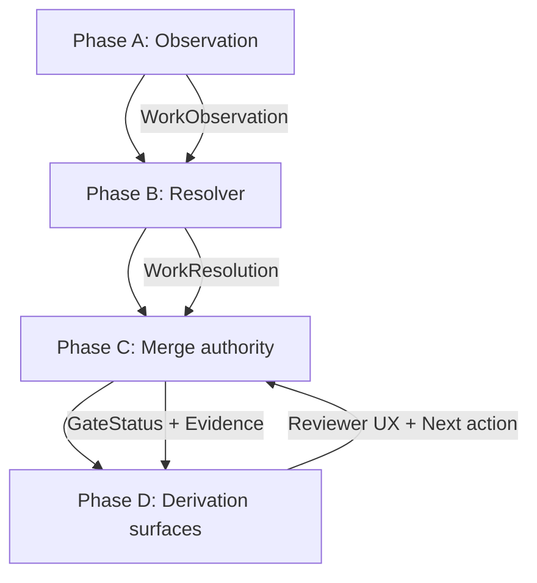

# Development Control Plane for a Voice‑First, Intent‑Driven AI OS

## Executive summary

A Development Control Plane (DCP) is a **control‑plane service** that operationalizes governance as a *Lead System Architect function*: it takes ambiguous work (“ship X”) and deterministically turns it into **intake → resolution → evidence → approval → promotion**. The purpose is to end re‑deriving the same peer reviews, the same registry questions, and the same “what did we decide?” loops by making governance **repeatable, testable, and default‑deny** at merge and release boundaries. Open Policy Agent (OPA) is designed to “offload policy decision‑making” from services and evaluate policy over structured inputs (API requests, configuration, IaC), which is the right core primitive for DCP gating. citeturn0search4turn0search12

The DCP should mirror your runtime “intent loop” architecture, but apply it to development governance:

- **Phase A (Observation)**: normalize the work request + repo change facts into a `WorkObservation` (plane, touched registries/contracts, entitlements, risk signals).
- **Phase B (Resolver)**: compute a `WorkResolution` using policy‑as‑code (OPA/Rego): required artifacts, required checks, required approvers, allowed actions; use **fail‑closed defaults** (OPA commonly uses `default allow := false`). citeturn0search8
- **Phase C (Merge)**: merge resolver output with reality (CI results, evidence artifacts, approvals) and publish an authoritative “merge allowed?” decision through protected‑branch required checks.
- **Phase D (Derivation)**: derive reviewer/approver “surfaces” such as queue views, missing‑artifact lists, and evidence links—best hosted in an internal developer portal (Backstage‑style) where catalog metadata and governance status are first‑class. citeturn1search5turn1search1

This architecture is well supported by industry standards and mature platform patterns:

- **Policy‑as‑code** in CI/CD is explicitly documented as a major use case for OPA (custom checks, config validation, organizational policy enforcement before production). citeturn0search0  
- **GitOps** tools (Argo CD / Flux) demonstrate “authoritative desired state + reconciliation + auditability” as an operating model; the DCP applies the same philosophy to registries and governance artifacts. citeturn0search1turn1search0  
- **Durable orchestration** (Temporal) provides a built‑in execution history (event history) that records every workflow step, supporting long‑running approvals, retries, and auditable decision trails. citeturn0search2turn0search6turn0search18  
- **Observability standards** (OpenTelemetry + W3C Trace Context) allow correlation between intake, policy decisions, CI runs, and release outcomes using standard trace propagation (`traceparent`/`tracestate`). citeturn0search3turn0search11turn14search7  
- **Supply chain evidence** (SLSA provenance + Sigstore) converts “trust” into verifiable evidence: SLSA defines a recommended provenance predicate for how artifacts were produced; Sigstore documents keyless signing and verification via Cosign. citeturn1search2turn1search3turn1search7  
- **Security governance** (NIST SSDF + NIST AI RMF/GenAI Profile + OWASP LLM Top 10) provides a standards‑anchored checklist for secure development, AI lifecycle risk, and LLM/agent attack vectors (prompt injection, insecure output handling, tool misuse). citeturn2search0turn2search4turn2search1turn2search9turn2search2

For your hospitality vertical, Cloudbeds constraints must be encoded as policy and entitlements: Cloudbeds explicitly recommends API keys for property‑level API access and states webhooks notify your application when events occur on a property account. That implies strict tenant binding for credentials, event ingestion validation, and fail‑closed cross‑tenant enforcement. citeturn2search15turn2search7 The DCP should treat hospitality integration work as inherently higher risk and require explicit capability and tenant‑isolation evidence before promotion.

Integration examples: Cloudbeds publishes OpenAPI specs in a public GitHub repository (useful for generating typed clients and for “declared vs actual” capability auditing), and the shadcn/ui ecosystem provides a reference for “approved component library → internal registry/promotion” style UI governance (design‑time). citeturn5search1turn9search2turn5search0turn9search0

Unspecified constraints: budget, team size, and timeline are unspecified. I assume an existing Node/TypeScript monorepo with Vite client and intent‑loop phases B/C/D implemented, and I assume the DCP runs out‑of‑band (not on the voice hot path) and governs merges/releases/deployments (control‑plane only).

## Scope and operating model

**What the DCP is**  
A DCP is an internal platform that standardizes and enforces the human+automation layer that feeds your technical gates (validators, CI scripts, registries). It operates as a **policy‑driven work router** and **evidence gatekeeper**.

**What the DCP is not**  
It is not a runtime UI generator, not a voice hot‑path service, and not a replacement for runtime validators. Its authority is over **promotion** (merge → release → deploy), not over user‑facing voice/canvas behavior.

**Operating model: cadence, artifacts, gates**  
- **Cadence**: scheduled governance loops implemented as workflows and SLAs (e.g., weekly triage run, monthly registry drift scan). Temporal workflows are explicitly built for long‑running, resilient execution with a recorded event history, which fits cadence + approvals. citeturn0search18turn0search6  
- **Artifacts**: standardized, typed records required for merge and for “done” (intake, registry delta statement, capability delta, decision record). OPA’s policy model assumes structured inputs; the DCP makes artifacts first‑class policy inputs. citeturn0search12turn0search0  
- **Gates**: enforced blockers: CI checks + policy evaluation + human approvals at higher risk. GitHub protected branches require status checks to be successful/skipped/neutral before merging; external services can mark commit statuses/checks via API. citeturn3search8turn3search0turn3search12

**Mapping DCP to intent‑loop Phases A–D**



**Integration points (explicit)**
- **Registry**: DCP treats “view/action/integration registries” as authoritative allowed surface/capability declarations; policy fails closed when changes imply unregistered capabilities. (GitOps “desired state” framing is analogous.) citeturn1search0turn0search1  
- **Sovereign Guard CI** (internal): DCP orchestrates and interprets existing validators; it does not replace them. Merge authority comes from a single aggregated “DCP Gate” check (GitHub required check) plus explicit approvals. citeturn3search8  
- **MCP plane boundaries**: MCP is an open protocol connecting LLM apps to external tools/data sources; DCP encodes “runtime plane deny by default” unless mediated by a governed proxy with explicit authorization. MCP includes security best practices and an authorization specification; DCP policy should enforce those flows for privileged tool access. citeturn12search0turn12search2turn12search12  
- **Cloudbeds vertical**: Cloudbeds recommends API keys for property‑level access and webhooks are per property account; DCP must enforce tenant binding of credentials, webhook validation, and explicit entitlements. citeturn2search15turn2search7turn2search3  

## Recommended architecture and authority lines

**Core architecture principle: decision vs enforcement**  
- **Policy Decision Point (PDP)**: evaluates governance policy (OPA bundle) over typed work artifacts and repo metadata. OPA is explicitly designed to unify policy across the stack and provide APIs to offload decisions. citeturn0search4turn0search20  
- **Policy Enforcement Points (PEPs)**: GitHub branch protection + required checks, CI runners, release systems, privileged operator actions.

**Reference architecture diagram**

```mermaid
flowchart LR
  %% actors
  DEV[Developer/PM/Operator] --> INTAKE[DCP Intake API]
  GH[GitHub PR/Push] -->|webhook| INTAKE

  %% core
  INTAKE --> DB[(DCP DB)]
  INTAKE --> PDP[OPA PDP\n(policy bundles)]
  INTAKE --> WF[Workflow Engine\n(Temporal optional)]
  WF --> AUD[(Audit Log\nappend-only)]
  WF --> EVID[(Evidence Store\nartifacts/attestations)]
  WF --> TEL[OpenTelemetry\ntraces/logs/metrics]

  %% enforcement
  INTAKE -->|update check-run/status| GH
  GH --> CI[CI Runner\nGitHub Actions / Tekton]
  CI --> SG[Sovereign Guard\n+ validators]
  CI -->|opa test| PDP
  CI -->|publish artifacts| EVID

  %% supply chain
  CI --> SLSA[SLSA provenance\n(in-toto statement)]
  CI --> COSIGN[Sigstore Cosign\nsign/verify]
  SLSA --> EVID
  COSIGN --> EVID

  %% registries/runtime interfaces
  INTAKE --> REG[Registry\nviews/actions/integrations/entitlements]
  PDP --> REG
  SG --> REG

  %% plane boundary controls
  INTAKE --> MCPG[MCP boundary gate]
  MCPG --> MCP[MCP servers\n(internal plane only)]

  %% hospitality
  INTAKE --> HOSP[Hospitality policy module\nCloudbeds]
  HOSP --> PDP
  HOSP --> REG
```

**Why this authority model works**
- **Merge authority is centralized and deterministic**: GitHub required checks gate merges to protected branches, and GitHub documents both checks and commit statuses as valid required status checks. citeturn3search8turn3search0  
- **Policy is versioned and testable**: OPA/Rego is designed for structured inputs and fast evaluation; CI/CD integration is a first‑class pattern in OPA docs. citeturn0search12turn0search0  
- **Approvals are durable and auditable**: Temporal records workflow event histories for every workflow execution step; this is a natural ledger for approvals and gating transitions. citeturn0search2turn0search6  
- **Evidence is verifiable**: SLSA provenance describes how artifacts were produced (recommended predicate), and Sigstore documents keyless signing + verification as operational steps. citeturn1search2turn1search3turn1search7  

image_group{"layout":"carousel","aspect_ratio":"16:9","query":["Argo CD architecture diagram operator manual","Backstage software catalog architecture diagram","SLSA provenance build model diagram","Sigstore keyless signing diagram"],"num_per_query":1}

## Data models and API contract sketches

A DCP becomes enforceable when everything important is a **typed contract** that can be stored, diffed, tested, and evaluated by policy.

### Canonical records

- **WorkIntake**: human/system-submitted request + explicit “done means.”  
- **WorkObservation**: computed facts about change (plane, touched paths, registries, tenants, risk signals).  
- **WorkResolution**: deterministic policy output (risk tier, gates, required approvals, allowed actions, denial reasons).  
- **ApprovalRecord**: reviewer decision with identity, scope, and rationale.  
- **EvidenceArtifact**: pointers to CI logs, test reports, attestations, signature verification outputs.  
- **AuditEvent**: append-only record linked to trace context.

These objects are designed to match OPA’s strengths: policy over structured inputs (requests/configuration) rather than over freeform chat. citeturn0search12

### TypeScript contract sketches

```ts
// shared/dcpContracts.ts
export const DCP_CONTRACT_VERSION = "dcp.v1" as const;

export type Plane = "customer_runtime" | "internal_worker" | "docs_only";
export type WorkClass =
  | "platform_governance"
  | "runtime_spine"
  | "vertical_hospitality"
  | "hardening"
  | "design_time_ui_registry";

export type RiskTier = "low" | "medium" | "high";
export type GateStatus = "pending" | "pass" | "fail" | "waived";

export interface WorkIntake {
  contractVersion: typeof DCP_CONTRACT_VERSION;
  title: string;
  requestedBy: { actorId: string; actorType: "human" | "system" };
  plane: Plane;
  workClass: WorkClass;
  tenants: { siteConfigId: string; vertical?: "hospitality" | "generic" }[];
  touched: {
    registries: string[];  // e.g. ["VIEW_REGISTRY", "ACTION_REGISTRY"]
    contracts: string[];   // e.g. ["intentLoopContract", "surfaceDerivationContract"]
  };
  doneMeans: string;              // required: definition of done
  implicitCapabilitiesNote?: string; // required for medium/high
  links?: { prUrl?: string; docUrl?: string };
}

export interface WorkObservation {
  contractVersion: typeof DCP_CONTRACT_VERSION;
  workItemId: string;
  observedAt: string;
  git: { repo: string; baseRef: string; headRef: string; headSha: string };
  diff: { pathsTouched: string[]; registryFilesTouched: string[] };
  riskSignals: string[]; // e.g. ["touches_entitlements", "touches_voice_runtime"]
}

export interface PhaseGate {
  gateId: string;
  name: string;
  requiredChecks: string[];       // CI check names
  requiredArtifacts: string[];    // e.g. ["registry_delta_statement"]
  requiredApprovals: string[];    // roles/groups
  status: GateStatus;
  failureReasons?: string[];
}

export interface WorkResolution {
  contractVersion: typeof DCP_CONTRACT_VERSION;
  resolutionId: string;           // deterministic hash: observation + policy version
  workItemId: string;
  policyVersion: string;          // e.g., opa bundle digest
  riskTier: RiskTier;
  allowedActions: Array<"merge" | "release" | "deploy_staging" | "deploy_prod">;
  gates: PhaseGate[];
  denyReasons: string[];          // fail-closed reasoning
  auditNotes: string[];           // prefixed: deny:, gate:, tenant:, plane:
}

export interface ApprovalRecord {
  contractVersion: typeof DCP_CONTRACT_VERSION;
  approvalId: string;
  workItemId: string;
  gateId?: string;
  decision: "approve" | "reject" | "waive";
  rationale: string;
  approvedBy: { actorId: string; actorType: "human" | "system" };
  approvedAt: string;
}

export interface EvidenceArtifact {
  contractVersion: typeof DCP_CONTRACT_VERSION;
  artifactId: string;
  workItemId: string;
  kind: "ci_run" | "test_report" | "attestation" | "signature_verification";
  uri: string;                   // pointer to artifact storage
  digest?: { sha256: string };
  producedAt: string;
}

export interface AuditEvent {
  contractVersion: typeof DCP_CONTRACT_VERSION;
  eventId: string;
  occurredAt: string;
  actor: { actorId: string; actorType: "human" | "system" };
  workItemId?: string;
  kind:
    | "work.intake"
    | "work.observed"
    | "policy.resolved"
    | "gate.evaluated"
    | "approval.recorded"
    | "evidence.attached";
  trace: { traceparent?: string; tracestate?: string }; // W3C Trace Context
  payload: Record<string, unknown>;
}
```

### JSON API sketches

**Intake**: `POST /api/dcp/work-items`

```json
{
  "contractVersion": "dcp.v1",
  "title": "Cloudbeds webhook ingestion + entitlement-safe actions",
  "requestedBy": { "actorId": "eng-123", "actorType": "human" },
  "plane": "customer_runtime",
  "workClass": "vertical_hospitality",
  "tenants": [{ "siteConfigId": "hotel-001", "vertical": "hospitality" }],
  "touched": { "registries": ["INTEGRATION_REGISTRY"], "contracts": ["intentLoopContract"] },
  "doneMeans": "DCP gate green; tenant isolation test; webhook idempotency test; policy bundle updated.",
  "implicitCapabilitiesNote": "New inbound webhook + read-only API calls; no write actions; tenant-bound API key."
}
```

**Policy evaluation**: `POST /api/dcp/work-items/:id/evaluate` → returns `WorkResolution` and updates GitHub check status.

**Approval**: `POST /api/dcp/work-items/:id/approvals` → stores `ApprovalRecord` and re-evaluates gates.

**Evidence attach**: `POST /api/dcp/work-items/:id/evidence` → stores `EvidenceArtifact` and re-evaluates gates.

## Reviewer and approver UX requirements

A DCP succeeds or fails on reviewer throughput and clarity. Backstage’s catalog model is explicitly built around metadata YAML stored with code, harvested and visualized; DCP should leverage that style of “catalog entity + governance status panels.” citeturn1search5turn1search1

Minimum UX surfaces (internal engineering + reviewers assumed):

- **Governance queue**: sortable by risk tier, plane, tenant impact, and “blocked reason.”
- **Gate timeline**: each gate shows status and missing items (checks, artifacts, approvals).
- **Evidence panel**: CI run links, test reports, OPA policy bundle version, provenance attestations, signature verification logs.
- **Decision panel**: structured denial reasons (prefixed audit notes) and the “next permitted action.”
- **Registry diff panel**: highlights registry delta and requires an explicit “delta/no delta” statement for registry-touching PRs.

This is aligned with GitHub’s Checks API model where checks carry detailed results and annotations, and required checks are enforced by branch protection. citeturn3search0turn3search8

## CI/CD integration, fail‑closed policy, testing, and observability

### Policy‑as‑code and fail‑closed patterns

OPA is “purpose built for policy evaluation” and is designed to reason about structured data (requests, IaC, configuration). DCP policy should follow a **default‑deny** baseline (`default allow := false`) with explicit allow rules per risk tier, plane, and entitlement. citeturn0search12turn0search8

OPA in CI/CD is directly documented as a guardrail tool to verify configurations, validate outputs, and enforce policies before production. citeturn0search0

Gatekeeper and Kyverno provide concrete examples of policy engines producing structured compliance outputs: Gatekeeper’s `ConstraintTemplate` pairs Rego with a schema for constraints; Kyverno emits `PolicyReport` objects for auditability. Those patterns translate directly into DCP outputs (`WorkResolution`, `GateStatus`, “policy report” style evidence). citeturn14search12turn14search1

### Sample GitHub Actions “DCP Gate” workflow

Protected branches require required status checks to be successful/skipped/neutral; this is the canonical enforcement surface. citeturn3search8

```yaml
name: dcp-gate
on:
  pull_request:
    types: [opened, synchronize, reopened, ready_for_review]
jobs:
  dcp_gate:
    runs-on: ubuntu-latest
    permissions:
      contents: read
      id-token: write
    steps:
      - uses: actions/checkout@v4

      - name: Run internal validators (Sovereign Guard)
        run: |
          npm ci
          npm run governance:sovereign-gate

      - name: Policy unit tests (OPA)
        run: |
          opa test ./policy -v

      - name: Report decision to DCP (fail closed)
        run: |
          # POST observation to DCP; DCP returns allow/deny + required gates
          # exit 1 if deny or missing mandatory evidence
          echo "invoke dcp evaluate"
```

GitHub Actions billing is plan-dependent; usage is free for standard GitHub-hosted runners in public repos and for self-hosted runners, while private repos have quotas and overages billed. citeturn13search1turn13search0

### Supply‑chain evidence gates (SLSA + Sigstore)

SLSA provenance is explicitly the recommended predicate to satisfy SLSA v1 provenance requirements and is designed so consumers can verify artifacts were built as expected. citeturn1search2  
Sigstore documents keyless signing (identity-based) and verification via Cosign (`cosign verify …`). citeturn1search3turn1search7

High-risk release gates should require:
- provenance attestation present (SLSA predicate),
- signature verification passing (Cosign),
- evidence artifacts attached to the work item.

Tekton Chains shows how supply-chain security controllers can observe execution, produce signed payloads, and log attestations to transparency logs (Rekor), which is a useful reference if you later run gates in-cluster. citeturn14search14turn14search2

### Testing strategy

A DCP requires tests at multiple layers:

- **Policy unit tests**: `opa test` on policy bundles; treat policy as production code. citeturn0search0  
- **Contract tests**: strict schema parsing for `WorkIntake`, `WorkResolution`, `ApprovalRecord`, `AuditEvent` (fail closed on unknown/missing fields).  
- **Integration tests**: PR webhook → observation → policy resolution → GitHub check-run updates. GitHub documents building checks via the REST API and distinguishes checks from commit statuses. citeturn3search0turn3search16  
- **E2E tests**: create a PR, verify observe-only mode reports problems, then verify high-risk blocking prevents merge until required evidence exists.

### Observability and metrics

OpenTelemetry’s default propagator uses W3C Trace Context headers, and the propagators spec requires parsing/validating `traceparent` and `tracestate`. citeturn0search3turn14search7turn0search11

DCP should:
- emit traces for each work item lifecycle step (intake, resolution, gate evaluation, approvals),
- attach `traceparent` to CI job environment and to evidence artifacts,
- expose metrics that connect governance performance to delivery outcomes.

DORA defines core delivery metrics (lead time for changes, deployment frequency, time to restore service, change failure rate) and provides definitions usable for platform benchmarking. citeturn11search0  
Recommended “governance metrics” layered on top:
- first-pass governance gate success rate,
- mean time intake → merge (by risk tier),
- rework loops per PR (number of failed gate cycles),
- waiver rate and waiver expiry breaches,
- “unregistered capability attempts” count (policy denial reasons).

## Security, identity, tenant isolation, and entitlements

### Standards‑anchored governance controls

- **NIST SSDF** explicitly notes most SDLC models don’t address security in detail and that secure practices “need to be added to and integrated with each SDLC implementation,” which is precisely what DCP operationalization does. citeturn2search4turn2search0  
- **NIST AI RMF** is explicit that it does not prescribe risk tolerance; DCP is where your organization encodes tolerances as risk tiers, required evidence, and approvals. citeturn2search1  
- **NIST AI 600‑1 (GenAI Profile)** is a companion resource for applying the AI RMF to generative AI contexts, relevant for agentic systems and tool-use governance. citeturn2search9  
- **OWASP LLM Top 10** has grown into the broader OWASP GenAI Security Project, framing common LLM/agent risks such as prompt injection and insecure output handling. citeturn2search2turn2search10  
- **NIST SP 800‑53** provides a catalog of security/privacy controls and frames them as part of organization-wide risk management; DCP should map high-risk gates to control families like audit/logging and access control. citeturn11search3  

### Tenant isolation and Cloudbeds entitlements (specifics)

Cloudbeds guidance is clear on two points that matter for DCP policy:

1) **Authentication**: Cloudbeds recommends API keys for property-level users (default and recommended method), with OAuth as an alternative. citeturn2search15turn2search23  
2) **Webhooks**: Cloudbeds webhooks send notifications when events occur on a Cloudbeds property account. citeturn2search7  

Further, Cloudbeds warns against exposing API keys in public repositories and reserves the right to disable compromised keys. citeturn5search29  

DCP implications:
- Every integration work item must declare **tenant scope** (`siteConfigId`) and credential binding; policy denies any cross-tenant credential use.
- Webhook ingestion requires idempotency evidence and payload validation; policy denies promotion without tests.
- Any new Cloudbeds endpoint usage is an “implicit capability delta” that must be declared and matched to registry/entitlement entries.

Cloudbeds OpenAPI specs and generated clients are practical inputs to this discipline: the Cloudbeds `openapi-specs` repository can be used to generate typed clients and to auto-derive a declared capability set for review. citeturn5search1turn9search2turn5search9

### MCP plane boundary enforcement

MCP is explicitly an open protocol connecting LLM applications to external tools and data sources, and includes security best practices plus an authorization specification. citeturn12search0turn12search2turn12search12  

DCP policy should enforce:
- MCP tool access is **internal plane only** by default.
- Any runtime exposure requires a server-side governed proxy with explicit authorization and tenant isolation.
- “Tool expansion” is automatically high risk, requiring OWASP-aligned mitigations (prompt injection, output validation) and explicit approvals.

## Implementation plan, rollout, and backlog

### Industry pattern comparison table

| Tool/pattern | Purpose | Fit for voice-first AI OS DCP | Integration points | Pros | Cons | Maturity | License/cost |
|---|---|---|---|---|---|---|---|
| OPA | Policy-as-code PDP; evaluate Rego over structured inputs. citeturn0search4turn0search12 | Core PDP for WorkResolution and fail‑closed gating. | DCP resolver, CI, registry checks, entitlement policy. | Decouples policy from enforcement; CI/CD guardrails documented. citeturn0search0 | Requires policy discipline and tests. | CNCF Graduated. citeturn15search0 | Apache‑2.0. citeturn6search0 |
| Gatekeeper | Kubernetes admission controller using constraints + Rego templates. citeturn14search12 | Reference model for admission control and structured policy schemas; useful if infra is K8s. | Cluster policy; external data checks. | Templates couple policy + schema; external data model. citeturn14search0turn14search12 | K8s‑centric; not a work-item/approval engine. | Mature ecosystem. | Apache‑2.0 indicated in project sources/packages. citeturn10search10turn10search6 |
| Kyverno | Kubernetes-native policy (validate/mutate/generate) + policy reports. citeturn14search1 | Great “policy result as artifact” model for DCP evidence surfaces. | Cluster governance; audit reports as evidence. | Standard PolicyReport outputs, report UIs. citeturn14search1turn14search29 | K8s boundary. | CNCF Graduated. citeturn15search1 | Apache‑2.0. citeturn6search2 |
| Argo CD | GitOps CD; reconcile desired Git state to cluster state. citeturn0search1 | Strong for deployment governance and “desired state” registry promotion workflows. | Deploy DCP services; promote runtime registry changes. | Clear component responsibilities; API server spans UI/CLI/CI. citeturn0search1 | Requires K8s; not a policy engine. | CNCF Graduated (Argo). citeturn4search6 | Apache‑2.0. citeturn6search3 |
| Flux | GitOps toolkit; reconciliation of desired state. citeturn1search0 | Strong for multi-tenant GitOps promotion; DCP can model registries as desired state. | Environment promotion; registry-as-code reconciliation. | Modular controllers; explicit reconciliation model. citeturn1search0turn1search8 | K8s‑centric. | CNCF Graduated. citeturn4search0 | Apache‑2.0 (project). citeturn7search4 |
| Temporal | Durable workflows with event history. citeturn0search6turn0search18 | Best for approvals/cadence/evidence workflows beyond single CI runs. | Approval routing, scheduled governance cadence, retries/escalations. | Event history is an auditable log of steps. citeturn0search2turn0search6 | Adds infra complexity; deterministic workflow constraints. citeturn0search18 | Production-mature ecosystem. | MIT (server). citeturn7search1 |
| Backstage | Internal developer portal + software catalog. citeturn1search5turn7search10 | Best reviewer UX host for queue/gates/evidence surfaces. | DCP dashboards, review queues, metadata ingestion. | Catalog built around metadata YAML stored with code. citeturn1search5turn1search1 | Needs custom plugin development for DCP. | CNCF Incubating. citeturn4search1 | Apache‑2.0. citeturn7search2 |
| GitHub Actions | CI runner producing checks/check-runs. citeturn3search0 | Primary PEP for merge gating in GitHub-centric org. | Run validators/policy tests/attestations. | Native PR UX; required checks enforce gates. citeturn3search8 | Can sprawl; usage billed by plan/overages. citeturn13search1turn13search0 | Very mature platform. | Metered (plan/quota). citeturn13search1 |
| Tekton | K8s-native CI/CD CRDs; Tasks/Pipelines. citeturn3search1 | Good for in-cluster gate execution; Chains supports signing/attestations. | Cluster pipelines; provenance; transparency logs. citeturn14search14turn14search2 | Declarative pipelines; integrates supply-chain tooling. | Operational overhead; PR UI integration separate. | CNCF Incubating (per CNCF). citeturn4search3turn3search21 | Apache‑2.0. citeturn7search3 |
| MLflow | Model registry + lineage + approval workflows for model lifecycle. citeturn3search6turn3search2 | Useful if DCP also governs model/agent artifacts and eval evidence. | Evidence store for model versions/evals; promotion gates. | Lineage + versioning + lifecycle metadata. citeturn3search6 | Not a general dev governance engine; model-centric. | Mature OSS. | Apache‑2.0. citeturn15search3 |

### Step-by-step implementation plan

**Phase foundation (effort: low/med)**  
Milestones: implement typed contracts (`WorkIntake`, `WorkResolution`, etc) and strict validation; establish an append-only audit record.  
Required artifacts: contract schemas; definition-of-done field; registry delta statement field.  
Tests: contract tests (parse/strict mode).  
CI gate: `dcp/contract` must pass.

**Phase DCP‑lite enforcement (effort: medium)**  
Milestones: single aggregated `dcp/gate` check that runs internal validators and policy tests; publish status to PR; protect main branch with required checks.  
Evidence: baseline CI artifacts attached to work item.  
CI gate: protected branch requires success/skipped/neutral checks. citeturn3search8

**Phase policy resolver (effort: medium)**  
Milestones: OPA policy bundle producing deterministic `WorkResolution` and risk tier classification; unit tests via `opa test`. citeturn0search0  
CI gate: `dcp/policy` required for medium/high risk.

**Phase evidence and provenance (effort: medium/high)**  
Milestones: evidence store + SLSA provenance predicate capture; Cosign signature verify gate for release artifacts. citeturn1search2turn1search7  
CI gate: `dcp/provenance` required for releases.

**Phase reviewer UX (effort: medium/high)**  
Milestones: Backstage plugin or internal UI surfaces for queue/gates/evidence; RBAC for approvers. citeturn1search5turn1search13  
CI gate: optional initially; move to required once stable.

**Phase durable orchestration (effort: high)**  
Milestones: Temporal workflows for approvals, escalations, waivers, and scheduled cadence; event history used as authoritative audit trail. citeturn0search6turn0search18

**Phase hospitality governance module (effort: medium/high)**  
Milestones: Cloudbeds tenant isolation policy rules; webhook idempotency test gate; capability diffs derived from OpenAPI specs; go-live readiness gates. citeturn2search7turn2search15turn5search9

### Rollout strategy and change management

- **Observe-only**: DCP posts advisory checks; no merge blocking.  
- **High-risk blocking**: only work items flagged `high` (auth/entitlements/integration/tool expansion/registry changes) are blocked until artifacts and approvals exist.  
- **Default required**: expand required checks to all PRs once false positives are low and workflows are understood.

This sequencing matches how branch protection and required checks are intended to be used: checks can be adopted incrementally and later made required for protected branches. citeturn3search8turn3search4

### Prioritized backlog and first three sprints

**Backlog (top 10)**
1) Deterministic `resolutionId` hashing (observation + policy bundle digest).  
2) OPA policy bundle versioning + CI policy unit tests. citeturn0search0  
3) Registry-touch detection + enforced “delta/no delta” statements.  
4) Evidence artifact schema + storage + retention.  
5) OpenTelemetry trace propagation across DCP + CI jobs (`traceparent`). citeturn0search3turn0search11  
6) SLSA provenance capture + verification as gate. citeturn1search2  
7) Sigstore Cosign verification gate for releases. citeturn1search7  
8) MCP plane boundary policy: runtime default deny; require authorized proxy. citeturn12search2turn12search12  
9) OWASP LLM Top 10–aligned “tool expansion” gate templates (prompt injection/output validation). citeturn2search10  
10) Cloudbeds vertical module: tenant-bound keys, webhook idempotency, OpenAPI-derived capability diff. citeturn2search7turn5search9turn5search29  

**Sprint one**: DCP‑lite contracts + `dcp/gate` (advisory), protected branch configuration drafted but not enforced, baseline metrics export. citeturn3search8  
**Sprint two**: OPA resolver with risk ladder; high-risk blocking; policy unit tests required in CI. citeturn0search0turn0search8  
**Sprint three**: evidence store + provenance pilot (SLSA) + signature verification (Cosign) for release branches; trace propagation end‑to‑end. citeturn1search2turn1search7turn14search7  

## Prioritized primary sources used

Primary/official sources used most heavily in this report (ordered by how foundational they are to the design):

- OPA docs (policy, integrations, CI/CD) and CNCF project status. citeturn0search4turn0search0turn15search0  
- Argo CD architecture/operator manual and CNCF Argo maturity. citeturn0search1turn4search6  
- Flux concepts and CNCF Flux maturity. citeturn1search0turn4search0  
- Temporal workflow/event history docs. citeturn0search6turn0search18  
- Backstage software catalog docs and CNCF Backstage status. citeturn1search5turn4search1  
- OpenTelemetry context propagation and W3C Trace Context. citeturn0search3turn0search11turn14search7  
- SLSA provenance predicate and related SLSA specs. citeturn1search2turn1search18  
- Sigstore Cosign signing/verification docs. citeturn1search3turn1search7  
- NIST SSDF (SP 800‑218) and NIST AI RMF + GenAI Profile (NIST AI 100‑1, NIST AI 600‑1). citeturn2search0turn2search1turn2search9  
- OWASP LLM Top 10 / GenAI Security Project. citeturn2search2turn2search10  
- Cloudbeds developer documentation (authentication, webhooks, integration guidance) and Cloudbeds OpenAPI specs repository. citeturn2search15turn2search7turn9search2turn5search9  
- shadcn/ui and react-shadcn-components repositories as design-time UI governance examples. citeturn5search0turn9search0turn5search2