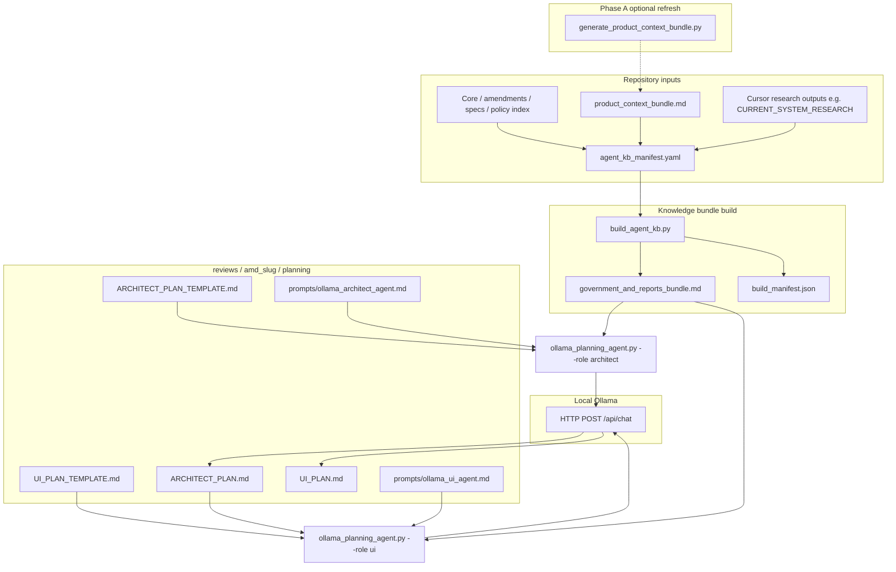
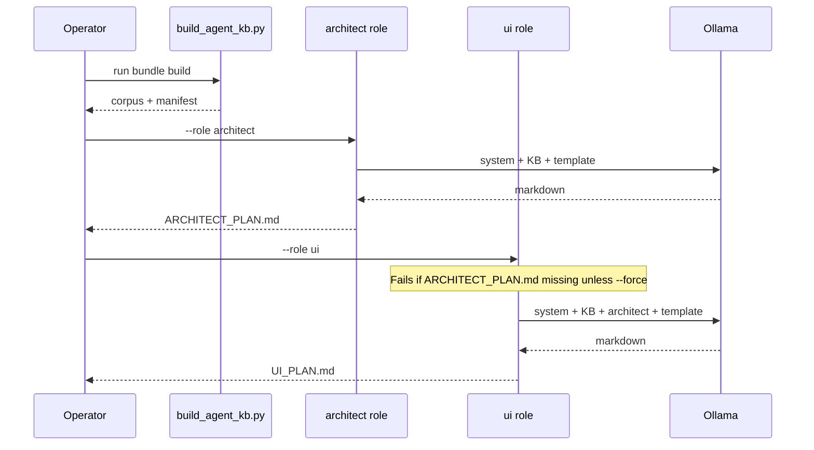

# Local Ollama planning agents (Architect → UI)

This document is the **operator README** for the **pre-ratification planning** automation that uses a **local** [Ollama](https://ollama.com/) LLM and a **merged knowledge bundle** (governing documents + product snapshots + research reports). It implements **AIOS-AMD-PLAN-001** phases **B** and **C** in software-assisted form; **Phases D–F** (committee, author revision, binding peer review) are **not** automated here.

**Binding lifecycle:** **[AIOS-AMD-PLAN-001](../../implementation/AIOS-AMD-PRE-RATIFICATION-PLANNING-LIFECYCLE.md)**  
**Parent KB overview:** **[`reference/knowledge_base/README.md`](../README.md)**

---

## 1. Purpose and scope

| In scope | Out of scope |
|----------|----------------|
| Building one markdown **corpus** from declared repo paths | Cloud LLM APIs (OpenAI, Gemini, etc.) — use `scripts/peer_review.py` for those |
| Running **Architect** then **UI** agents in **strict order** (UI blocked until Architect output exists) | Committee packet generation (`COMMITTEE_PACKET.md`) — manual or separate tooling |
| Writing drafts under **`reviews/<slug>/planning/`** | Treating agent output as **ratified** or **normative** without human review |
| Local **Ollama** `/api/chat` with configurable host and model | CI automation — this is **local operator** tooling |

**Non‑negotiable:** Generated **`ARCHITECT_PLAN.md`** and **`UI_PLAN.md`** are **drafts**. A human must verify them against **`ai-os-voice-interface`** (source, behavior, diffs) and governing text before they inform amendment or spec edits.

**Intent-bearing repository taxonomy (draft):** Folder layout under governed repos is **architecture-relevant**. The **Architect** role **defines** taxonomy rules; the **builder** **maintains** classified paths; **implementation** agents **consume** declared structure — see **[AMD-2026-013](../../amendments/AMD-2026-013.md)** and **[AIOS-REPO-TAXONOMY-001](../../implementation/AIOS-REPO-TAXONOMY-001.md)**. Planning outputs **SHOULD** use **classified** review paths where declared (e.g. `reviews/<amendment_slug>/planning/` today; `reviews/amendments/<slug>/planning/` when migrated per memo).

---

## 2. Where this sits in AIOS-AMD-PLAN-001

The amendment pre-ratification lifecycle is **non‑normative** workflow guidance; **AMD-2026-005** remains the ratification gate for peer review.

| Phase | Name | This README covers |
|-------|------|--------------------|
| **A** | Evidence (product snapshot, research) | **Prerequisite** — refresh snapshot/research when stale; inputs to the bundle |
| **B** | Architect | **`--role architect`** → `ARCHITECT_PLAN.md` |
| **C** | UI | **`--role ui`** → `UI_PLAN.md` (needs Phase B output) |
| **D–F** | Committee, author revision, peer review | **Not** covered here — see lifecycle doc and `scripts/peer_review.py` |

---

## 3. System architecture

### 3.1 Data flow



### 3.2 Execution order (enforced)



---

## 4. Files in this process (inventory)

### 4.1 Configuration and inputs (you edit)

| Path | Role |
|------|------|
| [`agent_kb_manifest.yaml`](agent_kb_manifest.yaml) | YAML list of **relative paths** (from repo root) under `governing_documents` and `reports_and_snapshots`. Set `label` to identify the track (e.g. `amd_2026_006_workspace_track`). |
| Paths referenced in the manifest | Typically: core law, relevant **AMD**s, **SPEC**s (e.g. Workspace integration, intent model, UI registry, execution scope), **[`AIOS_POLICY_INDEX.md`](../../AIOS_POLICY_INDEX.md)**, **[`product_context_bundle.md`](../snapshots/product_context_bundle.md)**, **[`CURRENT_SYSTEM_RESEARCH_*.md`](../cursor_research_outputs/)**. |

### 4.2 Scripts (repository root)

| Script | Purpose |
|--------|---------|
| [`scripts/build_agent_kb.py`](../../../scripts/build_agent_kb.py) | Concatenates manifest paths into one markdown file + JSON manifest. Warns on missing paths. |
| [`scripts/ollama_planning_agent.py`](../../../scripts/ollama_planning_agent.py) | Loads corpus + templates + prompts; calls Ollama; writes `ARCHITECT_PLAN.md` or `UI_PLAN.md`. |
| [`scripts/generate_product_context_bundle.py`](../../../scripts/generate_product_context_bundle.py) | Refreshes product excerpt when Phase A evidence is stale (often run from or alongside the product repo workflow — see [`../README.md`](../README.md)). |

### 4.3 Prompts (system messages)

| Path | Used by |
|------|---------|
| [`prompts/ollama_architect_agent.md`](../../../prompts/ollama_architect_agent.md) | Architect role — grounding, file paths, schemas, routing tables. |
| [`prompts/ollama_ui_agent.md`](../../../prompts/ollama_ui_agent.md) | UI role — surfaces, disclosure, Shell vs Workspace; must align with Architect plan. |

### 4.4 Per-review planning artifacts (templates and outputs)

Under **`reviews/<amd-slug>/planning/`** (example: **`amd_2026_006`**):

| File | Role |
|------|------|
| `ARCHITECT_PLAN_TEMPLATE.md` | Input shape for the Architect agent. |
| `UI_PLAN_TEMPLATE.md` | Input shape for the UI agent. |
| **`ARCHITECT_PLAN.md`** | **Written** by `--role architect` (draft). |
| **`UI_PLAN.md`** | **Written** by `--role ui` (draft). |

**`--amd-slug`** must match the folder name under `reviews/` (underscores, e.g. `amd_2026_006`).

### 4.5 Generated corpus (local build; gitignored)

| Path | Role |
|------|------|
| [`corpus/government_and_reports_bundle.md`](corpus/government_and_reports_bundle.md) | Single markdown file: concatenation of all manifest sources with section headers. **Do not hand-edit** — regenerate with `build_agent_kb.py`. |
| [`corpus/build_manifest.json`](corpus/build_manifest.json) | Machine-readable list of included files, sizes, `ok` / `missing`. |

See [`.gitignore`](.gitignore). Operators should **run the builder** after changing the manifest or any included source file.

---

## 5. Prerequisites

1. **Python 3** with dependencies: from repo root,  
   `py -3 -m pip install -r scripts/requirements.txt`  
   (`httpx` for Ollama HTTP API, `pyyaml` for the manifest parser.)

2. **Ollama** installed and running locally (or reachable at `OLLAMA_HOST`).

3. **Pulled model** matching `OLLAMA_MODEL`, e.g.  
   `ollama pull llama3.2`  
   Use `ollama list` to confirm the name.

4. **Bundle built** before any agent run:  
   `py -3 scripts/build_agent_kb.py`  
   If the command reports missing paths, fix the manifest or restore files.

5. **Phase A** (recommended): If the Workspace/product picture is outdated, regenerate **`product_context_bundle.md`** per [`../README.md`](../README.md), then rebuild the agent KB.

---

## 6. End-to-end procedure

### Step 1 — Refresh evidence (when needed)

- Regenerate **`reference/knowledge_base/snapshots/product_context_bundle.md`** if `ai-os-voice-interface` has changed materially.
- Update or add **Cursor research** outputs if you are tracking a new research pass.
- If you add new paths, edit **`agent_kb_manifest.yaml`** and rebuild.

### Step 2 — Build the knowledge bundle

```bash
# From aios-governing-docs repository root
py -3 scripts/build_agent_kb.py
```

Optional:

```bash
py -3 scripts/build_agent_kb.py --manifest reference/knowledge_base/agents/agent_kb_manifest.yaml
```

Confirm console output: path to `government_and_reports_bundle.md` and character count. Address **warnings** about missing files so the model is not trained on empty placeholders.

### Step 3 — Architect (Phase B)

```bash
py -3 scripts/ollama_planning_agent.py --role architect --amd-slug amd_2026_006
```

- **Writes:** `reviews/amd_2026_006/planning/ARCHITECT_PLAN.md`.
- **Dry run (no Ollama call):** add `--dry-run` to print prompt sizes.

### Step 4 — UI (Phase C)

```bash
py -3 scripts/ollama_planning_agent.py --role ui --amd-slug amd_2026_006
```

- **Requires:** `ARCHITECT_PLAN.md` from Step 3.
- **Escape hatch:** `--force` runs UI without an architect file (not recommended). The user message includes an explicit note that no architect plan was provided.

### Step 5 — Human verification

- Diff **`ai-os-voice-interface`** and open cited paths.
- Check claims against **AMD-2026-007**, **AIOS-SPEC-007**, **AIOS-SPEC-006**, **AIOS-SPEC-009**, etc., as applicable.
- Edit drafts manually before committee or author revision.

---

## 7. `ollama_planning_agent.py` reference

| Argument | Description |
|----------|-------------|
| `--role architect \| ui` | **Required.** Architect runs first; UI consumes Architect output. |
| `--amd-slug <name>` | Folder under `reviews/<name>/planning/`. Default in code: `amd_2026_006`. |
| `--bundle PATH` | Override default corpus path (default: `reference/knowledge_base/agents/corpus/government_and_reports_bundle.md`). |
| `--dry-run` | Do not call Ollama; print KB size and prompt character counts. |
| `--force` | **UI role only.** Proceed without `ARCHITECT_PLAN.md`. |

**Implementation notes:**

- Uses Ollama **`/api/chat`** with `stream: false`.
- Default timeout for the HTTP client is **600 seconds** (large prompts + slow local inference).
- System prompt = file contents of `prompts/ollama_architect_agent.md` or `ollama_ui_agent.md`.
- User prompt = knowledge bundle + **template** + instructions; UI agent also receives **full** `ARCHITECT_PLAN.md` body.

---

## 8. Environment variables

| Variable | Default | Meaning |
|----------|---------|---------|
| `OLLAMA_HOST` | `http://127.0.0.1:11434` | Base URL for Ollama (no trailing slash required; script normalizes). |
| `OLLAMA_MODEL` | `llama3.2` | Model tag as Ollama expects it. |

**Windows:** Set in the shell session or system environment before running the script.

**Remote Ollama:** If another machine hosts Ollama, set `OLLAMA_HOST` to that host’s URL (firewall and TLS are your responsibility).

---

## 9. Context window and size

The bundle can be **large** (hundreds of thousands of characters). If the model context is exceeded or the run is slow:

- **Trim** the manifest for a narrower track (fewer specs or reports) while keeping **normative** sources required for the amendment.
- **Use a smaller** model only if quality remains acceptable for planning drafts.
- **Split** work across sessions by manually editing the manifest for a “minimal” slice (advanced; keep a record of what was excluded).

Use **`--dry-run`** to see **system** and **user** prompt sizes before spending tokens.

---

## 10. Troubleshooting

| Symptom | What to check |
|---------|----------------|
| `ERROR: Run build_agent_kb.py first` | Corpus file missing; run `build_agent_kb.py`. |
| `ERROR: Architect output missing` (UI) | Run `--role architect` first, or use `--force` only if intentional. |
| HTTP 4xx/5xx from Ollama | `ollama serve` running? Correct `OLLAMA_HOST`? Model pulled (`ollama list`)? |
| `ModuleNotFoundError: httpx` | `pip install -r scripts/requirements.txt` |
| Missing file warnings in `build_agent_kb.py` | Paths in YAML wrong or files not committed; fix manifest or restore files. |
| Garbled or poor output | Model too small for task; tighten manifest; improve templates; human-edit. |

---

## 11. Relationship to other tooling

| Tool | Relationship |
|------|----------------|
| **`peer_review.py`** | **Binding** triangulated review with optional `--product-context`. Planning agents **do not** replace peer review. |
| **`generate_product_context_bundle.py`** | Feeds **Phase A** snapshot that often **is** included in `agent_kb_manifest.yaml`. |
| **Governance integrity CI** | Uses minimal `requirements.governance-integrity.txt`; **does not** install Ollama or run these agents. |

---

## 12. Quick reference (copy-paste)

```bash
py -3 -m pip install -r scripts/requirements.txt
py -3 scripts/build_agent_kb.py
py -3 scripts/ollama_planning_agent.py --role architect --amd-slug amd_2026_006
py -3 scripts/ollama_planning_agent.py --role ui --amd-slug amd_2026_006
```

Dry run:

```bash
py -3 scripts/ollama_planning_agent.py --role architect --amd-slug amd_2026_006 --dry-run
```

---

## 13. Proposed next lane — isolated execution demonstration (draft)

The planning stack documented here **ends** at **draft** Architect/UI markdown. It does **not** check out branches, build the product, or attach screenshots.

A **draft governance memo** — **[AIOS-EXEC-DEMO-001](../../implementation/AIOS-ISOLATED-EXECUTION-DEMONSTRATION-PIPELINE.md)** — proposes **Phase X**: an **isolated execution demonstration pipeline** (transaction JSON, execution contract, branch/worktree procedure, validation and visual evidence, `reviews/<slug>/execution/` artifacts). **System prompt** for that lane: [`prompts/isolated_execution_demonstration_system.md`](../../../prompts/isolated_execution_demonstration_system.md). **Packet templates:** [`templates/execution_packet/`](../../../templates/execution_packet/README.md).

That lane is **not** implemented by `ollama_planning_agent.py`; it is a **roadmap** for tooling in the product repo and operator process.

**MVP implemented:** [`scripts/run_isolated_execution_demo.py`](../../../scripts/run_isolated_execution_demo.py) — creates `reviews/<slug>/execution/`, optional **git worktree** + **npm** validation. See **[AIOS-EXEC-DEMO-001](../../implementation/AIOS-ISOLATED-EXECUTION-DEMONSTRATION-PIPELINE.md)** Annex E.

---

## 14. Subfolder README

The **[`corpus/`](corpus/README.md)** folder only documents the generated files; **this** file (`agents/README.md`) is the **main** process README.
