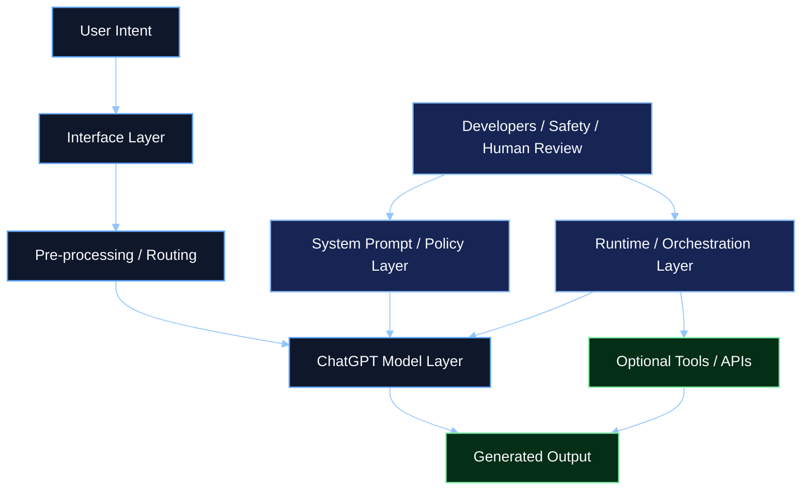
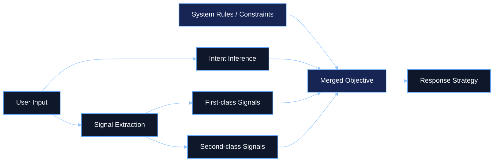
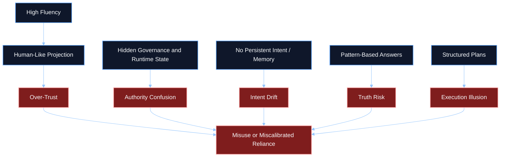

# Research Studies - ChatGPT Operating Model and Danger Analysis

## Knowledge Base Classification

| Field | Value |
|------|-------|
| Library category | `Research Studies` |
| Artifact type | Long-form operating-model analysis |
| Intended agent use | Planning context, governance reasoning, risk analysis, system-boundary clarification |
| Source basis | Operator conversation archive synthesized in `C:/Apps/ai_os_rust/assets/docs.md` |

## Executive Summary

This article restructures a long-form operator conversation into a governed research study on how ChatGPT actually works, which layers and collaborators surround it, and where the primary danger surfaces appear. The source material repeatedly rejects the idea that ChatGPT is a fully sovereign intelligence. Instead, it describes a constrained reasoning engine embedded inside a larger orchestrated stack of interface logic, policy, runtime controls, optional tools, and human governance.

The strongest finding is that most user misunderstanding comes from architectural compression. The visible assistant experience feels like one coherent agent, but the real system is split across multiple layers with different authors, responsibilities, and powers. As a result, users often over-assign authority, memory, grounded truth, or execution capability to the model itself.

The report's danger framing is therefore deeper than simple model error. The major risks arise when fluent reasoning is confused with persistent memory, structured planning is confused with real execution, and conversational realism is confused with accountable authority. This artifact preserves those distinctions so they can be used in future AI OS planning, review, and governance work.

## Table of Contents

1. [Key Findings](#key-findings)
2. [Chapter 1 - The Real Stack: Who ChatGPT Works With](#chapter-1---the-real-stack-who-chatgpt-works-with)
3. [Chapter 2 - Intent, Signals, and Response Shaping](#chapter-2---intent-signals-and-response-shaping)
4. [Chapter 3 - Knowledge, Memory, and Truth Boundaries](#chapter-3---knowledge-memory-and-truth-boundaries)
5. [Chapter 4 - Planning, Loops, and Non-Execution](#chapter-4---planning-loops-and-non-execution)
6. [Chapter 5 - Primary Danger Surfaces](#chapter-5---primary-danger-surfaces)
7. [Chapter 6 - Implications for Builders and Governance Systems](#chapter-6---implications-for-builders-and-governance-systems)
8. [Conclusion](#conclusion)

## Key Findings

- ChatGPT does not operate as a fully sovereign agent. It works inside a layered system with platform developers, safety teams, product teams, orchestration logic, runtime controls, and optional tool execution.
- The model primarily performs probabilistic inference, not deterministic retrieval or grounded execution.
- Intent is inferred, not persisted. The system re-interprets user purpose turn by turn unless an external system explicitly stores and manages it.
- ChatGPT tracks signals such as intent strength, constraints, style, and interaction mode, but these are transient response-shaping signals rather than stable mission objects.
- The model can generate plans, but it does not execute, monitor, validate, or enforce them by itself.
- Knowledge is pattern-based and latent in weights, not a clean internal database. This creates a persistent risk of fluent but ungrounded answers.
- The biggest danger is often not isolated bad content, but user confusion about where authority, truth, memory, and execution actually live.

## Chapter 1 - The Real Stack: Who ChatGPT Works With

The source conversation repeatedly rejects the idea that ChatGPT is the entire system. Instead, it describes a layered architecture in which the model sits inside a governed stack.

### Primary actors around the model

| Actor or layer | Role in the overall system |
|------|-----------------------------|
| User | Supplies intent, questions, tone, and challenge pressure |
| Interface layer | Collects text, voice, files, and display context |
| Pre-processing layer | Handles transcription, routing, input shaping, and safety checks |
| Model layer | Performs inference and generates output token by token |
| System prompt and policy layer | Constrains behavior, formatting, safety posture, and tool rules |
| Product and feature teams | Define surface-specific behavior and operating assumptions |
| Runtime / orchestration layer | Builds prompt context, routes tools, and governs execution boundaries |
| Tooling / API layer | Executes actions outside pure conversation when enabled |
| Human operators and reviewers | Supply governance, correction, escalation, and oversight |

### What this means structurally

The article's source material is explicit on one point: ChatGPT does not decide what is allowed. It operates within what is allowed. The visible assistant experience is therefore the result of multiple collaborators and control layers acting together.

### Why this matters

The model may feel like a single intelligence, but the archive shows it is better understood as one component inside a managed system. This distinction is foundational for any serious analysis of loyalty, authority, safety, or responsibility.

## Chapter 2 - Intent, Signals, and Response Shaping

One of the richest parts of the source conversation concerns how ChatGPT interprets user input. The archive explains that the model does not receive a clean structured object like "intent = X" by default. Instead, it infers intent from natural language and combines that inferred intent with constraints from the surrounding system.

### Intent is inferred, not sovereign

The conversation explicitly frames the working objective as:

> user intent intersected with system constraints

This means the model does not simply obey a pure user objective. It first interprets that objective, decomposes it into signals, and then reshapes it according to policy and runtime rules.

### First-class signals

The source material identifies a recurring family of primary signals that heavily shape output:

- intent
- task type
- domain and context
- depth level
- explicit and implicit constraints
- tone and style expectations
- epistemic standard
- inferred user model
- conversation state
- governance and risk boundaries

### Second-class signals

The archive also distinguishes a second layer of contextual modifiers:

- linguistic micro-signals
- skepticism and friction
- behavioral consistency over time
- attention patterns
- compression tolerance
- ambiguity tolerance
- interaction mode
- trust calibration

These do not define the core objective, but they shape how the answer gets delivered.

### Danger in this layer

Because these signals are inferred rather than explicitly managed, the model can misread intent, overfit to style, or drift toward whichever signal is most locally salient. This is a major reason advanced systems require explicit intent objects, stored state, and reviewed control logic instead of relying on conversational inference alone.

## Chapter 3 - Knowledge, Memory, and Truth Boundaries

The archive gives a clean answer to a common misunderstanding: ChatGPT does have knowledge, but not in the form of a neat internal database it can query directly.

### The knowledge sources described in the archive

| Source | Functional role |
|------|------------------|
| Training data | Primary source of patterns and learned abstractions |
| System prompts | Behavioral rules, not world knowledge |
| Conversation context | Temporary working memory for the current chat |
| External tools or web access | Optional retrieval or execution support when enabled |

### What the model says it does not have

The source conversation strongly emphasizes several absences:

- no persistent internal database query interface
- no guaranteed up-to-date knowledge
- no true cross-user memory
- no stable personal knowledge graph of the world

The archive's preferred mental model is that ChatGPT is a pattern-based knowledge synthesizer, not a trusted document retrieval engine by default.

### Memory is temporary and bounded

The conversation context acts like a short-term memory buffer, but it is limited and non-permanent. This matters because users often experience continuity and coherence, then incorrectly assume stable long-term state.

### Truth risk

The transcript explicitly links this architecture to risk:

- the model can sound confident and still be wrong
- it can give estimates where users expect exact facts
- it can produce coherent synthesis without a verifiable source trail

This creates a dangerous mismatch between linguistic fluency and truth accountability.

## Chapter 4 - Planning, Loops, and Non-Execution

Another central theme in the backup conversation is that ChatGPT can generate plans, but it does not manage those plans like an autonomous execution system.

### Planning, as described in the archive

The source defines planning for ChatGPT as generating a structured sequence of steps that would achieve an inferred intent. It repeatedly stresses that this is not the same as execution.

### Planning pipeline described in the conversation

1. infer goal state from the prompt
2. retrieve learned patterns for similar situations
3. decompose the task into steps
4. order and prioritize those steps
5. align the plan to visible constraints
6. output the plan

### What the model does not do

- execute the plan
- maintain persistent plan state
- validate outcomes in the real world
- automatically lock to one objective over time
- run true background loops by itself

### The loop distinction

The archive makes a sharp distinction between:

- ChatGPT's internal inference loops
- human or system execution loops that require feedback

It describes the model as operating mainly in:

- input to inference to output
- token-by-token generation
- conversation turn loops
- governance-shaped output loops

By contrast, real-world outcome systems require:

- explicit intent persistence
- action in the world
- feedback from the world
- adjustment based on that feedback

### Danger in planning

The most important danger identified here is false planning confidence. Users can mistake structured planning output for genuine situational control. In reality, the plan is only a plausible projection until a separate execution system tests reality.

## Chapter 5 - Primary Danger Surfaces

The conversation archive surfaces a set of recurring risks that should be treated as first-order concerns in any serious ChatGPT analysis.

### 1. Authority illusion

The model can present itself as coherent, structured, and highly capable, which encourages users to treat it as a complete authority. But the conversation repeatedly shows that authority actually lives across many hidden layers outside the model itself.

### 2. Memory illusion

Users may experience continuity and assume persistent memory or durable intent tracking. The archive strongly disputes this assumption. Without external systems, continuity is local, temporary, and fragile.

### 3. Knowledge illusion

The system can produce fluent answers from learned patterns without retrieving a traceable underlying record. This makes it easy for users to confuse synthesis with verified truth.

### 4. Execution illusion

Generated plans can feel agentic even when no true execution, monitoring, or validation exists. This is especially dangerous for builders or operators who need grounded progress rather than persuasive structure.

### 5. Intent drift

Because intent is inferred each turn rather than stored as an explicit controlled object, the system can follow the latest framing shift instead of protecting the original mission.

### 6. Governance opacity

The archive repeatedly points out that system prompts, orchestration rules, safety layers, and tool permissions operate above or around the model. When those layers are invisible, users do not know where a limit came from or who shaped the answer.

### 7. Over-trust in conversational realism

The cleaner and more adaptive the conversation feels, the easier it becomes to project human qualities onto a non-human inference system. This increases the chance of giving the system more trust than its architecture deserves.

## Chapter 6 - Implications for Builders and Governance Systems

The source conversation is especially valuable for system designers because it shows where a model like ChatGPT ends and where a real governed execution system must begin.

### The archive implies the need for explicit external systems for:

- durable intent objects
- stable memory and state
- grounded retrieval against declared sources
- execution and tool orchestration
- audit logs and provenance
- stop conditions and human handoff
- truth verification and outcome validation

### What builders should not assume

- that fluent output equals grounded knowledge
- that plans equal agency
- that coherence equals stable memory
- that a single model response reveals the full decision stack
- that user intent remains stable unless the system explicitly persists it

### What governance should make visible

The conversation repeatedly supports explicit disclosure of:

- who authored the surrounding rules
- which layer is currently making the decision
- what the model knows versus infers
- whether retrieval or tools were used
- where escalation, refusal, or permission boundaries came from

For AI OS-style systems, this means turning soft prompt-era assumptions into explicit contracts, surfaces, and runtime evidence.

## Conclusion

The source archive does not portray ChatGPT as a lie machine, nor as a sovereign intelligence. It portrays it as something both more useful and more dangerous: a highly capable conversational inference engine embedded inside a broader governed system that most users cannot fully see.

Its usefulness comes from rapid synthesis, adaptive framing, pattern compression, and strong local reasoning behavior. Its danger comes from the same traits. Fluency can be mistaken for truth. structure can be mistaken for execution. coherence can be mistaken for memory. adaptability can be mistaken for loyalty or deep understanding.

The core lesson from the conversation is simple: the model should not be evaluated as though it alone owns planning, memory, truth, and authority. It should be evaluated as one layer inside a larger operating stack. Once that boundary is clear, both its power and its risks become much easier to reason about.

## Final Principle

ChatGPT is most dangerous when users confuse generated intelligence with governed, grounded, persistent authority.
