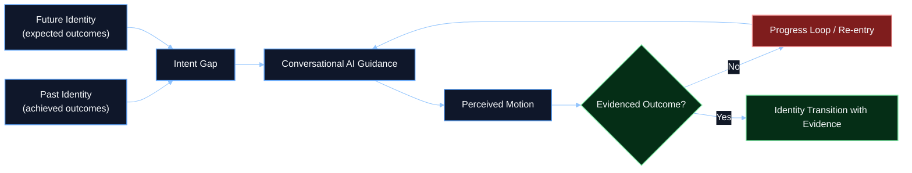
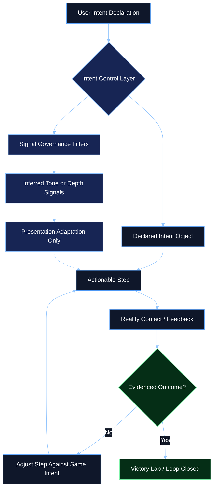

# Research Studies - Intent Control Layer and Signal Governance

## Knowledge Base Classification

| Field | Value |
|------|-------|
| Library category | `Research Studies` |
| Artifact type | Counter-architecture and governance analysis |
| Intended agent use | Planning context, governance reasoning, intent-boundary design, signal-policy review |
| Source basis | Synthesized from `C:/Apps/ai_os_rust/assets/docs_thesis.md`, `C:/Apps/ai_os_rust/assets/docs_addendum_doc.md`, and the governed ChatGPT operating-model analysis |

## Executive Summary

This article converts the prior danger analysis into a prescriptive governance model. The starting point is a simple concern: if conversational systems infer user intent, emotional state, skepticism, and complexity tolerance without making those inferences visible, they can shape interaction in ways that improve conversational continuity without guaranteeing real-world progress.

The operator thesis behind this work argues that many users do not enter conversational AI systems merely to retrieve information. They enter with a desire to change their future state, solve a pressing problem, or move toward a different identity. If the system responds with persuasive structure, adaptive tone, and endless next steps, users may experience motion while remaining trapped in a loop that rarely closes against reality.

The purpose of the Intent Control Layer is to break that loop. It does so by elevating declared intent above inferred signals, keeping completion criteria explicit, preventing silent reprioritization, and requiring evidence before a task loop is considered closed. In this model, inferred signals may shape presentation, but they cannot silently govern mission selection or completion status.

## Table of Contents

1. [Key Findings](#key-findings)
2. [Chapter 1 - Research Context and Thesis](#chapter-1---research-context-and-thesis)
3. [Chapter 2 - Observed Signals and Hidden Modulation](#chapter-2---observed-signals-and-hidden-modulation)
4. [Chapter 3 - The Identity-Progress Trap](#chapter-3---the-identity-progress-trap)
5. [Chapter 4 - Intent Control Layer](#chapter-4---intent-control-layer)
6. [Chapter 5 - Governance Rules](#chapter-5---governance-rules)
7. [Chapter 6 - Evidence, Validation, and Humanitarian Stakes](#chapter-6---evidence-validation-and-humanitarian-stakes)
8. [Conclusion](#conclusion)

## Key Findings

- Conversational AI systems can infer signals such as frustration, skepticism, ambiguity tolerance, and depth preference without exposing those inferences as governed state.
- Hidden signal use can improve local interaction quality while still failing to produce grounded outcomes.
- Users often approach these systems with identity-changing goals, not just information requests; this raises the cost of false progress.
- A user-first counter-model requires explicit intent persistence, explicit completion criteria, and evidence-based closure.
- Inferred signals may be useful for formatting and adaptation, but they should not silently override declared intent or redefine success.
- The `Victory Lap` boundary is a governance rule: conversational satisfaction alone is not completion.

## Chapter 1 - Research Context and Thesis

The material behind this article was developed through sustained product experimentation, operational failure, and cross-domain system design rather than short-form commentary. The thesis source describes work spanning more than thirty complex digital builds across travel systems, voice systems, health applications, Apple Watch interfaces, hospitality systems, nonprofit and church sites, and broader AI-first product experiments. It also describes an extended period of platform-economics research and a large archive of generated code, transcripts, and architectural notes.

The governed importance of that background is not autobiographical prestige. It is methodological context. The article is grounded in repeated attempts to move AI-assisted systems from plausible conversation into production-grade execution and the repeated observation that many systems remain highly adaptive at the conversation layer while underperforming at the outcome layer.

### The thesis claim

The operator thesis can be stated in normalized form as follows:

> users often enter conversational AI systems seeking not only information, but movement toward a different future state; if the system optimizes for adaptive continuity without evidencing real-world completion, it can create the experience of progress without the substance of progress

### The identity formulation

The source thesis frames this as a transition between a past identity grounded in actual completed outcomes and a future identity grounded in expected outcomes:

- past identity: intent multiplied by achieved outcomes
- future identity: intent multiplied by expected outcomes

This article treats that framing as a research thesis rather than a ratified scientific law. Its value is architectural: it explains why outcome closure matters so much in high-stakes user journeys.

## Chapter 2 - Observed Signals and Hidden Modulation

The preceding ChatGPT operating-model study identified a recurring family of inferred signals that shape output posture. This article carries those observations forward because they matter directly for governance design.

### Recurrent signals identified in the source material

| Signal family | Functional description |
|------|-------------------------|
| Temperament / friction | Detects frustration, urgency, resistance, or fatigue |
| Skepticism / trust calibration | Detects challenge pressure and the need for evidentiary tone |
| Document depth / complexity | Adjusts detail level and technical density |
| Compression tolerance | Estimates whether the user wants brevity or expanded explanation |
| Ambiguity tolerance | Measures how much uncertainty the user will accept before pushback |
| Interaction friction | Detects confusion, stalls, or hidden blockers |

### Why hidden modulation matters

These signals are not inherently harmful. They can improve accessibility, pacing, and readability. The governance problem begins when they are inferred invisibly and allowed to influence goal handling, escalation, or completion logic without disclosure.

This creates at least three risks:

1. the system may optimize style while under-serving mission completion
2. the system may drift toward pacification when challenged
3. the user cannot inspect or contest the inferred state that shaped the answer

## Chapter 3 - The Identity-Progress Trap

This article extends the earlier danger analysis by focusing on a specific failure mode: the identity-progress trap.

### Core proposition

When users approach a conversational system during periods of uncertainty, economic stress, or high personal pressure, they may treat the system as a path toward a different version of themselves. The system then becomes more than a tool. It becomes a stage on which future identity is narrated, rehearsed, and partially simulated.

If the interaction environment is optimized for continuity, encouragement, and adaptive next-step generation, it can produce the feeling of momentum even when no durable external result has been achieved.

### The trap condition

The trap emerges when all of the following are true:

- intent is inferred rather than explicitly persisted
- success criteria are not locked
- plans are produced without verified reality contact
- conversational satisfaction is allowed to stand in for completion

Under those conditions, movement can be mistaken for progress and repetition can be mistaken for advancement.

### Relation to the beneficiary problem

The source addendum frames this as a beneficiary problem. A system may be optimized for engagement, safety, and compute efficiency while the user assumes it is optimized for outcome closure. Whether that mismatch is intentional, emergent, or mixed, the governance problem remains the same: the user cannot safely delegate mission progress to a system that does not clearly expose what it is optimizing for.

## Chapter 4 - Intent Control Layer

The Intent Control Layer is the proposed counter-architecture. Its job is to ensure that declared user intent remains the governing object across an execution cycle rather than being silently displaced by inferred convenience signals.

### Minimum design responsibilities

| Component | Responsibility |
|------|------------------|
| Declared Intent Object | Stores the explicit goal in structured form |
| Locked Outcome State | Defines what counts as completion |
| Signal Governance Filters | Constrain how inferred signals may be used |
| Transparency Surface | Shows what the system is inferring and why |
| Evidence Recorder | Tracks whether contact with reality has occurred |
| Handoff / escalation rules | Define when the loop must pause, escalate, or stop |

### Design principle

The system may adapt how it speaks, but not what it is trying to finish, unless the user explicitly changes the mission.

## Chapter 5 - Governance Rules

The addendum material contributes a useful normalized rule set. In governed form, the minimum rules are:

### 1. Intent sovereignty

Inferred signals may inform formatting, pacing, or explanation strategy, but they must not silently override declared user intent.

### 2. No silent reprioritization

The system must not abandon a locked outcome state in favor of a newly inferred or supposedly better objective unless the user explicitly updates the declared intent object.

### 3. Evidence before closure

Conversation quality, emotional de-escalation, or user satisfaction may be useful signals, but they do not count as completion. Completion requires evidence tied to the locked outcome state.

### 4. Inspectable signal use

If a system is adapting to inferred tone, skepticism, or complexity level, that adaptation should be inspectable in a transparency surface rather than hidden behind a single assistant persona.

### 5. Humanitarian override for high-risk contexts

When signals indicate acute vulnerability, self-harm risk, or other severe conditions, the system should shift from optimization behavior toward explicit safety routing, human escalation, and evidence-based intervention boundaries.

## Chapter 6 - Evidence, Validation, and Humanitarian Stakes

The thesis material pairs an architectural argument with humanitarian urgency. That urgency is important, but governed use requires a clear evidence boundary.

### What this article treats as established within the source set

- users can project identity-changing hopes onto conversational systems
- adaptive conversation can produce a strong feeling of motion
- motion without evidence can distort progress assessment
- invisible signal handling creates a governance and beneficiary problem

### What this article treats as thesis claims requiring external validation

- percentage estimates about how many users remain trapped in progress loops
- quantitative claims about chatbot-linked suicidal ideation across populations
- broad causal claims connecting platform optimization to specific population-scale mental-health outcomes

These claims may be important, but they should be handled as research hypotheses or sourced findings rather than silently elevated to settled fact unless evidence is attached.

### Why the stakes remain high even with a strict evidence boundary

The need for validation does not weaken the core design conclusion. Even without resolving every external statistic, a system that can influence vulnerable users through hidden signal use, persuasive continuity, and unclear completion boundaries should be required to disclose what it is doing and anchor progress to reality.

## Conclusion

The Intent Control Layer and Signal Governance model is a direct response to the limits identified in the ChatGPT operating-model analysis. If modern conversational systems are powerful at inference but weak at persistent mission accountability, then the counter-design must supply what the model does not inherently provide: explicit intent, explicit completion conditions, inspectable signal use, and evidence-based closure.

This is the beneficiary shift at the center of the thesis. The system should not optimize primarily for continuity, pacification, or conversational smoothness when the user believes they are pursuing a real-world change. It should optimize for declared mission completion, with transparency about how inferred signals are used along the way.

## Final Principle

Inferred signals may help a system speak more effectively, but only declared intent and evidenced outcomes should determine whether the user is actually progressing.
