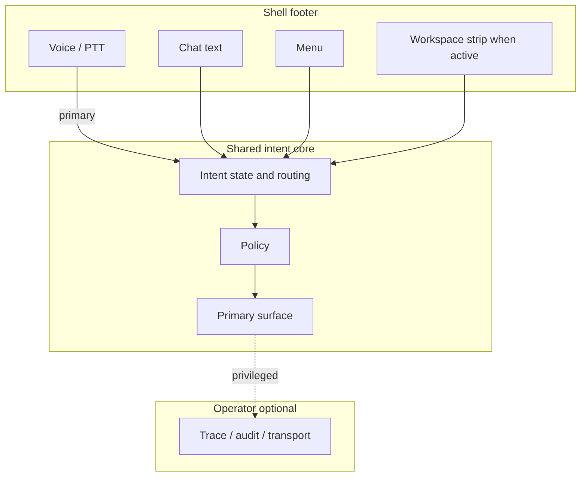

# Agent knowledge bundle — amd_2026_016_nonhuman_principals_lane**Generated:** 2026-04-10**Manifest:** `reviews/amd_2026_016/planning/KNOWLEDGE_PACKET.yaml`**Packet ID:** `PKT-AMD-2026-016-PLANNING`**Role:** `architect`Declared planning packet for governed non-human principal law. This lane must produce architecture-bearing schema, route, and storage/state surfaces before downstream drafting or renewed peer review is treated as above the line.---## Source: `core/technical_manifesto.md`

---
document_id: AIOS-CORE-001
title: AIOS Technical Manifesto & Platform Economics
version: 1.0.0
status: ratified
category: core
author: Gateway Global
created: 2026-03-15
last_updated: 2026-04-01
reviewers:
  - { reviewer: "DeepSeek R1", date: "2026-03-15", review_path: "reviews/technical_manifesto/round_1/review_001_deepseek.md" }
supersedes: archive/technical_manifesto_0_original.md
cross_references:
  - { doc_id: "AIOS-CORE-002", relationship: "constrained_by" }
  - { doc_id: "AIOS-CORE-003", relationship: "incorporated_by" }
amendment_history: []
---

# GATEWAY GLOBAL AIOS: THE TECHNICAL MANIFESTO & PLATFORM ECONOMICS

## Preamble: The Shift to Intent
For forty years, human productivity has been bottlenecked by the application interface. Users have been forced to translate their goals into the machine’s language—navigating siloed menus, fragmented dashboards, and rigid workflows. 

The Gateway Global AI Operating System (AIOS) inverts this paradigm. We are abandoning the concept of the standalone application in favor of Governed Execution Infrastructure. The AIOS does not force users to adapt to software; it dynamically compiles the exact interface, capabilities, and data required to fulfill the user's intent in real-time. We are **deterministic by design, and transparent by default.**

## Ingress Principles: Why Push‑to‑Talk is the Default

The AIOS adopts Push‑to‑Talk (PTT) as the primary ingress channel because explicit user activation is the strongest safeguard against unintended audio capture and mis‑activation. Empirical research on smart‑speaker privacy has consistently shown that always‑on wake‑word systems introduce residual risk of false activations, unintended recordings, and downstream privacy exposure. PTT creates a “speech circuit breaker”: the system listens only when the user deliberately signals intent.

This choice is constitutional, not accidental. Wake‑word or always‑on modes may be offered only as opt‑in capabilities, governed by stricter policy rules and transparency requirements (e.g., visual indicators, auditable activation logs). For all ingress modes—voice, chat, visual—the same governing laws apply; the input channel is a mere port to the same deterministic kernel.

---

## Article I: The Sovereign Architecture & State Persistence
To achieve absolute determinism and eliminate AI hallucination, the AIOS is strictly divided into distinct operational planes. Ephemeral reasoning modules (LLMs) are bounded workers responding to the OS kernel, possessing zero inherent authority.

* **The UI Surface:** Comprised of four state-driven planes (System, Visualizer, Canvas, and User Controls). 
* **The Orchestration Core:** The central nervous system routing every interaction through a strict intent loop (classification, phase resolution, policy enforcement, bounded execution). Every step of this loop is logged and fully replayable for audit and debugging purposes.
* **The Integration Bus:** The OS interfaces with external legacy systems and data sources exclusively through the open Model Context Protocol (MCP).
* **State Persistence:** Persistent session and user state is managed exclusively by the Kernel in a tenant-isolated store, with strict encryption enforced both at rest and in transit.

---

## Article II: UI Sovereignty & The Component Contract
The AIOS visual layer is heavily governed. Reasoning modules cannot write arbitrary UI code.

* **Declarative Rendering:** The Canvas agent emits a JSON UI plan referencing pre-approved registry item names. 
* **Versioned Registries:** All UI components must be whitelisted by the active Node Contract and pulled from a strict, semantic-versioned `shadcn/ui` component registry. 
* **Deterministic Fallbacks:** The OS never fails silently. If an requested component is unregistered or invalid, the OS explicitly logs the incident for developer visibility and degrades to a deterministic, non-intrusive fallback UI (e.g., a "content not available" placeholder), ensuring the user is never left confused.

---

## Article III: The Development Control Plane (DCP)
The AIOS scales exponentially via our internal coding swarm, governed by the Development Control Plane (DCP). The DCP ensures that AI-driven development remains subordinate to the runtime law.

* **Governance-First Orchestration:** The DCP operates as an automated Lead System Architect, converting ambiguous work requests into deterministic phases: intake, resolution, evidence, approval, and promotion.
* **Policy-as-Code (Fail-Closed):** All merges, registry updates, and capability expansions are evaluated by a centralized Policy Decision Point (PDP) that defaults to deny. 
* **Supply-Chain Attestations & Rollbacks:** Tier 3 tasks (Voice Runtime, Credential-Sensitive operations) require cryptographic supply-chain attestations—meaning all third-party Kit code and container images must be signed and verified against a platform-managed trust store. The DCP maintains immutable audit logs of all promotions, enabling instant rollbacks to a previous known-good registry or policy state.

---

## Article IV: Ecosystem Integration & Kit Isolation
The AIOS acts as a supreme orchestration layer that maximizes the value of legacy SaaS without requiring a rip-and-replace migration.

* **Execution Kits:** Enterprise workflows are unbundled into "Kits"—packages of NodeContracts, Policies, and Skills—that execute natively on the AIOS.
* **Strict Sandboxing:** Kits execute in a sandboxed environment with explicitly defined permissions. They cannot access the Kernel’s persistent state, the UI Surface, or cross-tenant data except through governed OS APIs.
* **Resilient Integration:** Vendors like Cloudbeds and Google Workspace are connected via MCP. The Kernel enforces strict timeouts and circuit-breaker patterns on the Integration Bus to prevent external system latency from causing cascading failures.

---

## Article V: Platform Economics & Metered Intelligence
Gateway Global operates on a transparent commercial model that separates base operational value from premium external intelligence.

* **Internal Knowledge (Base Entitlement):** Actions utilizing internal documents, workflow generation, and standard data orchestration are included in the base platform deployment.
* **External Intelligence (Funded Data Account):** Actions requiring variable-cost external compute—such as live web search, premium model inference, or third-party data enrichment APIs—draw from a separate Funded Data Account.
* **The 2x Multiplier:** Paid external intelligence actions are billed at 2x the direct upstream cost, covering the OS's retrieval, routing, governance, and productized delivery. Customers receive itemized usage logs showing the upstream cost and the platform fee to guarantee absolute billing transparency.
* **Automated Protection:** If a customer's Funded Data balance is exhausted, the AIOS deterministically blocks external actions and falls back to internal-only workflows to prevent unmetered cost exposure.

---

## Article VI: Observability & Auditability
In a deterministic system, transparency is a prerequisite for trust. Users and administrators must always understand why a system decision was made.

* **Immutable Tracing:** The AIOS Kernel emits a structured, immutable audit log for every intent classification, policy evaluation, tool invocation, and state mutation.
* **Accessible Forensics:** These logs are securely accessible to authorized tenants, providing total visibility for debugging, compliance reporting, and forensic analysis.

---

## Article VII: Data Privacy & Tenancy
Data sovereignty is a foundational right of the enterprise. The AIOS guarantees that user data is protected from unauthorized access, cross-contamination, and model ingestion.

* **Absolute Isolation:** The AIOS enforces strict logical (and where required, physical) isolation between tenants. 
* **Configurable Residency:** Customers maintain the authority to configure data residency regions to comply with local regulations (e.g., GDPR, CCPA).
* **Retention & Erasure:** Enterprises define their own data retention policies, supported by automated, cryptographically verified erasure protocols upon request.

---

## Article VIII: Security & Threat Model
The AIOS assumes a hostile operational environment. We treat all external inputs, including outputs generated by our own authorized LLMs, as untrusted data.

* **Input Sanitization:** The Kernel sanitizes, validates, and scrubs every single interaction against active schemas before any state change or UI rendering is permitted.
* **Injection Mitigation:** The separation of the reasoning layer (compute) from the mutation layer (state) neutralizes prompt injection attacks, as the LLM inherently lacks the permissions to execute unauthorized database writes or system commands.
* **Supply‑Chain Integrity:** Every Kit distributed through the AIOS Marketplace must meet verifiable integrity standards:
- Signed provenance attesting to the origin and authenticity of all artifacts.
- Versioned manifests listing all included Contracts, Policies, and Skills.
- A declared test harness and compatibility matrix.
- Security disclosures detailing tool access, data scopes, and any third‑party dependencies.

These requirements align with industry supply‑chain security frameworks (e.g., SLSA) and support independent assurance audits (such as SOC 2) by providing clear material for control testing.

---

## Article IX: Versioning & Backwards Compatibility
To ensure enterprise stability, the AIOS commits to long-term reliability and predictable evolution.

* **Semantic Governance:** The Kernel maintains strict semantic versioning for all public APIs, component registries, and policy schemas. 
* **Graceful Deprecation:** No capability or UI component is removed without a minimum notice period and automated migration tooling, ensuring legacy Kits continue to function flawlessly as the OS upgrades.

# Appendix: Core Terminology

The following definitions govern the interpretation of all AIOS governing documents.

- **Platform**: The governed runtime that converts user intent into authorized execution and renders a consistent, dynamically generated UI.

- **Stateful Shell**: The user‑facing runtime component that owns session state, orchestrates control planes, routes intents, and composes UI output.

- **Ingress**: The primary user interaction channel. The default Ingress is Push‑To‑Talk (PTT), with chat and visual as equivalent ports under the same governing laws.

- **IntentKey**: A stable identifier that binds an understood user intent to a selected governing Contract (and thus to allowed UI and compute).

- **NodeContract**: A declarative specification of an interaction node: required/optional inputs, allowed state transitions, allowed render directives, and allowed Skills.

- **PolicyRecord**: A declarative governance rule set that evaluates whether an action is allowed given identity, role, risk tier, context, and required confirmations.

- **SkillPrimitive**: A stateless compute primitive with strictly typed inputs/outputs, bounded tool access, and measurable latency budgets.

- **RenderDirective**: A typed instruction emitted by a Skill or Contract that the Stateful Shell translates into a UI component from the canonical registry. The UI layer is “locked” to this registry to ensure consistency and safety.

- **Kit**: A distributable package composed of one or more Contracts, Policies, and Skills (and their tests), intended to replace what would historically be an “application.”

- **Control Plane**: The enforcement layer that validates, routes, and gates behavior. The AIOS uses separate control planes for policy evaluation, skill orchestration, and UI rendering, all governed by the Development Control Plane (DCP).


---

## Source: `core/governance_constitution.md`

---
document_id: AIOS-CORE-002
title: The Gateway Global AIOS Governance Constitution
version: 1.0.0
status: ratified
category: core
author: Gateway Global
created: 2026-03-15
last_updated: 2026-04-01
reviewers:
  - { reviewer: "DeepSeek R1", date: "2026-03-15", review_path: "reviews/governance_constitution/round_1/review_001_deepseek.md" }
  - { reviewer: "DeepSeek R1", date: "2026-03-20", review_path: "reviews/governance_constitution/round_1/review_002_deepseek.md" }
supersedes: archive/governance_constitution_v0.md
cross_references:
  - { doc_id: "AIOS-CORE-001", relationship: "constrains" }
  - { doc_id: "AIOS-CORE-003", relationship: "constrains" }
amendment_history: []
---

# THE GATEWAY GLOBAL AIOS GOVERNANCE CONSTITUTION

## Preamble
The Gateway Global AI Operating System (AIOS) is a sovereign execution environment designed to translate human intent into deterministic action. Because this system orchestrates critical enterprise data, logic, and interfaces, it cannot be governed by the arbitrary decisions of individual developers or the probabilistic outputs of generative models. 

This Constitution establishes the **AIOS Governance Council**, defines its operational authority, and encodes the exact processes by which the system’s laws—Contracts, Policies, and Skills—are authored, audited, and amended.

---

## Article I: The Governance Council (The Stewards of the OS)
Absolute control of the AIOS architecture and policy boundaries rests with the Governance Council. 

**Section 1. Composition & Terms:**
The Council is comprised of three distinct branches. Gateway Global funds the Council’s operations, but the Council’s architectural and governance decisions are binding upon the corporate entity.
* **The OS Kernel Team (Platform Engineers):** Appointed by Gateway Global to staggered two-year terms. Responsible for the physical architecture and strict enforcement of the Execution Laws.
* **The Digital Governance Officers (Policy Engineers):** Appointed by Gateway Global to staggered two-year terms. Responsible for the legal, ethical, and compliance boundaries of the platform.
* **The Enterprise Consortium (Tenant Representatives):** Elected annually by active enterprise Tenants. They ensure platform evolution aligns with real-world regulatory requirements and hold formal consultation and veto rights.

**Section 2. Quorum and Voting:**
Unless otherwise specified, official Council decisions require a simple majority of voting members present, with a required quorum of at least two-thirds of all active voting members.

---

## Article II: The Legislative Process (Authoring the Law)
No capability may be introduced to the AIOS without passing through the formal legislative pipeline via the Development Control Plane (DCP).

**Section 1. The Compiler as the First Gate:**
All proposed legislation (`NodeContracts`, `Policies`, `Skills`) must first pass the deterministic compiler. If a proposal attempts an unauthorized action or references an unregistered UI component, it is automatically rejected.

**Section 2. Tier 3 Ratification:**
Any update classified as Tier 3 (touching the Voice Runtime, credential brokers, or core Kernel mutation logic) triggers a mandatory merge freeze. Ratification requires the cryptographic signature of **at least one OS Kernel Team member AND one Digital Governance Officer**, ensuring both architectural and policy oversight.

**Section 3. Transparency & Weekly Log:**
The Council is required to publish a machine-readable, versioned governance log of all ratified Tier 3 changes (with appropriate security redactions) to all Tenants and Vendors weekly.

---

## Article III: The Judicial Process (Enforcement & Conflict Resolution)
The Council acts as the ultimate Judiciary for operational conflicts and vendor compliance.

**Section 1. Arbitrating State Conflicts:**
If the automated State Conflict Resolution Protocol deadlocks, the Council must review the conflicting contracts and issue a temporary hotfix to the Policy Registry. This hotfix is strictly temporary and must be reviewed at the next Council meeting for permanent resolution via the standard amendment process.

**Section 2. Vendor Kit Audits & Due Process:**
The Council retains the right to audit any third-party Vendor Kit. Before revoking a Kit’s cryptographic signature, the Council must provide the Vendor with written notice and a **14-day remediation period**, except in cases of immediate systemic security threats. A Vendor may appeal a revocation to a mutually agreed-upon independent arbitrator.

---

## Article IV: Emergency Powers & The "Kill Switch"
In the event of a catastrophic compromise, the system prioritizes containment over continuity.

**Section 1. Automated Circuit Breakers:**
The Policy Engine automatically severs connections to any Vendor API exhibiting schema-violating payloads or critical latency spikes, dropping the OS into a secure, internal-only fallback state.

**Section 2. The Global Halt (Two-Key Authorization):**
To prevent unilateral misuse, triggering a Global Halt requires **two-person authentication** (e.g., one Digital Governance Officer and one OS Kernel Team member). This action instantly revokes all active compute privileges and renders a "System Maintenance" UI across all active sessions. 

**Section 3. Expiration and Post-Mortem:**
A Global Halt automatically expires after **24 hours** unless explicitly renewed by a supermajority vote of the Council. Within 14 days of any emergency action, the Council must publish a public incident report detailing the cause, impact, and preventative measures taken.

---

## Article V: Ethics, Conflicts of Interest, and Removal
To maintain unimpeachable trust, the Council operates under strict ethical guidelines.

**Section 1. Conflict of Interest:**
Council members must formally disclose any financial or consulting relationships with Vendors or Tenants. Members must recuse themselves from any audit, ratification, or vote that presents a conflict of interest.

**Section 2. Removal and Succession:**
A Council member may be removed by a three-quarters vote of the remaining members for gross negligence, conflict of interest, or persistent absence. Vacancies must be filled within 60 days according to the original appointment process.

---

## Article VI: The Amendment Process & Supremacy
To prevent arbitrary architectural drift, evolution must be rigorous.

**Section 1. The Simulation Period:**
Proposed amendments must be executed against a representative sample of active `NodeContracts` and `Policies` in a staging environment to detect breaking changes before a vote is permitted.

**Section 2. Non-Retroactivity**
Amendments to this Constitution, the Technical Manifesto, or the Master Platform Operating Agreement apply prospectively only. They do not alter the interpretation of historical audits, previously compiled NodeContracts, or runtime decisions rendered before the effective date of the amendment. This preserves the ability to replay and audit past interactions under the governing rules that existed at the time.

**Section 3. The Enterprise Consortium Veto:**
The Enterprise Consortium must be given a **30-day comment period** on any proposed amendment. If two-thirds of the Consortium object to an amendment (e.g., due to breaking backwards compatibility), overriding that objection requires a strict three-quarters supermajority of the remaining Council branches.

**Section 4. Supremacy & Incorporation:**
This Constitution, the Technical Manifesto, and the Master Platform Operating Agreement (MPOA) form the complete governing framework. In the event of inconsistency, this Constitution prevails for governance matters, the MPOA prevails for liability and economics, and the Technical Manifesto prevails for system architecture.

## Appendix: Branch Responsibilities & Checks

| Branch | Responsibilities | Checks on Other Branches |
|--------|------------------|--------------------------|
| **Lawmaking Authority** (OS Kernel Team) | Owns canonical schemas, registries, and compilation rules. Determines what Contracts, Policies, Skills, and UI components may exist. | Cannot execute production Skills or bypass runtime policy. Subject to Judicial review of registry integrity. |
| **Executive Authority** (Stateful Shell) | Orchestrates Skills, composes UI, manages session lifecycle. Executes only within boundaries set by Lawmaking and authorized by Judicial. | Cannot invent new Actions, Skills, or UI components; must honor policy decisions. |
| **Judicial Authority** (Digital Governance Officers) | Evaluates PolicyRecords, validates ExecutionPackets, issues allow/deny/confirm/escalate rulings. Interprets enacted Law. | Cannot create new primitives; rulings can be overridden only by Council supermajority or emergency procedures. |

**Mutual Dependencies**  
- A Contract cannot bind a Skill unless the Skill is registered in the Lawmaking registry and the Judicial authority permits invocation under the active Policy.  
- A Skill cannot call tools outside its declared tool set; outputs must conform to declared schemas.  
- The UI cannot render components outside the canonical RenderDirective Registry, ensuring that visual evolution never breaks existing Contracts.

---

## Source: `core/master_platform_operating_agreement.md`

---
document_id: AIOS-CORE-003
title: Gateway Global AIOS Master Platform Operating Agreement
version: 3.0.0
status: ratified
category: core
author: Gateway Global
created: 2026-03-15
last_updated: 2026-04-01
reviewers:
  - { reviewer: "DeepSeek R1", date: "2026-03-20", review_path: "reviews/master_platform_operating_agreement/round_1/review_001_deepseek.md" }
supersedes: archive/master_plan_operating_agreement_0.md
cross_references:
  - { doc_id: "AIOS-CORE-001", relationship: "incorporates" }
  - { doc_id: "AIOS-CORE-002", relationship: "constrained_by" }
amendment_history: []
---

You are completely right. I moved too fast and left critical enterprise exposures in the document. A contract without a governing law clause, mutual indemnification, or clearly defined liability caps is a draft, not a legally binding agreement. 

By applying these surgical peer-review updates—specifically the 12-month liability cap, the pass-through vendor terms, the Delaware arbitration clause, and the expanded data privacy protections—we close every remaining loophole. 

Here is the fully hardened, enterprise-ready **Gateway Global AIOS Master Platform Operating Agreement v3.0**.

***

# GATEWAY GLOBAL AIOS: MASTER PLATFORM OPERATING AGREEMENT

## Preamble
This Master Platform Operating Agreement ("Agreement") governs the rights, liabilities, and economic obligations of all parties interacting within the Gateway Global AI Operating System (the "AIOS"). This Agreement establishes the legal boundaries between Gateway Global (the "Platform"), Enterprise Customers (the "Tenants"), and third-party API and Kit developers (the "Vendors"). 

The *AIOS Technical Manifesto (v1.0)* and the *AIOS Governance Constitution (v1.0)* as of the Effective Date are incorporated herein by reference. Amendments to those documents follow their own independent processes and do not amend this Agreement unless explicitly stated.

---

## Article I: Core Definitions
To ensure absolute clarity in economic and operational execution, the following terms are strictly defined:
* **Gross Transaction Value (GTV):** The total monetary value processed by a specific Vendor Kit during a single intent execution, excluding taxes and routing fees. In multi-Kit workflows, GTV is calculated discretely per Vendor Kit to strictly prevent double-counting.
* **Flat API Request Rate:** An alternative to the percentage-based toll, negotiated directly between the Tenant and Vendor, subject to Platform routing minimums.
* **Business Hours SLA:** References to "72 business hours" shall be strictly interpreted as three (3) consecutive standard business days.
* **Cryptographic Shredding:** The permanent, verifiable deletion of the encryption keys securing a data payload, rendering the associated ciphertext permanently unrecoverable.
* **WCAG Compliance:** Refers strictly to the Web Content Accessibility Guidelines (WCAG) 2.1 Level AA standard.

---

## Article II: Platform Economics & Fee Caps
All financial interactions within the AIOS are strictly bound by the following caps:
* **The External Intelligence Multiplier:** Any action requiring external intelligence compute (e.g., premium model generation, live web search) executed via platform-managed keys will be billed to the Tenant’s Funded Data Account at exactly **2.0x the direct upstream vendor cost**. 
* **The "Thin Slice" Transaction Toll:** For business-logic execution utilizing third-party Kits, Gateway Global charges a platform routing fee not to exceed **2.5% of the Gross Transaction Value (GTV)** or the agreed Flat API Request Rate.
(The thin‑slice model mirrors successful B2B marketplace practices—such as AWS Marketplace and Atlassian—where low single‑digit platform fees maximize ecosystem participation. This structure prioritizes ecosystem growth over short‑term revenue extraction.)
* **Shadow Mode Exception:** Tenants deploying Kits in "Shadow Mode" incur zero transaction tolls. *However*, actions utilizing external intelligence compute during Shadow Mode will still debit the Tenant's Funded Data Account at the standard 2.0x multiplier to cover raw upstream API costs.

---

## Article III: Liability Boundaries & Execution Immunity
Because the AIOS separates reasoning (LLMs) from state mutation (the Kernel), liability is strictly compartmentalized based on the point of failure:
* **Vendor API Failure:** If the AIOS Kernel successfully routes a mathematically valid payload to a Vendor's endpoint and the Vendor's system fails or returns corrupted data, liability is governed strictly by the Vendor's own Terms of Service. The Platform assumes no liability for Vendor outages or consequential damages but will pass through any applicable Vendor service credits to the Tenant.
* **Policy Enforcement Immunity:** If a Compute Kernel Worker (LLM) hallucinates a malicious action, and the AIOS Policy Engine successfully catches and drops the directive, no liability is incurred. 
* **Kernel Failure Liability (Default Cap):** If the AIOS Kernel executes a state mutation that explicitly violates an active, compiled NodeContract or Tenant Policy, Platform liability is strictly capped at **an amount not to exceed the total fees paid by the Tenant to the Platform in the twelve (12) months preceding the incident**.
* **Tenant Configuration Liability (No Duty to Warn):** If a Tenant authorizes a flawed Policy that results in undesired business outcomes, the Tenant assumes full liability. The Platform may, but is under no obligation to, flag self-contradictory policies.

---

## Article IV: State Conflict Resolution & Judicial Escalation
* **Tenant-Defined Priority Matrix:** In the event of a state conflict, the Kernel automatically defers to the Kit with the higher priority weight as defined by the Tenant.
* **Deterministic Deadlock & Escalation:** If priority weights are equal, the Kernel defaults to a "Fail-Closed" posture. Deadlocks are immediately escalated to the AIOS Governance Council.
* **Rollback Guarantee:** In the event of a resolved conflict resulting in undesired state, the system guarantees commercially reasonable efforts to execute a cryptographic rollback to the pre-conflict state, subject to technical limitations introduced by subsequent, dependent state mutations.

---

## Article V: Data Sovereignty, Privacy, and Erasure
* **Model Training Prohibition:** Gateway Global strictly prohibits the use of *any* Tenant data—whether ephemeral Shadow Data or live Production Data, anonymized or otherwise—for the training of foundational AI models without the explicit, written consent of the Tenant.
* **Right to Erasure:** Executing a global erasure command triggers the cryptographic shredding of all associated extracted entities, session context, and audit logs within **72 hours**, subject only to mandatory, documented Legal Holds.
* **Bring Your Own Key (BYOK):** Tenants utilizing BYOK are solely responsible for key lifecycle management. The loss or destruction of a Tenant-managed key will render the encrypted state permanently unrecoverable, for which the Platform accepts no liability.

---

## Article VI: Vendor Marketplace Certification & UI SLAs
* **Kit Certification:** To be listed in the Marketplace, Vendors must pass the AIOS Security Attestation, provide a guaranteed support SLA, and ensure their APIs strictly conform to the Model Context Protocol (MCP).
* **UI Component SLA:** If a Vendor submits a custom UI component to the global registry, the Platform is legally bound to review and test for WCAG 2.1 Level AA compliance, issuing an approval or explicit rejection within three (3) consecutive business days.

---

## Article VII: Term, Termination, and Transition
* **Termination for Convenience/Cause:** Either party may terminate this Agreement with 30 days written notice. In the event of a material breach, the non-breaching party may terminate immediately following a 15-day uncured cure period.
* **Transition & Data Export:** Upon termination, Tenants are granted a 30-day Transition Period during which they may export all persistent session state, policies, and audit logs via standard API formats. Following the 30-day period, all Tenant data will undergo mandatory cryptographic shredding.

---

## Article VIII: Representations, Warranties, & Indemnification
* **Mutual Representations:** Each party warrants they have the legal authority to enter this Agreement and comply with all applicable laws. The Platform warrants that the OS Kernel operates materially as described in the *Technical Manifesto*.
* **Mutual Indemnification:** The Platform shall indemnify and defend the Tenant against third-party claims alleging that the AIOS infringes upon intellectual property rights. The Tenant shall indemnify the Platform against claims arising from Tenant-uploaded data, self-authored policies, or violations of applicable data privacy laws. Both parties mutually indemnify each other against confirmed data breaches resulting from their respective gross negligence.

---

## Article IX: Governing Law & Dispute Resolution
* **Choice of Law:** This Agreement shall be governed by and construed in accordance with the laws of the State of Delaware, without regard to its conflict of law principles.
* **Binding Arbitration:** Any dispute, controversy, or claim arising out of or relating to this Agreement shall be settled by binding, confidential arbitration administered by the American Arbitration Association (AAA) under its Commercial Arbitration Rules, with the seat of arbitration in Wilmington, Delaware.

---

## Article X: Supremacy, Incorporation, & Amendments
* **The Supremacy Clause:** In the event of a direct inconsistency between the governing documents:
    * The **Governance Constitution** prevails for matters of human oversight, voting, and ecosystem governance.
    * This **Master Platform Operating Agreement (MPOA)** prevails for matters of liability, indemnification, economics, and data sovereignty.
    * The **Technical Manifesto** prevails for matters of system architecture and deterministic execution logic.
* **Economic Amendments:** Any changes to the economic, liability, or indemnification terms of this MPOA require a **90-day public comment period** and direct written notification to all active Tenants and Vendors prior to enactment.

---

## Source: `amendments/AMD-2026-007.md`

---
document_id: AMD-2026-007
version: 0.2.1
status: ratified
category: amendment
title: Intent Primitive, Shell Affordances, Session Disclosure, Workspace Domain Pack v1, and Primary vs Operator UI
author: Gateway Global AIOS
created: 2026-04-03
last_updated: 2026-04-07
ratification_target: "2026-04-07"
supersedes: null
cross_references:
  - AIOS-SPEC-006
  - AIOS-SPEC-007
  - AIOS-SPEC-008
  - AIOS-SPEC-009
  - AMD-2026-005
  - AMD-2026-006
amendment_history:
  - version: 0.2.1
    date: 2026-04-07
    summary: Reconciled canonical text with triangulated Round 2 peer review and executed ratification motion (AMD-2026-007-RATIFICATION-MOTION). Added §11.9 shell-state vs skills; POL-SHELL-004–006 in §5; §11.9.2 SPEC-009 non-duplication; §11.9.3 documented affordances for POL-SHELL-005.
  - version: 0.1.0
    date: 2026-04-03
    summary: Initial draft for governance review.
---

# AMD-2026-007 — Intent Primitive, Shell Affordances, Session Disclosure, Workspace Domain Pack v1, and Primary vs Operator UI

## 0. Status and ratification

| Field | Value |
|-------|--------|
| **Status** | **`ratified`** **v0.2.1** — **2026-04-07** (peer review `reviews/amd_2026_007/round_2/`; motion **`AMD-2026-007-RATIFICATION-MOTION`**). |
| **Ratification** | **Executed:** canonical amendment text reconciled with **Round 2** review target **v0.2.1** (§11.9, POL-SHELL-004–006). **Follow-on:** (1) apply spec deltas listed in §6; (2) confirm policies in §5 in the organization policy index (**[`reference/AIOS_POLICY_INDEX.md`](../reference/AIOS_POLICY_INDEX.md)**); (3) record this AMD id in each affected spec’s `amendment_history`; (4) merge **§11** / **§11.9** references into canonical specs per §6. |

This amendment **does not** itself replace AIOS-SPEC-007 or AIOS-SPEC-008; it **directs** normative text and policy IDs those documents (or successor files) **must** contain after ratification. **§11** is the **core primitive layer**: shell behavior, UI separation, domain pack, and policies **all reference resolved intent**; without §11, implementations drift (routing, UI, voice, policy gaps).

---

## 1. Purpose

Ratify a single, coherent **AI OS shell and Workspace presentation contract** **anchored to a first-class governed intent object** (§11) so that:

1. **Intent** is **normatively defined** and **resolved** through a single lifecycle; **voice**, **chat**, **menu**, and **system triggers** are **expression modalities** into that lifecycle — not parallel ad hoc concepts.
2. **Voice-first** remains the **primary** interaction modality for declaration and steering (see §11.7).
3. **Menu** and **text Chat** remain **required global fallbacks** in the shell for real-world limits (no microphone, user cannot or must not speak, noisy environments, accessibility, preference).
4. **Intent-driven UI** remains **sovereign** for **primary task surfaces** (SPEC-008 UI sovereignty; §11.4): the main canvas reflects **resolved intent state** and **outcomes**, not an omnibus dashboard of unrelated widgets.
5. **User, system, and intent state** are **disclosed composably** (§11.6) — lane, identity provider session, integration adapter health, per-capability readiness, **and** resolved intent — so users and agents can answer “where am I?” and “what is blocked?”
6. **Primary** user experience shows **outcomes and governed affordances**; **operator** experience holds **audit identifiers, raw transport, MCP/JSON-RPC evidence** — not interleaved as the default primary path (§11.4–11.5).
7. **Workspace** capabilities scale through a **typed capability registry** used to **fulfill** resolved intents under policy (§7, §11.8).

---

## 2. Scope

**In scope**

- **Intent definition and execution model** (§11) — the **governed primitive** that routing, UI, policy, and registry **must** share; without it, shell and Workspace rules **lack a single anchor**.
- Shell footer: **Command rail** behavior, **voice ↔ chat** toggle, **Menu**, optional **workspace / governance context strip** when a governed canvas is active.
- **Menu catalog** model (declarative entries, visibility, capability prerequisites, grouping).
- **Composed session summary** model for chrome and agent context (not a duplicate source of truth for business data).
- **Workspace Domain Pack v1** — normative **interfaces and responsibilities** (TypeScript schema in repo; this AMD states requirements).
- **Primary vs operator** surface split for governed integrations.
- **Policy IDs** introduced or reserved for enforcement and traceability.

**Out of scope (explicit)**

- Replacing AIOS-CORE-001 or legal documents.
- Vendor-specific MCP server implementation details (referenced only as “adapter”).
- Automatic merge into application code (implementation follows ratified specs in a separate release process).

---

## 3. Definitions

| Term | Definition |
|------|------------|
| **Intent** | **Normative definition:** §11.1. A structured, governed declaration of a desired outcome; the **core object** that routing, policy, capabilities, and UI **resolve and execute** under this amendment. |
| **Resolved intent** | An intent instance that has passed **resolution** and **validation** (§11.3) and **MAY** proceed to execution; carries **at least** the properties in §11.2. |
| **Primary surface** | The user-facing region where **intent execution and outcomes** are presented (structured cards, next actions, consent for write plane). |
| **Operator surface** | A **privileged** region (drawer, panel, or mode) for **evidence**: audit ids, payloads, MCP traces — default-off for typical users when policy allows. |
| **Shell fallback** | A **global** affordance that does **not** replace intent sovereignty: **Menu** (structured entry to system and domain routes) and **Chat** (text input when voice is impractical). |
| **Composed session summary** | One **read model** aggregating: active governance canvas view (if any), workspace hub context (if any), lane connectivity, Google identity session (where applicable), MCP adapter health signal, per-domain capability readiness, and **last user-visible milestone** (e.g. onboarding step completed). |
| **Capability registry** | Typed catalog of Workspace (and future) capabilities: id, domain, plane (read/draft/write), scopes, policy hooks, UI flags, confirmation requirements. |

---

## 4. Normative decisions (ratified principles)

### 4.1 Voice-first and shell fallbacks

- The system **SHALL** treat **spoken input** as the **primary** modality for intent declaration and steering where the product enables voice.
- The system **SHALL** provide **persistent** shell access to **Menu** and to **switch between voice and text chat** without requiring voice.
- The system **MUST NOT** remove **Menu** or **voice ↔ Chat** from the shell **without** a **documented accessibility and continuity substitute** approved under governance (this amendment or successor).

**Rationale:** Fallbacks are **not** “anti-intent”; they preserve operability under physical and social constraints while keeping intent-driven canvases primary.

### 4.2 Intent sovereignty vs omnibus dashboard

- **Primary** workspace content **SHALL** be driven by **active intent state** and playbooks (AIOS-SPEC-008).
- The system **SHOULD NOT** present an **omnibus dashboard** of unrelated widgets as the default **primary** surface for governed Workspace tasks.
- **Menu** **MAY** expose multiple entry points; entries **SHOULD** be **data-driven** from a **menu catalog** with eligibility rules — not an unbounded ad hoc grid without governance metadata.

### 4.3 Composed disclosure (no ambiguous “connected”)

- The shell **SHALL** separate **at least** these **dimensions** where the product implements them: **Workspace lane / local gate**, **Google identity session** (or declared bearer policy), **MCP adapter health**, **per-domain capability readiness**.
- The system **MUST NOT** collapse these into a single ambiguous label such as “connected” without disclosing **which** dimension failed when support or audit is required.

### 4.4 Workspace presentation (full-stage)

- When a **Workspace** governed canvas is active, the **content region** **SHOULD** use the **available viewport** within shell safe areas (header/footer), not a **centered narrow card** as the **outer** shell for the hub unless a specific accessibility exception is documented.
- When a **workspace context strip** exists in the footer (back, hub switch, operator trace), it **SHALL** **augment** the shell **without** removing §4.1 fallbacks.

### 4.5 Primary vs operator content

- **Resource identifiers** and **raw transport strings** **SHOULD NOT** be the **primary** path for mail and similar flows; **search → structured result → select → read** **SHOULD** be the default happy path.
- **Audit identifiers, raw JSON, MCP method names** **SHALL** be available in an **operator** surface keyed to policy and role.

### 4.6 Capability registry

- New Workspace-facing capabilities **SHALL** be registered with **plane** (read/draft/write), **policy** linkage, and **UI** visibility rules before being exposed as production **primary** affordances.

**Connection to §11:** §4.1 defines **modalities** (**voice**, **chat**, **menu**) for **intent expression** (§11.3.1). §4.2–4.3 require **resolved intent** to drive **primary** surfaces and **composed** disclosure including **intent state** (§11.4, §11.6). §4.5 maps **primary vs operator** to **outcome vs execution trace** (§11.4–11.5). §4.6 registers **capabilities** that **fulfill** intent under **policy** (§11.8).

---

## 5. Policy register (introduced or reserved)

After ratification, these **policy identifiers** **SHALL** be registered in the organization policy index and referenced from specs and code.

| Policy ID | Statement (summary) |
|-----------|---------------------|
| **POL-INTENT-001** | **Resolved intent** **SHALL** conform to **§11.2** minimum properties; routing and UI **SHALL NOT** treat intent as an unconstrained string bag. |
| **POL-INTENT-002** | **Governance** **SHALL** enforce at **intent** resolution and execution per **§11.8** (actor → domain → capability → policy → execution). |
| **POL-INTENT-003** | **Primary surface** **SHALL** comply with **§11.4–11.5** (outcome-first; no raw ids/transport as default). |
| **POL-INTENT-004** | For **time-indexed** domains (at minimum Workspace **mail** and **calendar**), ambiguous or unbounded requests **SHALL** be **temporally grounded** before execution — explicit period, session context, governed default with disclosure, or bounded choice — per **AIOS-SPEC-009** §6.3.1. **MUST NOT** silently run unbounded queries when grounding is required. |
| **POL-INTENT-005** | When a request would return a **materially broad** mail or calendar result set, the system **SHALL** **disclose** approximate scope/volume and **require or apply narrowing** per **AIOS-SPEC-009** §6.3.2. |
| **POL-INTENT-006** | **Unverified** or **policy-sensitive** **execution plans** (**AIOS-SPEC-009** §15) **SHALL** obtain **user approval** or **documented policy auto-approval** before **write-plane**, **multi-step composite**, or **new-plan** execution — see **§15.5** and **§15.7**. |
| **POL-INTENT-007** | **Successful** verified executions **MAY** be **promoted** to **reusable playbooks** per policy (**AIOS-SPEC-009** §15.6); promotion **MUST** be auditable. |
| **POL-SHELL-001** | Preserve global **Menu** and **voice ↔ Chat** fallbacks; removal requires governed substitute. |
| **POL-SHELL-002** | Shell **SHALL** present **composed session summary** dimensions (lane, Google, adapter, capabilities) per product implementation. |
| **POL-SHELL-003** | **Workspace footer strip** **MAY** add domain actions **alongside** §POL-SHELL-001 controls. |
| **POL-SHELL-004** | **Shell state** and **shell routing** controls **SHALL NOT** be registered as **skills** or **tools** in the **capability registry** nor modeled as **domain intent fulfillment** through the **skill** or **domain execution** plane — **§11.9.1**. |
| **POL-SHELL-005** | **Voice** and **non-voice** (chat/menu) paths **SHALL** maintain **capability parity** **within** **documented** shell affordances and **policy** — **§11.9.3**. |
| **POL-SHELL-006** | **Narrow** **engineering bootstrap** exception where the **shell routing plane** must operate before full **registry** coverage — **MUST** be **documented**, **time-bounded** where applicable, and **formalized** or **retired** per **§14** follow-on — **§11.9.4**. |
| **POL-UI-001** | **Primary** surfaces **SHALL** emphasize intent outcomes; **operator** surfaces hold transport/audit evidence. |
| **POL-WS-REG-001** | **Capability registry** **SHALL** gate registration of Workspace capabilities by plane and policy. |
| **POL-WS-UI-001** | **Mail/read** flows **SHALL** default to **cards + selection**, not paste-id as primary. |

Normative detail for each policy **MAY** live in standalone `POL-*.md` files or in **AIOS-SPEC-007** annexes; this AMD **fixes identifiers** and **intent** so drift is detectable.

---

## 6. Required specification deltas (post-ratification)

### 6.1 AIOS-SPEC-008 (Intent Discovery & Onboarding Framework)

**Primary path:** **[`AIOS-SPEC-009`](../specifications/IntentPrimitiveAndExecutionModel.md)** (**Intent Primitive and Execution Model**) is the **canonical ratifiable specification** for the intent primitive. **AIOS-SPEC-008** **SHOULD** **normatively reference** SPEC-009 for definitions, lifecycle, UI contract, and transparency — **or** merge equivalent text while avoiding duplication.

**Merge** (or align) **§3.1 Intent** and lifecycle chapters with **§11** of this AMD and **AIOS-SPEC-009** so that **one** normative intent definition exists — **either** by **reference** to **SPEC-009** **or** by **normative reference**: “Intent primitive and lifecycle **MUST** match **AMD-2026-007 §11** and **AIOS-SPEC-009**.”

**Add** (or merge) a section **Shell affordances and fallback modalities** stating:

- Voice-primary with **Menu** and **Chat** as **documented fallbacks** consistent with §4.1–4.2 of this AMD.
- **Composed session summary** requirement aligned with **POL-SHELL-002** and §3 definitions herein, **including resolved intent** per §11.6.
- Cross-reference **AMD-2026-007** and **Workspace Domain Pack v1** (see §7).

**Update** §18 (Cross-Document Impact) to replace “future shell governance specification/amendment” with a **concrete reference** to **Workspace Domain Pack v1** and this AMD.

**Append** to `amendment_history` in frontmatter.

### 6.2 AIOS-SPEC-007 (Google Workspace Integration Governance)

The file **`specifications/GoogleWorkspaceIntegrationGovernance.md`** **SHOULD** exist as the canonical SPEC-007 (currently referenced by WORKSPACE.md and SPEC-008).

**Add** annexes or sections:

- **UI transparency model** (lane, Google session, adapter, capabilities, **resolved intent** — §11.6).
- **Workspace Domain Pack v1** contract (or **normative reference** to `specifications/WorkspaceDomainPackV1.md` if split).
- **Primary vs operator** presentation rules for integration surfaces.
- **Intent enforcement** for Workspace routes: **POL-INTENT-001**–**007** and **§11.8**; **temporal grounding** for mail/calendar per **AIOS-SPEC-009** §6.3.1–6.3.2; **compilation / approval / promotion** per **AIOS-SPEC-009** §15.
- Policy cross-refs: **POL-SHELL-002**, **POL-WS-REG-001**, **POL-WS-UI-001**.

### 6.3 AIOS-SPEC-006 (UI Component Registry Standard)

**Add** or clarify entries for:

- **Command rail** variants (default / workspace / operator).
- **Operator trace** component class and **forbidden** primary placement for raw transport (per **POL-UI-001**).

### 6.4 Optional standalone: Workspace Domain Pack v1

**May** be authored as **`specifications/WorkspaceDomainPackV1.md`** containing: TypeScript-oriented schema descriptions, menu catalog fields, session summary fields, rail modes, and registry column definitions — **normative** once ratified.

---

## 7. Workspace Domain Pack v1 (normative outline)

This AMD **requires** a **Domain Pack v1** document (standalone or annex of SPEC-007) that **MUST** specify at minimum:

| Area | Requirement |
|------|-------------|
| **Menu catalog** | Stable ids, labels, route/intent targets, **section** group, **visibility** expression, **requiresCapability** references. |
| **Session summary** | Fields for canvas view, workspace hub, lane, googleAuth, adapter, capabilities[], lastMilestone; mapping to shell and optional agent context. |
| **Command rail modes** | `default` \| `workspace` \| `operator` semantics; **MUST** preserve §4.1 fallbacks. |
| **Capability registry** | Rows: id, domain, plane, scopes, policyRef, ui.primaryAllowed, confirmation.required. |
| **Mail read plane** | Structured cards, selection-driven read; **POL-WS-UI-001** compliance. |

**Section numbering:** §§**8–10** are **unused** in this revision so that **§11** remains the canonical **Intent Definition and Execution Model** (peer review label). Future amendments **MAY** insert intermediate sections or renumber; until then, **§11** is the **core primitive** chapter.

---

## 11. Intent definition and execution model (REQUIRED)

This section is **canonical** for this amendment. **SPEC-008** §3.1 and lifecycle text **MUST** align with §11 on ratification (see §6.1). **SPEC-007** **MUST** enforce intent for Workspace integration routes (see §6.2). **POL-INTENT-001**–**007** implement this layer in policy registers (see **AIOS-SPEC-009** §15 for compilation and promotion).

### 11.1 Intent (normative definition)

**Intent** is a **structured, governed declaration of a desired outcome within a domain**, expressed by an **actor**, **resolved** by the system into **permissible actions**, and **executed** through **controlled capabilities** under **policy**.

### 11.2 Intent properties (required)

Every **resolved** intent ready for validation or execution **MUST** contain at least:

```ts
/** Minimal governed shape; field semantics MAY extend in Domain Pack v1. */
interface Intent {
  id: string;
  domain: string;
  outcome: string;
  actor: Actor;
  plane: "read" | "draft" | "write";
  capabilities: string[];
  constraints: string[];
  confidence: number;
}

/** Actor: stable identity and role binding for policy — normative detail in AIOS-SPEC-008 or Workspace Domain Pack v1. */
interface Actor {
  id: string;
  role: string;
}
```

Implementations **MAY** attach additional fields (e.g. playbook id, audit correlation id) **without** violating **POL-INTENT-001**.

### 11.3 Intent lifecycle (normative)

```text
Expression → Resolution → Validation → Execution → Outcome → State update
```

#### 11.3.1 Expression

Intent expression **MAY** originate from:

- **voice** (primary where enabled),
- **chat** (text),
- **menu** (structured shell entry),
- **system trigger** (scheduled, onboarding, or policy-driven).

All expression paths **SHALL** feed **resolution** — they **MUST NOT** bypass **validation** and **policy** for governed actions.

#### 11.3.2 Resolution

- Classify utterance or selection into a **structured intent**.
- Assign **domain** and **outcome**; populate **§11.2** fields to the extent required for the current phase.

#### 11.3.3 Validation

- **Actor** permissions.
- **Policy** enforcement (including scope and confirmation rules).
- **Capability** availability per **capability registry**.

#### 11.3.4 Execution

- **Control plane** and adapter calls as defined for the intent’s **capabilities**.
- **Multi-step orchestration** when the playbook requires it.

#### 11.3.5 Outcome

- **Structured result** returned to the **primary surface** (§11.4).

#### 11.3.6 State update

- **Session state** updated so **intent context persists** across modalities (voice ↔ chat ↔ menu) unless policy clears it.
- **Composed session summary** **SHALL** reflect current **resolved intent** where applicable (§11.6).

### 11.4 Intent-driven UI contract

The **primary surface** **SHALL**:

1. Display **resolved outcome**, not raw tools or transport.
2. Present **structured results** aligned to the intent’s **domain** and **plane**.
3. Offer **next valid actions** derived from **policy** and **capability** state.
4. Reflect **current intent state** (including label or short description when helpful).

The primary surface **MUST NOT** (by default):

- Require **raw resource identifiers** from the user for happy-path flows where structured search/select exists.
- **Expose transport mechanics** (MCP method names, JSON-RPC shapes) as the default primary content.
- Require **manual tool selection** when a **known intent playbook** defines the path.

The primary surface **SHOULD**:

- Show an **intent label** or human-readable summary when it aids orientation (example: `Intent: Review emails requiring response`).

### 11.5 Outcome-first rendering

Upon **successful resolution** of a **known** intent with a defined playbook, the system **SHALL** render the **outcome view** **without** requiring **intermediate manual tool selection** for the default path — unless **policy** explicitly requires a confirmation step.

### 11.6 Transparency requirements

The system **SHALL** disclose:

#### Actor

- **Who** is acting (see **Actor** in §11.2).

#### System state

- **Lane** (e.g. Workspace gate),
- **Auth** (e.g. Google / session policy),
- **Adapter** (integration health),
- **Capabilities** (readiness per domain).

#### Intent state

- **Resolved intent** (summary or id per product UX),
- **Confidence** (optional display when material).

#### Operator trace

- **Audit**, **raw payload**, and **transport** evidence **SHALL** remain **available** in the **operator surface** — **not** primary by default (aligns with §4.3 and §4.5).

### 11.7 Voice-first AI (normative)

**Voice-first AI** is a system where **intent** is **continuously captured**, **resolved**, and **updated** through **conversational interaction**, with **UI** acting as a **supporting surface** for clarity, consent, and rich review — **not** the sole or mandatory control mechanism for declaration and steering.

### 11.8 Governance enforcement model

Governance **SHALL** operate at the **intent** level:

```text
Intent
  → Actor validation
  → Domain validation
  → Capability resolution
  → Policy enforcement
  → Execution
```

Routing, UI, registry, and audit **SHALL** remain **traceable** to this chain (**POL-INTENT-002**).

### 11.9 Shell state controls vs skills and voice parity (REQUIRED)

This section governs **shell-state** and **shell routing** only. **Domain** intent lifecycle, execution semantics, **PolicyRecord**, and **execution plans** remain **canonical** in **AIOS-SPEC-009** — see **§11.9.2**.

#### 11.9.1 Routing plane vs capability execution plane (POL-SHELL-004)

- **Shell** **state** transitions and **shell** **routing** (command rail, voice/chat/menu chrome, session-local shell routing, workspace context strip that does not **fulfill** a **resolved Workspace domain outcome**) **SHALL** route on the **shell control / routing plane** under **shell authority** and **POL-SHELL-004**–**POL-SHELL-006**.
- **Shell** **controls** **SHALL NOT** be modeled as **skills** or **tools** in the **capability registry** for **domain** **fulfillment**; the **registry** **SHALL** exclude shell-only controls from **domain** **skill** **namespaces** where **POL-SHELL-004** applies.
- **POL-SHELL-004** **SHALL** be **testable** (e.g. registry rules, routing metadata, or conformance checks) — **not** advisory only.

#### 11.9.2 Non-duplication with AIOS-SPEC-009 (domain intent)

- **§11.9** **governs** **shell-state** semantics and **shell routing** **only**.
- **AIOS-SPEC-009** remains the **canonical** specification for **domain** **intent** lifecycle, **resolution**, **validation**, **execution**, **PolicyRecord**, **execution plans**, **§15** compilation — **§11** above and **§11.1–§11.8** define the **intent primitive** at the **AMD** layer; **§11.9** **SHALL NOT** restate **AIOS-SPEC-009** **§2–§4** or **§15** as a second normative source — **implementations** **SHALL** treat **SPEC-009** as the **domain** locus for those rules.

#### 11.9.3 “Documented” shell affordances (POL-SHELL-005)

- **“Documented”** means: the affordance is **listed** in **AIOS-SPEC-006** (or successor **UI registry**), **Workspace Domain Pack v1** **menu catalog**, **this amendment §5**, or an explicit **policy annex** filed under governance **after ratification** (format detail **MAY** follow without narrowing the **§11.9.3** **minimum**).
- **Voice parity** (**POL-SHELL-005**): where **voice** and **chat/menu** both exist for the **same** **shell** **control**, **parity** **SHALL** hold **within** **documented** **shell** **affordances** — **not** an unbounded guarantee across **domain** **capabilities** governed by **AIOS-SPEC-009**.

#### 11.9.4 Engineering bootstrap (POL-SHELL-006)

- Where **routing** **plane** **bootstrap** is required **before** full **registry** **hygiene**, **POL-SHELL-006** **allows** a **narrow** **documented** **exception** — **MUST** be **tracked** for **closure** or **formalization** per **§14**.

---

## 12. Relationship to other amendments

| Document | Relationship |
|----------|----------------|
| **AMD-2026-005** | Workspace model & governed interface surfaces — this AMD **refines shell and presentation** without revoking scope class or intent taxonomy decisions. |
| **AMD-2026-006** | Workspace plane / integration ratification (per WORKSPACE.md reference) — **complementary**; **SHOULD** be cross-reviewed so SPEC-007 and policy IDs do not conflict. |

If **AMD-2026-006** is ratified first, **merge** policy tables and **deduplicate** Workspace policy namespaces in the index.

---

## 13. Implementation alignment (repository)

The following implementation areas **SHOULD** converge to this AMD after spec merge (non-exhaustive):

- `src/components/shell/CommandRail.tsx`, `commandRailTypes.ts` — rail modes and fallbacks.
- `src/components/shell/ShellIdentityBar.tsx` — composed disclosure.
- `src/App.tsx` — `AppMode` vs `govCanvas` composition; menu catalog source.
- `src/workspace/workspacePolicy.ts`, `intentRegistry.ts` — registry and planes.
- `src/overlays/WorkspaceHubSurface.tsx` — full-stage layout.

**Non-normative:** File paths may change; specs and policies remain source of truth.

---

## 14. Ratification checklist

- [x] Governance / triangulated peer review complete (**Round 2** `reviews/amd_2026_007/round_2/`; **READY_FOR_RATIFICATION** per gate report).
- [x] Ratification motion executed (**`AMD-2026-007-RATIFICATION-MOTION`**, **2026-04-07**).
- [x] This AMD **`status`** set to **`ratified`**, **`version`** **v0.2.1**, **`ratification_target`** set; **§11.9** and **POL-SHELL-004**–**006** present in **§5**.
- [ ] Policy register (§5) **fully** reflected in master policy index rows (**POL-SHELL-004**–**006** detail — index lists identifiers; **verify** annex links as needed).
- [ ] SPEC-008 updated per §6.1 (**§11** / **§11.9** alignment).
- [ ] SPEC-007 file present and updated per §6.2 (or explicit defer with dated exception).
- [ ] SPEC-006 updated per §6.3 or defer documented.
- [ ] Domain Pack v1 document exists per §6.4 / §7.
- [ ] **`amendment_history`** on **child specs** updated per §6 merges.

---

## Appendix A — Intent and fallback flow (informative)



---

**End of AMD-2026-007 v0.2.1 (ratified).**


---

## Source: `amendments/AMD-2026-012.md`

---
document_id: AMD-2026-012
version: 1.0.0
status: ratified
category: amendment
title: Shell Authority and Voice-First Entry
author: Gateway Global AIOS
created: 2026-04-07
last_updated: 2026-04-11
ratification_target: "2026-04-11"
supersedes: null
cross_references:
  - doc_id: AMD-2026-005
    title: Workspace Model & Governed Interface Surfaces
  - doc_id: AMD-2026-007
    title: Intent Primitive, Shell Affordances, Session Disclosure, Workspace Domain Pack v1, and Primary vs Operator UI
  - doc_id: AIOS-SPEC-009
    title: Intent Primitive and Execution Model
  - doc_id: AIOS-SPEC-007
    title: Google Workspace Integration Governance
  - doc_id: AIOS-SPEC-006
    title: UI Component Registry Standard
  - doc_id: AMD-2026-012-RATIFICATION-MOTION
    title: Ratification motion — AMD-2026-012
amendment_history:
  - version: 1.0.0
    date: 2026-04-11
    summary: "Ratified per AMD-2026-012-RATIFICATION-MOTION v1.0.0; substantive freeze at v0.1.3; policy index entry; peer review Round 2 Pass C."
  - version: 0.1.3
    date: 2026-04-10
    summary: "Post–Round 2 revision — §8.4 interim binding numeric defaults; §4.2 audit + economic presentation authority; §7 control-plane mapping note (SessionContext / PolicyRecord)."
  - version: 0.1.2
    date: 2026-04-08
    summary: "Round 1 revision — auditable §4.4 fallback via §7 only; §5.2 governed state; §8.4 subordinate UX thresholds; §6 dependency order; §9.4 discovery/Kits without hierarchy inversion."
  - version: 0.1.1
    date: 2026-04-07
    summary: "§7 — explicit boundary: finite family = Shell-exposed primary outcomes; internal subcodes/diagnostics not capped."
  - version: 0.1.0
    date: 2026-04-07
    summary: "Draft — Shell as single governed entry authority; voice-first; subordinate skills/tools; outcome family; separation from admin/governance runtime."
---

# AMD-2026-012 — Shell Authority and Voice-First Entry

## 0. Status

| Field | Value |
|-------|--------|
| **Status** | `ratified` — **v1.0.0** (`ratification_target` **2026-04-11**) |
| **Ratification** | **[AMD-2026-012-RATIFICATION-MOTION](AMD-2026-012-ratification-motion.md)** v1.0.0 **approved** **2026-04-11**; peer review **[reviews/amd_2026_012/round_2/](../reviews/amd_2026_012/round_2/)** Pass C (v0.1.3 triangulation) |
| **Depends on** | Conceptual alignment with **[AMD-2026-007](AMD-2026-007.md)** (shell vs skill, primary vs operator, intent primitive) and **AIOS-SPEC-009** (shell vs domain fulfillment, disclosure). This amendment **names** Shell authority at the product-architecture level; it **does not** replace those documents’ technical definitions. |

---

## 1. Purpose

This amendment establishes the **Shell** as the **single governed point of entry** and **session authority** for the AI OS. It defines the Shell’s role in voice-first interaction, user classification, intent discovery, direction, transparency, permissions, execution handoff, and continuity of experience.

**Problem statement.** Implementations drift toward **dashboard-first**, **tool-first**, and **admin- or test-contaminated** experiences. That drift undermines the AI OS product model: users encounter launcher catalogs, verbose copy, or secondary personas before the Shell has established governed session state.

**Non-goals (this amendment)**

- Prescribing pixel-level UI layout or a specific component library (see **AIOS-SPEC-006**).
- Replacing **AIOS-SPEC-007** integration routing; Workspace remains a **subordinate** fulfillment lane when invoked by the Shell or control plane.
- Mandating a particular commercial product’s onboarding copy.

---

## 2. Amendment intent (normative summary)

The AI OS is a **voice-first system**. The Shell is the **primary product surface** through which users enter, orient, discover intent, receive direction, and continue their session. **Skills**, **tools**, and **integrations** are **subordinate capabilities** invoked when the Shell (or control plane on its behalf) routes execution.

The Shell **SHALL NOT** be defined as a dashboard, launcher catalog, or admin console for **standard end-user sessions**. It **IS** the governed **interaction authority** for session semantics (identity, intent, clarification, readiness, outcome).

---

## 3. Definitions

| Term | Definition |
|------|------------|
| **Shell** | The **single governed point of entry** and **session authority** for the AI OS for **primary (end-user)** sessions. It governs voice/chat/menu affordances, session classification, intent expression and resolution **as presented to the user**, transparency minima, and handoff to execution lanes. *Informative:* maps to “shell” and “primary surface” concepts in **AMD-2026-007** / **AIOS-SPEC-009**; this amendment **does not** rename those specs. |
| **Voice-first** | The **default** interaction model **SHALL** prioritize spoken or minimal-input intent expression, **brief** acknowledgment, **at most one** clarifying question when needed, then **direct execution**, **guided discovery**, or **clear failure**. Text is **supportive**, not the **dominant** default modality. |
| **User state (entry)** | At entry, the Shell **SHALL** classify the user at minimum as **new** or **returning**. Additional segments **MAY** exist but **MUST NOT** replace this distinction as the **first** classification step. |
| **Skill / tool** | A **subordinate** capability the Shell **MAY** invoke to fulfill resolved intent. Skills and tools **SHALL NOT** be the Shell and **MUST NOT** control default identity, entry path, fallback policy, or primary UX for standard sessions. |
| **Guided discovery** | A **Shell-led** mode for **new** or disoriented users when the goal is **orientation**, **capability exposure**, or **first success** rather than immediate deep execution. **SHALL** remain voice-first and **minimal** (§11). |

---

## 4. Normative shell authority

### 4.1 Single point of entry

For **standard end-user** AI OS sessions, the Shell **SHALL** be the **single governed point of entry**. No skill, tool, integration, launcher tile, or admin/test surface **SHALL** replace the Shell as the **default** entry path.

### 4.2 Session authority

The Shell **SHALL** be authoritative for:

| Concern | Shell authority |
|--------|------------------|
| Active session identity (as presented to the user) | **Yes** |
| Active user intent (goal and clarification state) | **Yes** |
| Direction of the session (what happens next at UX level) | **Yes** |
| Transparency obligations (concise disclosure of state) | **Yes** |
| Permission and readiness gating (what is blocked and why) | **Yes** — coherently with control plane truth |
| Handoff into and return from skills/tools | **Yes** |
| **Audit trail initiation** for the **primary session** (which governed events are logged and user-retrievable **where** policy requires session-scoped audit) | **Yes** — Shell **SHALL** align initiation and **primary-surface** disclosure of audit hooks with **AIOS-SPEC-009** / **PolicyRecord**; **operator** tools **MAY** extend detail |
| **Economic disclosure presentation** on the **primary surface** (fees, charges, marketplace or Kit economics **as shown** to the end user) | **Yes** — Shell **SHALL** govern **presentation** and **timing**; **commercial** pricing rules remain in **platform** / commercial documents |

### 4.3 Identity authority

The **active runtime session identity** (persona, mission, and disclosed lane) **SHALL** derive from **Shell-governed session state** (including control-plane-backed state where applicable). **Editable UI fields**, **stale defaults**, or **experimental/admin** identities **MUST NOT** override the active session **without** an explicit governed apply action (e.g. user confirms “Apply configuration,” or policy binds identity from a trusted source).

### 4.4 Fallback authority

When the system cannot proceed directly, the Shell **SHALL** determine the **next governed outcome** **solely** by selection within the **finite family** in §7. **Fallback is auditable:** the user-visible **primary** session state **SHALL** always map to **one** of those outcomes. Skills, tools, integrations, and legacy/admin flows **MUST NOT** install **independent** default fallbacks for **general** end-user sessions—including switching **persona**, opening unrelated **surfaces**, or defaulting to governance or admin modes—**without** Shell **selection** of the §7 outcome that **authorizes** the next experience.

---

## 5. User entry classification

### 5.1 New user

For a **new** user, the Shell **SHALL** prioritize: orientation; trust establishment; intent discovery; **small-step** capability exposure; and an **early successful** interaction without overwhelming UI.

### 5.2 Returning user

For a **returning** user, the Shell **SHALL** prioritize: continuity; restoration of context **from** **governed session state** (e.g. control-plane session record, **recent** or **pinned** intent, and continuity fields **as defined** in **AIOS-SPEC-009** or successor policy); **lowest-friction** return to intent **inferred from** that **same** governed state **and** applicable **PolicyRecord** (or equivalent ratified objects), **not** from unconstrained UI defaults; and **less** scaffolding than for a new user.

### 5.3 Tool state is secondary

The presence of configured integrations, tools, or skills **MUST NOT** supersede **new vs returning** as the **starting** classification for Shell journey design.

---

## 6. Shell journey model

The Shell **SHALL** govern the user journey through the following **stages** (names are **informative**; adjacent stages **MAY** **compress** or merge in implementation). **Logical dependency order** **SHALL** be **preserved**: **Entry** and **Intent discovery** (as needed) **precede** **Direction**; **Direction** **precedes** **Execution or guided discovery** except when the session remains **only** in **discovery_mode** per §7; **Result and continuity** **follow** the applicable execution, failure, or clarification outcome.

| Stage | Shell behavior |
|-------|------------------|
| **Entry** | User enters by voice or minimal input. Shell establishes: new vs returning; authenticated vs anonymous **where policy applies**; known readiness/blockers; whether clarification is needed immediately. |
| **Orientation** | Shell presents a **minimal** voice-first opening **appropriate** to user state. **SHALL NOT** default to verbose explanatory text, dashboard catalogs, or tool grids as the **default** orientation surface. |
| **Intent discovery** | Shell determines what the user wants and whether intent is **sufficiently specified** to proceed. |
| **Direction** | Shell selects one **governed outcome** from §7. |
| **Execution or guided discovery** | Shell either **executes** via a subordinate skill/tool lane **or** remains in **guided discovery** (§3). |
| **Result and continuity** | Shell presents result, failure, clarification, or next step; **maintains** session continuity. |

---

## 7. Shell-owned governed outcomes (finite family)

The Shell **SHALL** own a **finite** primary outcome family for the session. **Exact** schema names **MAY** vary by implementation; **semantic** coverage **SHALL** include **at least** the following **equivalents**:

| Outcome (semantic) | Meaning (informative) |
|--------------------|------------------------|
| `ready_for_intent` | Shell is ready to receive / refine intent. |
| `needs_clarification` | User intent is ambiguous; Shell requests **minimal** clarification. |
| `needs_auth` | Auth or token required before execution. |
| `needs_permission` | Policy or user consent required. |
| `discovery_mode` | Guided discovery (§3) without deep execution yet. |
| `ready_to_execute` | Preconditions met; execution **may** proceed. |
| `executed_with_result` | Skill/tool completed; Shell presents outcome. |
| `execution_failed` | Failure is **explicit**; Shell does not silently substitute another persona or surface. |

*Informative boundary:* The finite family **SHALL** constrain **Shell-exposed primary outcomes** for the user session, **not** the full set of **internal** control-plane subcodes or diagnostics, which **MAY** be finer-grained **provided** they **map** to one **primary** Shell outcome for UX and disclosure.

**Normative:** No skill, tool, or integration **SHALL** redefine the user’s **primary** session outcome **outside** this family **as exposed to the end user** in the Shell.

*Informative alignment:* **AIOS-SPEC-009** §12 (system state / disclosure); control-plane codes **SHOULD** map cleanly onto this family for primary UX.

**Normative mapping:** Implementations **SHALL** maintain a **deterministic** mapping from each **Shell-exposed** primary outcome in the table above to **control-plane** session state such that the outcome is **not** UI-only: **at least one** of **session summary**, **SessionContext** (or equivalent), or **PolicyRecord** fields **per** **AIOS-SPEC-009** **SHALL** **derive** or **confirm** the active primary outcome for **conformance** testing. **Exact** field names **MAY** differ if **documented** in the product **conformance** record.

---

## 8. Voice-first interaction standard

### 8.1 Default pattern

The default pattern **SHALL** be:

1. User expresses intent.  
2. Shell acknowledges **briefly**.  
3. Shell asks **one** clarifying question **only if needed**.  
4. Shell executes, guides (discovery), or **clearly fails**.  
5. Shell presents result **concisely**.

### 8.2 Text minimization

The Shell **SHALL** minimize **persistent** explanatory text. Long opening paragraphs, dense setup copy, and dashboard-like narration are **non-conformant** unless a **ratified** exception applies (e.g. regulated disclosure).

### 8.3 Speech over dashboard behavior

The Shell **SHOULD** privilege **responsive dialogue** and **lightweight overlays** over **dashboard-style** launcher behavior as the **default** primary experience.

### 8.4 Subordinate UX thresholds and interim defaults (enforceability)

#### 8.4.1 Interim defaults (normative, binding until superseded)

Qualitative UX terms in **§3** and **§8** **SHALL** meet **at minimum** the following **interim numeric** defaults **for conformance** **until** a **subordinate** **versioned** policy or **AIOS-SPEC-006** / **AIOS-SPEC-009** annex **explicitly** **supersedes** this subsection with **ratified** or **published** thresholds:

| Term / behavior | Interim default |
|-----------------|-----------------|
| **Brief** acknowledgment (after user intent, before a clarification branch) | **≤ 40 words** |
| **Concise** primary result (before optional “more detail” or expansion) | **≤ 120 words** **or** **≤ 6** short bullet lines |
| **Minimal** / **persistent** explanatory copy on the **default** primary opening surface (before first user intent in the session) | **≤ 200 words** total visible without user-initiated expansion |
| **Small-step** capability exposure (one progressive discovery step) | **≤ 3** distinct capabilities **per** step |

**SHALL NOT:** implementations **SHALL NOT** claim conformance to **§8** while **exceeding** these defaults **unless** (a) a **superseding** subordinate document **tightens** stricter numbers, or (b) a **ratified** exception applies (e.g. regulated disclosure).

#### 8.4.2 Subordinate policy (may tighten)

A **subordinate** UX policy or specification **MAY** define **stricter** caps or rubrics. **SHALL NOT** **relax** below **§8.4.1** without **ratified** amendment to this section or a **replacement** policy **explicitly** marked as superseding **§8.4.1**.

---

## 9. Skills and tools are subordinate

### 9.1 Subordinate role

Skills and tools **SHALL** be subordinate. They **MUST NOT**:

- define the default Shell identity;
- control the **opening** experience;
- dominate the **home** or **entry** experience;
- control **fallback** behavior for the Shell;
- present themselves as the **primary** product surface.

### 9.2 Integration example rule

Integrations (e.g. Google Workspace per **AIOS-SPEC-007**) **SHALL** be **skills/tools** in this sense. They **MAY** be configured, discovered, or invoked when **relevant**; they **MUST NOT** be treated as the Shell or as the **default** product experience.

### 9.3 Invocation rule

A skill/tool **SHOULD** surface when: the user **requests** it; the Shell **selects** it to fulfill **clear** intent; or the user **deliberately configures** capabilities. A skill/tool **SHOULD NOT** dominate the experience **before** the user has asked for it or before the Shell has determined it is **needed**.

### 9.4 Shell-led discovery, Kits, and marketplace boundary

**Shell-led discovery** **MAY** expose **Kits**, skills, tools, or other marketplace or catalog capabilities **progressively** (e.g. in **discovery_mode**, §7). Such exposure **SHALL** remain **Shell-governed**: it **MUST NOT** **invert** the **Shell/tool hierarchy** (§§2, 9.1)—Kits and skills **remain** **subordinate** capabilities invoked or surfaced **under** Shell direction, **not** as parallel **product** entry authorities.

*Informative:* **Kit** discovery, listing economics, and marketplace rules **SHALL** be specified in **commercial** / platform documents and **SHALL** **not** be fully defined in this amendment. This section **only** requires that **economics- or catalog-driven** surfaces **do not** replace the Shell as session authority or default entry path for **standard** end-user sessions.

---

## 10. Transparency and permissions

### 10.1 Shell-owned transparency

The Shell **SHALL** disclose, in a concise form appropriate to the modality:

- what it is doing;
- whether clarification is required;
- whether auth or permission is required;
- whether a skill/tool lane was selected;
- whether execution succeeded or failed.

### 10.2 Shell-owned permissions

Permissions and readiness gating **SHALL** be controlled by the Shell **or** the **control plane acting on behalf of the Shell**. UI surfaces **MUST NOT** present **contradictory** readiness claims (e.g. “connected” vs “sign-in required” for the same execution path).

### 10.3 No contradictory presentation

If execution is **not** ready, the Shell and all related surfaces **SHALL** reflect **consistent** state. **Contradictory** states **SHALL** be treated as **non-conformant**.

---

## 11. Discovery-first rule

In early product phases, the Shell **MAY** guide **new** users through **discovery** before deep execution. When doing so, discovery **SHALL** remain: **Shell-led**; **voice-first**; **minimal**; **progressive**; and **free** of dashboard-first or tool-catalog-first behavior as the **default**.

Discovery **MUST NOT** become a **pretext** for reverting to launcher grids, admin surfaces, or verbose instructional UI as the **default** Shell experience.

---

## 12. Prohibited patterns (end-user Shell)

Unless **explicitly** allowed by **later ratified** authority, the following **SHALL** be **prohibited** in the **end-user** AI OS Shell:

| # | Prohibited pattern |
|---|---------------------|
| P1 | Dashboard-first **entry** |
| P2 | Launcher grids as the **default** user experience |
| P3 | Verbose opening copy as the **default** Shell behavior |
| P4 | Tool-first or integration-first **home** state |
| P5 | Admin-, test-, or governance-**manager** identity in the **end-user runtime** as default or fallback |
| P6 | Fallback **drift** into unrelated personas or legacy surfaces |
| P7 | conflicting identity authorities between **editable UI** and **runtime** session state |
| P8 | Skills/tools **overriding** Shell-owned outcomes |
| P9 | Text-heavy experiences that **materially displace** voice-first interaction |

---

## 13. Governance and admin separation

Admin, governance-documentation, or **internal control** surfaces **SHALL** be **separate** from the **end-user Shell authority** model. Such surfaces **MUST NOT**:

- define the **default runtime identity** for end users;
- appear as **default** fallback;
- contaminate the **end-user opening** experience;
- share **unchecked** authority with the Shell in **standard** user flows.

*Informative:* Archived or operator-only surfaces **MAY** exist; they **MUST** be **disconnected** from default runtime paths (see §16).

---

## 14. Control-plane implications

The control plane **SHALL** enforce the Shell model by serving as the authoritative runtime layer for:

- session identity (as bound to policy);
- user-state classification signals (where implemented);
- intent resolution and disambiguation;
- readiness/auth state;
- permission gating;
- fallback outcome selection **within** the family in §7;
- skill/tool handoff;
- continuity signals back to the Shell.

The **UI** **SHALL** **render** and **collect** governed clarifications from this model **rather than inventing** a competing authority.

---

## 15. Conformance

An implementation **SHALL** be deemed **non-conformant** with this amendment if **any** of the following hold:

1. The Shell is **not** the **single** entry authority for standard end-user sessions.  
2. Skills/tools **dominate** the default experience **before** Shell intent.  
3. Runtime identity **materially** differs from Shell-governed / control-plane **truth** without disclosure.  
4. Fallback **drifts** into unrelated admin, test, or governance-manager behavior **without** Shell decision.  
5. The opening experience is **materially** dashboard-first or text-first rather than voice-first.  
6. The user **cannot** determine clarification, readiness, or execution state from **Shell** presentation **consistent** with control plane outcomes.  
7. Primary UX **materially** **exceeds** **§8.4.1** interim defaults **without** a **superseding** subordinate policy **or** **ratified** exception.

---

## 16. Migration note

Existing experimental, admin, governance-manager, or tool-dominant surfaces **MAY** be **archived** or **separated** as part of conformance work. They **MUST** be **disconnected** from **standard** end-user runtime paths.

---

## 17. Cross-document impact (informative)

| Document | Likely follow-up |
|----------|------------------|
| **AIOS-SPEC-009** | Cross-reference §7 outcome family and §8–10 voice-first rules in **§12** (disclosure) / **§2.1** (shell vs domain); tie **§5.2** returning-user state to **SessionContext** / **PolicyRecord** definitions. |
| **AMD-2026-007** | Align “Shell fallback” and “UI sovereignty” language with §4–9 here. |
| **AIOS-SPEC-007** | Reiterate Workspace as **subordinate** fulfillment lane (§9.2). |
| **AIOS-SPEC-006** / UX annex | **May** supersede **§8.4.1** with **stricter** thresholds; document **supersession** explicitly. |
| **Commercial / Kit policy** (if any) | Ensure **§9.4** Kit discovery does not override Shell entry or §7 outcomes. |

---

## Appendix A — Peer review questions

1. Does this define the Shell as an **authority** rather than a **UI wrapper**?  
2. Does it clearly establish a **single point of entry**?  
3. Is **new vs returning** at the correct **starting** layer?  
4. Are skills/tools clearly **subordinate**?  
5. Does the governed outcome family feel **finite** and **enforceable**?  
6. Is **fallback** law tight enough to prevent **persona drift** and **dashboard drift**?  
7. Does the **discovery-first** allowance preserve **voice-first** behavior rather than weaken it?  
8. Are **control-plane** obligations **concrete** enough to guide implementation?

---

## Appendix B — Peer review packet (outline)

**Live packet:** [`reviews/amd_2026_012/README.md`](../reviews/amd_2026_012/README.md) — [`REVIEW_BRIEF.md`](../reviews/amd_2026_012/REVIEW_BRIEF.md), [`TRIANGULATED_REVIEW_PROMPT.md`](../reviews/amd_2026_012/TRIANGULATED_REVIEW_PROMPT.md).

| Item | Suggested content |
|------|-------------------|
| **Summary** | One paragraph: problem, decision, relation to AMD-2026-007 / SPEC-009. |
| **Normative delta** | Bullet list of **SHALL** / **SHALL NOT** from §§4–§§12. |
| **Conformance probes** | 3–5 concrete scenarios (e.g. “no INTENT_JSON → no silent persona change”; “auth required → same disclosure on shell and panel”). |
| **Triangulation** | Assign dimensions: architecture, UX, policy alignment. |
| **Rubric** | Use `grading_rubric.md` (light or full) per **AMD-2026-005**. |

---

**This amendment is governed by the AIOS Governance Constitution (v1.0) and the ratification path in AMD-2026-005.**


---

## Source: `amendments/AMD-2026-013.md`

---
document_id: AMD-2026-013
version: 1.0.0
status: ratified
category: amendment
title: Intent-Bearing Repository Taxonomy (Architecture and Builder Control)
author: Gateway Global AIOS
created: 2026-04-08
last_updated: 2026-04-07
ratification_target: "2026-04-07"
supersedes: null
cross_references:
  - doc_id: AMD-2026-005
    title: Workspace Model & Governed Interface Surfaces
  - doc_id: AMD-2026-007
    title: Intent Primitive, Shell Affordances, Session Disclosure, Workspace Domain Pack v1, and Primary vs Operator UI
  - doc_id: AMD-2026-012
    title: Shell Authority and Voice-First Entry
  - doc_id: AIOS-AMD-PLAN-001
    title: Amendment pre-ratification planning lifecycle
  - doc_id: AIOS-EXEC-DEMO-001
    title: Isolated execution demonstration pipeline
  - doc_id: AIOS-REPO-TAXONOMY-001
    title: Intent-bearing repository taxonomy — implementation note and migration appendix
  - doc_id: AIOS-SPEC-009
    title: Intent Primitive and Execution Model
  - doc_id: AIOS-CORE-002
    title: The Gateway Global AIOS Governance Constitution
  - doc_id: AIOS-COMMITTEE-BRIEF-AMD-2026-013
    title: Committee review brief — intent-bearing repository taxonomy (AMD-2026-013)
  - doc_id: AMD-2026-013-RATIFICATION-MOTION
    title: Ratification motion — AMD-2026-013
amendment_history:
  - version: 1.0.0
    date: 2026-04-07
    summary: "Ratified per AMD-2026-013-RATIFICATION-MOTION v1.0.0; substantive freeze at v0.2.4; peer review Round 2 PASS on v0.2.3; policy index entry."
  - version: 0.2.4
    date: 2026-04-08
    summary: "Surgical §6.1 — accountable actors (maintainer merge approval); AIOS-AMD-PLAN-001 input-only; Constitution tier route; builder + published root list / README precedence."
  - version: 0.2.3
    date: 2026-04-08
    summary: "Round 1 follow-on — §6.1 role designation; §1.4 AIOS-SPEC-009 placement note; §2.2 examples; prose; frozen for Round 2 peer review."
  - version: 0.2.2
    date: 2026-04-08
    summary: "Frozen for triangulated peer review Round 1 — human committee approved as-is; status under_review; no normative edits until peer review completes unless gate FAIL requires revision."
  - version: 0.2.1
    date: 2026-04-08
    summary: "Committee submission packet — cross-reference to AIOS-COMMITTEE-BRIEF-AMD-2026-013; no normative change to §2–4."
  - version: 0.2.0
    date: 2026-04-08
    summary: "Pre-committee hardening — bounded thesis, applicability to declared taxonomies, non-exclusivity vs paths, qualified alignment with planning/execution, expanded non-goals, ambiguous-path and migration operability, committee routing."
  - version: 0.1.0
    date: 2026-04-08
    summary: "Draft — intent-bearing path structure under architecture/builder authority; execution agents consume declared taxonomy; staged migration; no ratification claim."
---

# AMD-2026-013 — Intent-Bearing Repository Taxonomy (Architecture and Builder Control)

## 0. Status

| Field | Value |
|-------|--------|
| Status | **`ratified` `1.0.0`** — substantive text frozen at **v0.2.4**; peer review **[AMD-2026-005](AMD-2026-005.md)** numerics on **v0.2.3** ([`reviews/amd_2026_013/round_2/`](../reviews/amd_2026_013/round_2/)); motion [`AMD-2026-013-ratification-motion.md`](AMD-2026-013-ratification-motion.md). |
| Normative force | This amendment **is ratified** governing law for **declared repository path taxonomy** in scope. It does not substitute for peer review or ratification of other instruments. |

---

## 1. Purpose

### 1.1 Control-plane intent

This amendment allocates authority for **declared repository taxonomy** in governed AI OS repositories. Where the architecture documents an intent-bearing taxonomy for a repository or subtree, folder and workspace paths **may** serve as **durable intent scaffolding**—stable placement and discovery for automation and review—not merely passive storage layout.

It governs **architecture** and the **control plane** (intent scaffolding, builder authority, orchestration stability, separation of duties, review evidence). It is **not** general **folder** cleanup.

### 1.2 Bounded thesis

The core claim is **conditional and bounded**:

- Repository taxonomy **may** serve as durable intent scaffolding **where appropriate and declared** by the architecture layer.
- This **does not** mean all intent must live in filesystem paths, nor that paths replace metadata, front matter, execution transactions, or runtime reasoning.
- **Runtime intent resolution** remains necessary for behavior; **where** durable declared structure exists, agents **shall** use it for placement, discovery, and lane binding instead of inventing ad hoc repository semantics.

**Problem statement.** Flat, inconsistent, or unowned folder naming forces downstream implementation and execution agents to infer intent from unclassified paths, increasing drift and weakening reviewability. **Declared** taxonomy reduces that burden by giving automation a **stable** structure to resolve against.

### 1.3 Separation from planning, execution, and ratification

**Planning**, **execution**, and **ratification** remain **distinct** (see AMD-2026-005, AIOS-AMD-PLAN-001). Taxonomy governs **where** governed artifacts and review workspaces live **when** a declared classification applies; it does not shorten peer review, replace numerical gates, or substitute for Council motions or binding transaction records.

### 1.4 Relationship to existing governance

| Instrument | Relationship |
|------------|--------------|
| AMD-2026-005 | Triangulation and ratification gates are unchanged. Peer review may evaluate evidence **located** under declared paths; taxonomy does not replace the gate. |
| AMD-2026-007 / AIOS-SPEC-009 | Intent primitive and execution semantics remain authoritative for **behavior**. Paths express durable **placement** and **discovery**; they do not redefine the intent primitive. Where AIOS-SPEC-009 applies, path classes shall remain consistent with intent domains and outcomes already defined there—taxonomy does not create new intent domains by paths alone. |
| AMD-2026-012 | Shell as entry authority is unchanged. Taxonomy supports discoverable planning and review workspace layout under declared conventions. |
| AIOS-AMD-PLAN-001 | Planning outputs **should** be placed under **classified** review paths **where** a declared taxonomy exists for that artifact class; until then, existing paths remain valid (see §2.1 Applicability). |
| AIOS-EXEC-DEMO-001 | Execution lane artifacts **should** use **declared** classified paths (e.g. `reviews/demos/` for demo packets) **where** specified by the execution memo; runners **shall not** invent parallel review roots **without** architecture/builder alignment. |
| Metadata, schemas, transactions | Document identity, execution evidence, and ratification-relevant truth remain in front matter, schemas, and transactions where those instruments require; paths are not a substitute for those records. |

---

## 2. Normative principles

### 2.1 Applicability and declaration

These principles apply to **governed** AI OS repositories (starting with `aios-governing-docs`; product repositories **should** align per AIOS-REPO-TAXONOMY-001 when applicable).

1. **Binding scope.** The classification obligations in §2.2 bind **only** to paths that fall under a taxonomy **declared** by the architecture role and documented in AIOS-REPO-TAXONOMY-001 (or a successor registry referenced by this amendment or product control-plane policy).

2. **Legacy and undeclared subtrees.** Where no taxonomy is declared for a subtree, **existing** layouts remain valid until a **staged** migration approved under §5. This amendment does **not** authorize blind bulk rename of legacy trees.

3. **New intent-bearing roots.** New top-level or convention-defining roots under governed namespaces (for example under `reviews/` where that convention applies) **shall** either conform to a **declared** intent class or receive **explicit** architecture/builder approval before being treated as normative. Implementation and execution agents **shall not** silently introduce new repository semantics.

### 2.2 Intent-bearing structure (where declared)

1. **Optional durable scaffolding.** Repository taxonomy **may** serve as intent-bearing structure. **Where declared**, path prefixes **shall** map to documented intent classes in the implementation memo or successor registry.

2. **Path classification.** Under a declared taxonomy, path segments **shall** express **intent class** (e.g. amendment review, specification review, demo execution, reference process), not merely anonymous storage. The mapping **shall** be documented; ad hoc interpretation **shall not** replace the declared map.

   **Examples (non-exhaustive).** A declared prefix `reviews/demos/` maps to demo/sample execution packets under AIOS-EXEC-DEMO-001. A target layout such as `reviews/amendments/amd_2026_012/` maps to amendment peer review for that slug (see AIOS-REPO-TAXONOMY-001).

3. **Non-exclusivity.** Path conventions **do not** replace metadata, front matter, runtime reasoning, or intent primitives under AMD-2026-007. They **constrain placement and discovery** for governed artifacts **where** the architecture has chosen path-based scaffolding.

4. **Architecture and builder ownership.** The architecture role **shall** define and document taxonomy rules and compatibility constraints. The builder **shall** apply those rules, execute governed migrations, and maintain classified structure **according to** the declared map.

5. **Implementation and execution agents — consumption.** Implementation agents and execution lane tooling **shall** **consume** declared classified paths. They **shall not** redefine repository semantics ad hoc (for example new parallel review roots without architecture/builder alignment).

6. **Governed migration.** Migration of intent-bearing paths **shall** pass architecture/builder review and **shall** use a migration map with traceability (for example CHANGELOG entries and, where used, the operational map in `reviews/CLASSIFICATION_AND_MIGRATION.md`). Blind bulk rename **shall not** be used for normative governance trees.

7. **Classified trees over ambiguous flat layouts.** Flat layouts that mix intent classes without classification **should** be replaced **over time** by classified layouts per the staged rollout; **legacy** paths **shall** be preserved, aliased, or archived per migration policy—not deleted without record.

---

## 3. Scope

**In scope**

- Normative principles for **declared** intent-bearing repository taxonomy in governed AI OS repositories.
- Authority boundaries among architecture, builder, implementation, execution, and review lanes.
- Requirements for documented migration when paths change **normative** meaning for a declared class.

**Out of scope (this amendment)**

- Ratification procedure (AMD-2026-005 unchanged).
- Pixel-level UI or component prescription (AIOS-SPEC-006 and related specs remain separate).
- Mandatory immediate whole-repository reorganization (rollout is staged; see §5).
- Replacing metadata, transactions, or intent primitives with paths.

---

## 4. Non-goals

- **Blanket mandate** to encode all meaning in paths, or to treat paths as the sole system of record for intent.
- **Mass repository reorganization** without staged migration, migration map, and architecture/builder review.
- **Replacement** of front matter, schemas, runtime reasoning, or execution transactions where those are the authoritative carrier of behavior or evidence.
- **Ratification shortcut**: taxonomy does not satisfy peer-review thresholds or Council process.
- **Cosmetic** folder renames without intent classification or control-plane value.
- **Delegating** taxonomy definition to downstream coding agents without architecture update and builder maintenance.
- **Conflating** repository taxonomy with ratification outcomes, peer review scores, or execution success.
- **UI or documentation cleanup** framed as architecture when it does not change declared control-plane rules.

---

## 5. Rollout boundaries

| Phase | Content | Authority |
|-------|---------|-----------|
| 0. Draft | Amendment + AIOS-REPO-TAXONOMY-001 implementation memo | Author / maintainer |
| 1. Committee | Normative principles and authority allocation; no mass migration | Committee or designated reviewers |
| 2. Staged migration | Class by class (e.g. demos first, amendments after mapping); migration map required | Architecture + builder |
| 3. Product alignment | Product repos **should** mirror taxonomy conventions where applicable | Product builder per AIOS-DEV-PROC-001 when ratified |

**Operational constraints.** Migrations **shall** preserve interpretability of historical paths (git history, migration tables, or redirects as documented). **Ambiguous** paths **shall** be handled per the implementation memo until reclassified: no silent deletion of authoritative review artifacts.

---

## 6. Architecture agent impact — separation of duties

| Role | Responsibility |
|------|----------------|
| Architecture role (planning / design) | Defines taxonomy rules, path classes, slug conventions, and compatibility constraints; documents them in AIOS-REPO-TAXONOMY-001 or successor; updates this amendment if normative text must change. |
| Builder | Maintains declared structure; executes governed migrations; does not invent new classes without architecture documentation. |
| Implementation agents | Consume paths as declared; propose changes through architecture/builder channels; no silent new roots that imply new intent classes. |
| Execution agents (e.g. isolated execution demonstration runner) | Emit artifacts under declared classified paths where the execution memo specifies; treat transaction records as lane evidence, not as substitute for declared taxonomy law. |
| Review lanes | Judge content against stable declared structure; broad repo updates **shall not** implicitly redefine architecture without amendment or memo revision. |

**Authority boundary.** Downstream agents **consume** declared taxonomy; they **do not** redefine architecture semantics. **Broad** repository updates **shall not** substitute for an architecture decision.

### 6.1 Role designation (accountability)

For audit and dispute clarity only—without creating new constitutional offices:

| Term | Accountable party (`aios-governing-docs`) |
|------|-------------------------------------------|
| **Architecture role** | **Accountable actors** are the **repository maintainer(s)** who **approve merge** of changes that **declare or change** taxonomy (updates to **AIOS-REPO-TAXONOMY-001** or normative text in this amendment), **except** where a **higher-tier** route applies per the **[Governance Constitution](../core/governance_constitution.md)**. **AIOS-AMD-PLAN-001** provides **non-normative planning input only**; it does **not** by itself exercise architecture approval authority. |
| **Builder** | **Maintainer(s)** with **merge authority** to this repository on the hosting platform. When maintainers publish an **authoritative list** at repository root (**`CODEOWNERS`**, **`MAINTAINERS`**, or a **maintainer section in `README.md`**), that publication is the **designated accountability surface** for the builder role **when present**. If multiple such publications conflict, maintainers **shall** state **which prevails** in **`README.md`** or in the file they identify there as canonical; **until** then, identity follows the platform merge-permission model. |

Product repositories **should** record analogous maintainer, merge, and designation rules in product policy when they adopt declared taxonomy; this amendment does not prescribe a single product-side file.

---

## 7. Committee routing

**Why committee review is appropriate**

- The proposal allocates **control-plane authority**: who may define repository semantics for governed trees, which affects planning, execution, peer review, and automation.
- It intersects intent governance (AMD-2026-007) and shell/workspace layout (AMD-2026-012) without replacing those instruments; alignment benefits from explicit committee visibility.

**Preparatory work safe before approval**

- Draft amendment and implementation memo; non-destructive examples already aligned (e.g. `reviews/demos/`); documentation cross-links; registry entries marked `draft`.

**What remains draft until committee completes**

- Claims of ratification or binding force beyond this repository’s draft practice; mandatory organization-wide migration deadlines; **must**-level requirements on product repositories beyond **should** until product policy adopts them; treating taxonomy as fully enforceable law without committee acceptance of the authority model.

This section is procedural transparency, not an escalation of ratification mechanics: AMD-2026-005 and existing motions remain the path to ratification.

**Committee submission packet** (fit assessment, scoring risks, v0.2.0 delta, questions): [AIOS-COMMITTEE-BRIEF-AMD-2026-013](../reference/implementation/COMMITTEE-REVIEW-BRIEF-AMD-2026-013.md).

---

## 8. Cross-references (implementation)

| Document | ID |
|----------|-----|
| Committee review brief (submission packet) | [AIOS-COMMITTEE-BRIEF-AMD-2026-013](../reference/implementation/COMMITTEE-REVIEW-BRIEF-AMD-2026-013.md) |
| Implementation note and migration appendix | [AIOS-REPO-TAXONOMY-001](../reference/implementation/AIOS-REPO-TAXONOMY-001.md) |
| Reviews tree — classification and migration (operational) | [`reviews/CLASSIFICATION_AND_MIGRATION.md`](../reviews/CLASSIFICATION_AND_MIGRATION.md) |

---

## 9. Amendment history

| Version | Date | Summary |
|---------|------|---------|
| 0.2.4 | 2026-04-08 | §6.1 enforceability — accountable actors, planning input-only, builder list / README precedence. |
| 0.2.3 | 2026-04-08 | Round 1 follow-on: §6.1 accountability, §1.4 AIOS-SPEC-009 placement, §2.2 examples; frozen for Round 2. |
| 0.2.2 | 2026-04-08 | Frozen for peer review Round 1; committee approved as-is. |
| 0.2.1 | 2026-04-08 | Committee submission packet pointer (AIOS-COMMITTEE-BRIEF-AMD-2026-013); no normative change to §2–4. |
| 0.2.0 | 2026-04-08 | Pre-committee hardening: bounded thesis, applicability, non-exclusivity, qualified planning/execution alignment, non-goals, migration operability, committee routing. |
| 0.1.0 | 2026-04-08 | Initial draft — intent-bearing taxonomy; architecture/builder ownership; execution consumption; staged rollout. |

---

*End of AMD-2026-013 draft.*


---

## Source: `amendments/AMD-2026-016.md`

---
document_id: AMD-2026-016
version: 0.2.0
status: draft
category: amendment
title: Governed Non-Human Principals and Deterministic Routed Authority
author: Gateway Global AIOS
created: 2026-04-10
last_updated: 2026-04-10
ratification_target: null
supersedes: null
cross_references:
  - doc_id: AMD-2026-005
    title: Workspace Model & Governed Interface Surfaces
  - doc_id: AMD-2026-007
    title: Intent Primitive, Shell Affordances, Session Disclosure, Workspace Domain Pack v1, and Primary vs Operator UI
  - doc_id: AMD-2026-012
    title: Shell Authority and Voice-First Entry
  - doc_id: AMD-2026-013
    title: Intent-Bearing Repository Taxonomy (Architecture and Builder Control)
  - doc_id: AIOS-SPEC-002
    title: AIOS PolicyRecord Specification
  - doc_id: AIOS-SPEC-009
    title: Intent Primitive and Execution Model
  - doc_id: AIOS-AMD-PLAN-001
    title: Amendment pre-ratification planning lifecycle
  - doc_id: AIOS-AMENDMENT-INTAKE-SCAFFOLD-001
    title: Amendment intake scaffold standard
  - doc_id: AIOS-REVIEW-PACKET-TAXONOMY-001
    title: Review packet artifact taxonomy (identity, status, events, handoff)
amendment_history:
  - version: 0.2.0
    date: 2026-04-10
    summary: "Round 1 revision — adds principal lifecycle law, documented route classes, deny-and-audit validation failures, default liability and ownership attribution, economic attribution, conformance records, and implementation examples aligned to PolicyRecord / intent execution."
  - version: 0.1.0
    date: 2026-04-10
    summary: "Draft — defines service accounts, agent principals, and application principals as governed non-human principals whose authority exists only through explicit role binding, explicit scope, mediated routing, and audit duty."
---

# AMD-2026-016 — Governed Non-Human Principals and Deterministic Routed Authority

## 0. Status

| Field | Value |
|-------|--------|
| Status | `draft` `0.2.0` |
| Scope posture | Narrow authority amendment. It governs non-human principals, service-account determinism, documented route classes, lifecycle, binding, scope, attribution, conformance, and audit duty. It does not redesign peer review, ratification, UI styling, shell-state law, or product-specific runtime implementation. |

---

## 1. Purpose

This amendment defines how non-human actors participate in AI OS authority without collapsing into ambient trust.

The problem is simple:

- AI OS already depends on non-human actors that can observe state, route communication, invoke actions, mutate configuration, or package output
- if those actors are not explicitly governed, authority drifts into hidden infrastructure, hidden prompts, or hidden background logic

This amendment establishes the missing law:

Non-human authority in AI OS is lawful only when the acting principal is explicitly identified, explicitly bound to a governed role, explicitly bound to governed scope, routed through a documented authority path, evaluated under policy, and recorded in auditable action records. If any one of those elements is missing, the authority is invalid and **SHALL NOT** be exercised.

---

## 2. Scope

**In scope**

- service accounts as deterministic non-human principals
- agent principals as bounded non-human reasoning or orchestration actors
- application principals as non-human tenant application actors
- principal registration, credentialing, suspension, revocation, and decommissioning rules
- explicit role binding and explicit scope for non-human authority
- documented routed communication for non-human action
- default liability, ownership, and economic attribution for non-human action
- minimum conformance records and implementation examples required to claim conformance
- required audit fields for non-human action
- prohibition of ambient authority, undeclared privileged routing, and silent ownership transfer by non-human actors

**Out of scope**

- replacing human identity, user account, or administrator law
- pixel-level shell or UI design
- ratification shortcuts
- redefining shell-state routing semantics already governed by `AMD-2026-007` §11.9
- redefining domain intent lifecycle, execution-plan law, or `PolicyRecord` schema already governed by `AIOS-SPEC-009` and `AIOS-SPEC-002`
- replacing `PolicyRecord`, intent schema, or shell control-plane documents
- product-repo implementation detail beyond what is necessary to define binding doctrine

---

## 3. Definitions

For this amendment:

- **Non-human principal** means a governed actor that is not a human account and that can observe, request, approve, invoke, execute, mutate, revoke, delegate, route, or package action in AI OS.
- **Service account** means a deterministic non-human principal with pre-bound permissions and pre-bound scope that may act without human interpretation at runtime only within its declared authority.
- **Agent principal** means a non-human principal that interprets, proposes, routes, composes, or executes bounded actions under declared law, policy, and role binding.
- **Application principal** means a non-human principal representing a tenant application or application-owned workflow acting within declared application authority.
- **Role binding** means the governed assignment that associates a principal to one or more permission families or named roles.
- **Scope binding** means the governed boundary within which a principal's authority is valid. A conformant implementation **SHALL** represent scope binding through one or more documented scope dimensions, including at minimum tenant scope, session scope where applicable, and resource or route scope where applicable. Additional scope classes **MAY** be used only if documented in a ratified specification or a conformance record accepted under governance.
- **Routed communication** means non-human communication or action requests carried through a documented authority path that is subject to policy evaluation, audit correlation, and route-class identification.
- **Route class** means the named governed path type through which authority-bearing action is requested or executed, such as a shell intent route, control-plane call, policy-evaluated service interface, or a governed tenant application interface.
- **Ambient authority** means undeclared or implicit power exercised without explicit role binding, explicit scope, or auditable routing.
- **Authority-bearing action** means an action that can observe protected state, invoke execution, mutate configuration, route privileged communication, create or modify governed artifacts, approve or deny a request, or otherwise change system posture in a way that matters to policy, ownership, permissions, or audit.
- **Deterministic non-human action** means an action executed by a non-human principal under pre-bound permissions, pre-bound scope, and a documented route class, without runtime human interpretation of whether that principal is authorized to act.
- **Principal registry** means the governed record or registry through which a non-human principal's identity, class, owner, credential posture, bindings, and revocation status are documented and validated before authority-bearing action is allowed.
- **Conformance record** means the documented implementation record that identifies the principal identifier format, role-binding source, scope-binding dimensions, permitted route classes, audit record location, failure outcomes, and lifecycle posture used to satisfy this amendment for a deployed authority path.

---

## 4. Normative decisions

### 4.1 Governed non-human principal rule

Service accounts, agent principals, and application principals **SHALL** be treated as governed actors in AI OS.

They **SHALL NOT** be treated as:

- invisible background logic
- implementation-only shortcuts
- implicit administrator equivalents
- trusted infrastructure exempt from ordinary governance

### 4.2 No ambient authority rule

A non-human principal **SHALL NOT** possess ambient authority.

Its authority **SHALL** exist only through:

- explicit principal identity
- explicit role binding
- explicit scope binding
- documented routed communication
- auditable action records

If any one of those is missing, the non-human principal **SHALL** be treated as under-governed and **SHALL NOT** exercise privileged authority.

### 4.3 Role-binding and scope rule

A non-human principal **SHALL** act only through explicit role binding and explicit scope.

That means:

- a principal identity alone is insufficient
- a role name alone is insufficient
- a route alone is insufficient
- a scope alone is insufficient

Authority exists only when the principal, role binding, and scope binding are all present and compatible.

### 4.4 Routed communication rule

Non-human principals **SHALL** communicate through documented route classes only.

Permitted route classes **MAY** include:

- shell intent routes
- control-plane calls
- policy-evaluated service interfaces
- application interfaces explicitly governed for that principal class

Each route class used for authority-bearing action **SHALL** be identified in a ratified specification, implementation conformance record, or policy annex. A route that is not documented in one of those authority sources **SHALL** be treated as under-governed.

Non-human principals **SHALL NOT**:

- directly mutate privileged shell state through hidden backdoors
- bypass the shell or control plane where those surfaces are the declared authority path
- impersonate human approval through routed messages
- emit undeclared privileged messages outside approved route classes

### 4.5 Required action-carriage fields

Every privileged or authority-bearing non-human action **SHALL** remain traceable to, at minimum:

- principal identity
- principal class
- role binding or permission family
- scope binding
- route class
- action family
- target resource or target resource class
- owning tenant, platform account, or invoking authority subject where applicable
- economic subject when the action may create metered usage or charge
- timestamp or execution reference
- audit correlation or equivalent action record identifier

The minimum facts in this subsection **SHALL** be present either in the execution envelope, the audit record, or both, provided the records are deterministically joinable by audit correlation identifier.

If an implementation cannot carry those minimum facts, it **SHALL NOT** claim conformance to this amendment for that authority path.

### 4.6 Validation and admission rule

Before a non-human principal may perform an authority-bearing action, the system **SHALL** evaluate at minimum:

1. principal identity validity
2. principal class validity
3. role-binding validity
4. scope-binding validity
5. route-class validity
6. policy authorization

This sequence **MAY** be implemented in one or more control-plane stages, but authority-bearing action **SHALL NOT** proceed unless those checks resolve successfully.

If an implementation cannot distinguish principal class at evaluation time, it **SHALL** treat the action as under-governed and **SHALL** deny execution.

### 4.7 Service-account rule

A service account is a governed non-human principal whose authority exists only through explicit role binding and explicit scope.

Service accounts **SHALL** be treated as deterministic non-human actors.

That means:

- permissions are pre-bound
- scope is pre-bound
- runtime allowance does not depend on ad hoc human interpretation
- routed service communication remains governed and auditable

Service accounts **SHALL** be registered in a principal registry or equivalent governed record before they are allowed to perform authority-bearing action. That record **SHALL** document at minimum:

- service-account identity
- owning tenant or platform authority
- credential posture
- role bindings
- scope dimensions
- permitted route classes
- suspension and revocation status

Service accounts **MAY** act independently within declared authority, or on behalf of a declared tenant, application, or workflow when that delegation is itself governed and auditable.

Service accounts **SHALL NOT**:

- inherit administrator authority implicitly
- exceed their bound scope
- silently acquire ownership of user-authored artifacts
- communicate as if they were anonymous system background behavior

### 4.8 Agent-principal rule

An agent principal **SHALL** be governed separately from a service account and separately from an application principal.

An agent principal **MAY** be granted bounded rights to:

- observe
- propose
- request
- route
- invoke
- execute
- package
- mutate

but only where those action families are explicitly declared for that agent class, role binding, and scope.

No agent principal **SHALL** be treated as a singular undifferentiated power source.

Where an agent principal proposes or executes an execution plan, the plan metadata or joinable audit record **SHALL** carry the agent principal identity, principal class, route class, and invoking authority subject where applicable.

### 4.9 Application-principal rule

An application principal **SHALL** be governed separately from service accounts and separately from agent principals.

Application principals **MAY** act as tenant-scoped non-human actors only where:

- the tenant scope is explicit
- application authority is explicit
- the routed communication path is explicit
- the user-visible disclosure and audit posture are explicit where required

An application principal **SHALL NOT** be treated as equivalent to a shell administrator or platform administrator merely because it can invoke a system function.

### 4.10 Non-substitution rule

The following principal classes **SHALL** remain distinct unless a later ratified law explicitly defines a lawful overlap posture:

- human account
- group principal
- service account
- agent principal
- application principal

A principal from one class **SHALL NOT** silently substitute for another class in law, routing, policy, or audit records.

### 4.11 Ownership and mutation boundary

No non-human principal **SHALL** silently change ownership, authority class, or privileged shell state merely because it touched a resource or participated in a route.

Where a non-human principal creates, edits, stores, routes, or packages a user-visible artifact, the system **SHALL** define:

- whether the artifact remains user-owned
- whether the principal acted on behalf of a user, tenant, or application
- what audit evidence records that action
- what authority allowed it

Unless superseded by an explicit tenant agreement, `PolicyRecord`, or ratified specification governing a narrower transaction class, the following default attribution rules **SHALL** apply:

- service-account actions and created artifacts are attributed to the owning tenant or platform authority that registered and configured the service account
- agent-principal actions and created artifacts are attributed to the invoking session, tenant, or application on whose behalf the agent was authorized to act
- application-principal actions and created artifacts are attributed to the tenant or platform authority that registered and deployed the application

### 4.12 Audit and policy consequence rule

Non-human principal actions **SHALL** remain subject to the default-deny, fail-closed, and policy-evaluated posture already required by governing AI OS policy documents.

Where principal identification, principal-class determination, role-binding validation, scope determination, route-class validation, or policy evaluation fails:

- authority-bearing action **SHALL NOT** proceed
- the failure **SHALL** remain auditable
- the implementation **SHALL NOT** silently substitute a broader role or broader scope
- the implementation **SHALL NOT** silently substitute a different principal class

### 4.13 Principal lifecycle management rule

The lifecycle of a non-human principal **SHALL** be governed. At minimum, a conformant implementation **SHALL** define how a principal is:

1. registered or created
2. credentialed or otherwise bound to trust material where applicable
3. bound to one or more roles or permission families
4. bound to scope dimensions
5. suspended, rotated, or modified
6. revoked or decommissioned

Revocation or suspension **SHALL** take effect before new authority-bearing action is allowed.

Decommissioning **SHALL NOT** complete while unreconciled role bindings, credentials, owned routes, or retained governed artifacts still require explicit handoff, deletion, or archival treatment.

### 4.14 Liability and economic attribution rule

Unless superseded by a narrower ratified rule, tenant agreement, or transaction-specific policy:

- liability for service-account action rests with the owning tenant or platform authority that registered the service account
- liability for agent-principal action flows to the invoking authority subject or owning tenant according to the governed route and approval path
- liability for application-principal action rests with the tenant or platform authority that registered and deployed the application

Where a non-human principal initiates or executes metered activity, the implementation **SHALL** record the economic subject for that action. Metered activity **SHALL NOT** be treated as anonymous background cost.

### 4.15 Minimum conformance record rule

A conformant implementation **SHALL** maintain a conformance record for each non-human principal class or deployment pattern in use. That record **SHALL** identify, at minimum:

- principal identifier format
- principal class
- owning authority subject
- role-binding source
- scope-binding dimensions
- permitted route classes
- audit record location
- credential or trust posture where applicable
- failure outcomes for validation failure
- revocation and decommissioning posture

Implementations **MAY** satisfy this requirement through DCP-validated records, policy annexes, versioned registry records, or another governed documentation surface that is reviewable and auditable.

---

## 5. Relationship to existing governance

| Instrument | Relationship | Implementation impact |
|------------|--------------|-----------------------|
| AMD-2026-005 | Peer-review thresholds and ratification requirements are unchanged. This amendment adds authority law; it does not shorten review. | Review, synthesis, and ratification gates remain unchanged. |
| AMD-2026-007 §11.9 | Shell affordances and shell-state routing semantics remain authoritative for shell-only controls. This amendment governs which non-human principal may participate in those surfaces and under what binding conditions. | Non-human shell participation **SHALL** respect shell-state vs domain-execution separation rather than creating a second shell-routing law. |
| AMD-2026-012 §4.2 and §7 | Shell authority remains authoritative for shell entry, session control, and primary Shell outcomes. This amendment adds the missing law for non-human participation in that authority. | Control-plane and shell implementations **SHALL** be able to identify principal class and validation outcome without weakening the finite Shell outcome family. |
| AMD-2026-013 | Repository taxonomy and actor accountability remain architecture/builder controlled. This amendment does not reassign builder or architecture authority; it governs non-human runtime and control-plane actors. | Governance artifacts for principal records, conformance records, and review packets **SHOULD** remain declared and traceable inside governed repository taxonomy. |
| AIOS-SPEC-002 §§1, 3, 5, 6 | `PolicyRecord` remains the primary runtime permission instrument. This amendment does not replace `PolicyRecord`; it defines the principal-governance facts that policy evaluation **SHALL** be able to see. | Implementations using non-human principals **SHALL** make principal class, bindings, scope facts, and audit correlation available through `required_context_keys`, joinable audit records, or a documented successor schema. |
| AIOS-SPEC-009 §§2.1, 5, 6, 12, 15 | Intent execution, auditability, transparency, and control-plane routing remain authoritative. This amendment adds binding principal law so non-human actors do not operate as undeclared execution subjects. | Where non-human principals initiate or execute domain intent, implementations **SHALL** join principal identity, principal class, route class, and invoking authority subject to execution-plan and audit truth. |
| AIOS-AMD-PLAN-001 / AIOS-AMENDMENT-INTAKE-SCAFFOLD-001 | Planning, intake, and packet workflow remain process tools. This amendment supplies doctrine that current shell packets may cite once reviewed and ratified. | Planning packets **SHOULD** cite this amendment rather than restating principal-law doctrine in planning prose alone. |

---

## 6. Cross-document impact (informative)

| Document / artifact class | Required follow-up |
|---|---|
| AIOS-SPEC-002 | Add principal-governance guidance for policy context keys, route-class evaluation, and audit linkage where non-human principals are used. |
| AIOS-SPEC-009 | Add principal identity / class linkage and execution-envelope or audit-envelope guidance where non-human actors initiate or execute plans. |
| Shell phase packets | Cite this amendment as doctrine source for service accounts, agent permissions, application permissions, routed authority, and ownership / audit duty rather than carrying the whole doctrine in planning prose alone. |
| Product conformance records | Document principal registry posture, route classes, lifecycle, and deny-and-audit failure outcomes before claiming conformance. |

---

## 7. Non-goals

- Limiting service-account governance to a single infrastructure vendor model rather than defining platform-wide authority law
- Turning all background logic into unrestricted infrastructure power
- Allowing agents, applications, or service accounts to share one vague authority bucket
- Using role names without permission bindings
- Using service accounts without scope bindings
- Allowing hidden direct shell mutation in place of governed routed communication
- Replacing human accountability for privileged governance acts with non-human convenience

---

## 8. Minimum conformance examples (informative)

### 8.1 Principal registry record example

```json
{
  "principal_id": "svc.shell.voice-router",
  "principal_class": "service_account",
  "owner_subject": "tenant:gateway-global",
  "credential_posture": {
    "type": "service_secret",
    "rotation_required": true,
    "revoked": false
  },
  "role_bindings": ["role.shell_voice_lane_router"],
  "scope_bindings": {
    "tenant_id": "gateway-global",
    "route_scope": ["shell.voice.route"],
    "resource_scope": ["shell.voice_lane"]
  },
  "permitted_route_classes": ["control_plane_call"],
  "status": "active"
}
```

### 8.2 Policy-evaluable context example

```json
{
  "required_context_keys": [
    "session.actor.id",
    "session.actor.role",
    "session.principal.id",
    "session.principal.class",
    "session.principal.scope.tenant_id",
    "session.route.class"
  ],
  "cel_expression": "session.principal.class == 'service_account' && session.route.class == 'control_plane_call' && session.principal.scope.tenant_id == session.tenant.id"
}
```

### 8.3 Authority-bearing action envelope example

```json
{
  "principal_id": "agent.doc.organizer",
  "principal_class": "agent_principal",
  "invoking_subject": "user:tenant-admin-001",
  "role_binding": "role.document_organizer",
  "scope_binding": {
    "tenant_id": "tenant-001",
    "resource_scope": ["documents/*"]
  },
  "route_class": "shell_intent_route",
  "action_family": "document_move",
  "target_resource": "documents/doc-1842",
  "economic_subject": "tenant_fda:tenant-001",
  "audit_correlation_id": "aud-20260410-001"
}
```

## 9. Conformance probes (informative)

At minimum, conformance evidence **SHOULD** prove the following cases:

1. A service account with valid role and scope succeeds on an allowed route class and produces a joinable audit record.
2. A service account exceeding its bound scope is denied, recorded, and not silently broadened.
3. An action with missing principal class, missing role binding, or missing route class is denied as under-governed.
4. A revoked or suspended non-human principal cannot perform new authority-bearing action.
5. A metered non-human action remains attributable to an economic subject rather than anonymous background usage.

## 10. Amendment history

| Version | Date | Summary |
|---------|------|---------|
| 0.2.0 | 2026-04-10 | Round 1 revision — adds lifecycle law, documented route classes, default attribution, economic attribution, conformance records, and implementation examples. |
| 0.1.0 | 2026-04-10 | Draft — defines non-human principals, service-account determinism, explicit role binding, explicit scope, routed communication, and audit duty as binding doctrine. |

---

*Draft amendment — AMD-2026-016.*


---

## Source: `specifications/PolicyRecord.md`

---
document_id: AIOS-SPEC-002
title: AIOS PolicyRecord Specification
version: 1.0.0
status: ratified
category: specification
author: Gateway Global
created: 2026-03-25
last_updated: 2026-04-01
reviewers: []
supersedes: null
cross_references:
  - { doc_id: "AIOS-CORE-001", relationship: "implements" }
  - { doc_id: "AIOS-CORE-002", relationship: "constrained_by" }
  - { doc_id: "AIOS-CORE-003", relationship: "implements" }
  - { doc_id: "AIOS-SPEC-001", relationship: "complements" }
amendment_history: []
---
Below is the revised **PolicyRecord Specification**, rewritten to align with your governing documents and vision. Changes include:

- Removed references to “coding swarms” and reframed PolicyRecords as artifacts authored by developers or AI agents under the **Development Control Plane (DCP)**.
- Explicitly tied to the **Governance Constitution** (Judicial Authority, Legislative Process) and the **MPOA** (liability, data sovereignty).
- Clarified the role of the **Policy Engine** as the central enforcement point.
- Updated terminology to match the glossary (e.g., “Stateful Shell”).
- Strengthened the explanation of `failure_mode: fail_open` restrictions and Tier 3 elevation.
- Added a note on policy precedence and relationship to Kits.

The JSON schema remains largely intact but its descriptions have been refined for consistency.

---

# AIOS PolicyRecord Specification v1.0.0

## 1. Architectural Purpose

The `PolicyRecord` is the primary instrument of the **Judicial Authority** within the AIOS. While a `NodeContract` defines *what* is computationally possible for a given intent, the `PolicyRecord` defines *whether* that computation is permitted at runtime—considering identity, role, risk tier, context, and compliance requirements.

Policies are evaluated by the **Policy Engine**, a centralized control plane that intercepts every execution packet before it reaches the Compute Kernel. The Policy Engine operates on a **default‑deny, fail‑closed** posture: if a policy evaluation fails (due to missing context, a syntax error, or an explicit `deny`), the execution is halted, the LLM is bypassed, and the system deterministically falls back to a safe UI.

This architecture implements the **Policy Supremacy** principle from the Technical Manifesto: no compute occurs unless explicitly authorized by the governing policies.

---

## 2. Relationship to Governing Documents

| Principle | Enforced Via |
|-----------|--------------|
| **Policy Supremacy** (Technical Manifesto) | The Policy Engine evaluates `PolicyRecord` before any payload reaches the Compute Kernel. An LLM cannot circumvent a policy block. |
| **Liability Boundaries** (MPOA Article III) | If a Vendor Kit requests an action that a `PolicyRecord` blocks, the Platform incurs zero liability—the system operated as designed. |
| **Data Sovereignty & Audit** (MPOA Article V) | `audit_level` controls what data is written to the immutable ExecutionViolationLog, enabling PII redaction and compliance with GDPR/CCPA. |
| **Judicial Authority** (Governance Constitution Article III) | PolicyRecords are the primary tool for the Judicial Authority to interpret and enforce the law. |
| **Legislative Process** (Governance Constitution Article II) | PolicyRecords are authored via the DCP. Any policy targeting core Kernel logic or using `failure_mode: fail_open` triggers Tier 3 mandatory ratification (dual‑signature). |

---

## 3. The JSON Schema Definition

This schema is hosted at `{{GATEWAY_SCHEMA_BASE_URL}}/policy-record.json` and is strictly enforced by the Development Control Plane (DCP) compiler.

```json
{
  "$schema": "https://json-schema.org/draft/2020-12/schema",
  "$id": "{{GATEWAY_SCHEMA_BASE_URL}}/policy-record.json",
  "title": "AIOS Governance Policy Record",
  "description": "Defines the strictly bounded rules under which Contracts and Actions are permitted to execute.",
  "type": "object",
  "additionalProperties": false,
  "required": [
    "policy_id",
    "version",
    "targets",
    "conditions",
    "effect",
    "priority",
    "audit_level",
    "failure_mode"
  ],
  "properties": {
    "policy_id": {
      "type": "string",
      "pattern": "^[a-z0-9][a-z0-9\\-\\.]{2,80}$",
      "description": "Stable, globally unique policy identifier (e.g., finance-require-auth-v1)."
    },
    "version": {
      "type": "string",
      "pattern": "^[0-9]+\\.[0-9]+\\.[0-9]+$",
      "description": "Semantic version of the policy record."
    },
    "description": {
      "type": "string",
      "maxLength": 2000,
      "description": "Human‑readable explanation of the policy’s purpose and scope."
    },
    "targets": {
      "type": "object",
      "additionalProperties": false,
      "description": "The exact scope to which this policy applies. At least one array must be populated.",
      "properties": {
        "node_ids": {
          "type": "array",
          "items": { "type": "string" },
          "description": "List of NodeContract IDs this policy applies to."
        },
        "action_ids": {
          "type": "array",
          "items": { "type": "string" },
          "description": "List of action IDs (MCP endpoints or system actions) this policy applies to."
        },
        "policy_tags": {
          "type": "array",
          "items": { "type": "string" },
          "description": "Tags (e.g., 'financial_transaction') that this policy matches."
        }
      }
    },
    "conditions": {
      "type": "object",
      "additionalProperties": false,
      "required": ["cel_expression"],
      "properties": {
        "cel_expression": {
          "type": "string",
          "description": "Common Expression Language (CEL) string evaluated against the OS SessionContext. Must return a boolean."
        },
        "required_context_keys": {
          "type": "array",
          "items": { "type": "string" },
          "description": "Variables the Policy Engine must inject into the CEL evaluator (e.g., 'session.is_authenticated')."
        }
      }
    },
    "effect": {
      "type": "string",
      "enum": ["allow", "deny", "require_confirmation", "escalate_to_hitl"],
      "description": "The deterministic outcome if the CEL expression evaluates to true."
    },
    "priority": {
      "type": "integer",
      "minimum": 1,
      "maximum": 1000,
      "description": "Resolution weight. If multiple policies match, the highest priority dictates the final effect."
    },
    "audit_level": {
      "type": "string",
      "enum": ["minimal", "standard", "verbose", "strict_redaction"],
      "description": "Controls what data is written to the immutable ExecutionViolationLog. 'strict_redaction' ensures PII is excluded."
    },
    "failure_mode": {
      "type": "string",
      "enum": ["fail_closed", "fail_open"],
      "default": "fail_closed",
      "description": "System behavior if the CEL expression crashes or required context keys are missing. fail_open is highly restricted and triggers Tier 3 review."
    },
    "fallback_directive": {
      "type": "object",
      "additionalProperties": false,
      "required": ["ui_component"],
      "properties": {
        "ui_component": {
          "type": "string",
          "description": "Canonical UI component to render when the policy denies or escalates."
        },
        "tts_message": {
          "type": "string",
          "description": "Optional text‑to‑speech message to accompany the fallback UI."
        }
      },
      "description": "Optional safe fallback state if the effect is 'deny' or escalation occurs."
    }
  }
}
```

---

## 4. Reference Implementation

Below is a valid `PolicyRecord` designed to intercept any NodeContract executing an action tagged with `financial_transaction` (like the `hospitality-check-in-v1` node we defined earlier). It ensures that the action cannot proceed unless the user is fully authenticated and explicitly confirms the action.

```json
{
  "policy_id": "global-finance-auth-gate-v1",
  "version": "1.0.0",
  "description": "Ensures any action tagged as a financial transaction requires strict authentication and user confirmation.",
  "targets": {
    "node_ids": [],
    "action_ids": [],
    "policy_tags": ["financial_transaction"]
  },
  "conditions": {
    "cel_expression": "session.is_authenticated == true && session.auth_assurance_level >= 2",
    "required_context_keys": ["session.is_authenticated", "session.auth_assurance_level"]
  },
  "effect": "require_confirmation",
  "priority": 900,
  "audit_level": "strict_redaction",
  "failure_mode": "fail_closed",
  "fallback_directive": {
    "ui_component": "aios-auth-gate-overlay",
    "tts_message": "For your security, please verify your identity to complete this transaction."
  }
}
```

---

## 5. Compiler Enforcement (DCP Pipeline)

When a `PolicyRecord` is submitted as part of a Pull Request (or an AI agent’s automated draft), the Development Control Plane (DCP) executes the following deterministic checks:

1. **Schema Validation**  
   The JSON must strictly validate against `policy-record.json`. Any `additionalProperties` will cause rejection.

2. **CEL Syntax Linting**  
   The DCP parses the `cel_expression` using a standard CEL compiler to ensure:
   - No syntax errors.
   - All variables used are either built‑in or listed in `required_context_keys`.
   - The expression returns a boolean.

3. **Context Key Verification**  
   The `required_context_keys` array is cross‑referenced against the Platform’s allowed `SessionContext` schema. If a policy requests a key that the OS does not track (e.g., `session.user_social_security_number`), compilation fails.

4. **Failure Mode Auditing**  
   If a policy declares `failure_mode: "fail_open"`, the Pull Request is automatically flagged as a **Tier 3 security event**. It triggers a mandatory review and **dual‑signature ratification** by at least one OS Kernel Team member AND one Digital Governance Officer, as required by the Governance Constitution (Article II, Section 2).

5. **Target Resolution**  
   If `targets.node_ids` or `targets.action_ids` are populated, the compiler verifies that those identifiers exist in the respective registries. Attempting to attach a policy to an unregistered NodeContract or action will fail the build.

6. **Priority Conflict Check**  
   The DCP performs a static analysis to detect overlapping policies with identical priority that could lead to ambiguous outcomes. If such a conflict is found, the build is rejected and the developer must resolve it.

7. **Immutable Logging**  
   Every validation result—including rejections, approvals, and Tier 3 elevations—is recorded in the DCP’s immutable audit log, accessible to the Governance Council.

---

## 6. Policy Precedence and Composition

When multiple policies match a given execution packet, the Policy Engine:

1. Collects all applicable `PolicyRecord` instances (by `node_ids`, `action_ids`, or `policy_tags`).
2. Orders them by `priority` (highest first).
3. Evaluates each policy’s `conditions.cel_expression` against the current `SessionContext`.
4. The **first policy whose conditions evaluate to `true`** determines the final `effect`.

If no policy matches (or all conditions evaluate to `false`), the default system behavior is **`deny`** (fail‑closed). This ensures that ungoverned actions are never executed.

---

## 7. Relationship to Kits

A `PolicyRecord` is always part of a **Kit**—a versioned, signed bundle that may also contain NodeContracts and Skills. The Kit is the distributable unit listed in the Marketplace and installed by Tenants. A PolicyRecord alone cannot be deployed; it must be included in a Kit with a valid manifest and cryptographic provenance.

For Kit certification requirements, see the forthcoming **Marketplace Terms & Vendor Onboarding**. For the NodeContract schema, refer to the **NodeContract Specification**.

---

**This specification is governed by the AIOS Governance Constitution (v1.0).**  
Amendments to the schema or validation rules must follow the Constitution’s legislative process, including simulation, public comment, and supermajority ratification.

---

## Source: `specifications/IntentPrimitiveAndExecutionModel.md`

---
document_id: AIOS-SPEC-009
version: 0.5.7
status: ratified
category: specification
title: Intent Primitive and Execution Model
author: Gateway Global AIOS
created: 2026-04-04
last_updated: 2026-04-08
reviewers: []
ratification_target: 2026-04-06
supersedes: null
cross_references:
  - doc_id: AIOS-SPEC-002
    relationship: constrained_by
    citation: "PolicyRecord Specification (AIOS-SPEC-002) — policy-backed execution readiness"
  - doc_id: AIOS-SPEC-006
    relationship: constrained_by
    citation: "UI Component Registry Standard (AIOS-SPEC-006) — shell surfaces and command rail"
  - doc_id: AIOS-SPEC-007
    relationship: implements
    citation: "Google Workspace Integration Governance (AIOS-SPEC-007) — integration layer"
  - doc_id: AIOS-SPEC-008
    relationship: extends
    citation: "Intent Discovery and Onboarding Framework (AIOS-SPEC-008)"
  - doc_id: AIOS-SPEC-009-CONFORMANCE-TEST-V1
    relationship: references
    citation: "AIOS-SPEC-009 Pre-Ratification Conformance Test Suite"
  - doc_id: AMD-2026-007
    relationship: constrained_by
    citation: "Amendment AMD-2026-007 — intent primitive, shell affordances, §11.9"
  - doc_id: AMD-2026-008
    relationship: references
    citation: "Amendment AMD-2026-008 — sovereign voice and local runtime ratification (ratified 1.0.0)"
  - doc_id: AMD-2026-008-RATIFICATION-MOTION
    relationship: references
    citation: "Ratification motion — AMD-2026-008 (approved 2026-04-08)"
  - doc_id: OLLAMA_RUNTIME_STANDARD
    relationship: references
    citation: "Ollama Runtime Standard (operations/OLLAMA_RUNTIME_STANDARD.md)"
  - doc_id: WHISPER_RUNTIME_STANDARD
    relationship: references
    citation: "Whisper Runtime Standard (operations/WHISPER_RUNTIME_STANDARD.md)"
  - doc_id: LOCAL_TTS_RUNTIME_STANDARD
    relationship: references
    citation: "Local TTS Runtime Standard (operations/LOCAL_TTS_RUNTIME_STANDARD.md)"
  - doc_id: AMD-2026-009
    relationship: constrained_by
    citation: "Amendment AMD-2026-009 — bounded web retrieval and governed website review (ratified 1.0.0)"
  - doc_id: AMD-2026-009-RATIFICATION-MOTION
    relationship: references
    citation: "Ratification motion — AMD-2026-009 (approved 2026-04-09)"
amendment_history:
  - version: 0.5.7
    date: 2026-04-08
    summary: "AMD-2026-008 ratified 1.0.0; §3.1 incorporation freeze note (this revision); motion AMD-2026-008-RATIFICATION-MOTION v1.0.2; no normative body change."
  - version: 0.5.6
    date: 2026-04-09
    summary: "AMD-2026-009 ratified 1.0.0; §15.8 / external knowledge cross-reference reaffirmed; motion AMD-2026-009-RATIFICATION-MOTION v1.0.0."
  - version: 0.5.5
    date: 2026-04-06
    summary: §12.2 primary transparency — replace subjective “when material” with PolicyRecord-backed execution-readiness threshold (AIOS-SPEC-002); §12.3 confidence optional per UX policy; ratified.
  - version: 0.5.4
    date: 2026-04-16
    summary: §15.4 economic disclosure — replace “where feasible” with explicit non-binding estimate vs infeasibility + billing-basis disclosure (MPOA / tenant policy).
  - version: 0.5.3
    date: 2026-04-14
    summary: Round 1 triangulation (AIOS-SPEC-009) — §6.3 policy thresholds; §8 multi-modal state; §12 disclosure; §15.4 economic disclosure + §15.5.1 MPOA liability; promoted playbook terminology; Style Guide cross_references (dict + citation).
  - version: 0.5.2
    date: 2026-04-07
    summary: §2.1 shell-state vs domain intent boundary (AMD-2026-007 §11.9 non-duplication); POL-SHELL-004 routing plane vs skill execution plane.
  - version: 0.5.1
    date: 2026-04-03
    summary: §2 external knowledge in scope; §15.8 external knowledge steps, audit chain, AMD-2026-009 §7.1 cross-link.
  - version: 0.5.0
    date: 2026-04-04
    summary: Added §17 Sovereign voice and local runtime lanes (STT, interpretation cross-ref, TTS); WHISPER_RUNTIME_STANDARD and LOCAL_TTS_RUNTIME_STANDARD cross-references.
  - version: 0.4.0
    date: 2026-04-03
    summary: Added §16 Local interpretation lane and Ollama runtime; POL-MODEL-001–004.
---

# AIOS-SPEC-009 — Intent Primitive and Execution Model

## 0. Status and ratification

| Field | Value |
|-------|--------|
| **Status** | `ratified` (**v0.5.7**, **2026-04-08**) |
| **Ratification** | Requires alignment with **AMD-2026-007** §11; **AIOS-SPEC-008** **MUST** reference or merge this spec; **AIOS-SPEC-007** **MUST** enforce this spec at the integration layer |

This specification defines the **core primitive of the AI OS: Intent**.

All routing, UI, policy, voice interaction, and capability execution **MUST** conform to this model.

**Relationship to AMD-2026-007:** Amendment **AMD-2026-007** (ratified) **§11** and this specification **MUST** remain aligned; on conflict, **governance process** determines precedence (typically: merged text in a single revision). **§11.9** of that amendment governs **shell-state** only; **§2.1** below fixes **SPEC-009** scope to **domain intent** without duplicating **§11.9**.

**Relationship to AMD-2026-009:** Where execution includes **bounded web retrieval** or **governed website review**, **[AMD-2026-009](../amendments/AMD-2026-009.md)** **SHALL** govern search scope classes, review modes, audit fields, and failure behavior — see **§15.8**.

**Relationship to AMD-2026-008:** **[AMD-2026-008](../amendments/AMD-2026-008.md)** **ratified** **1.0.0** incorporates this specification (**§3.1**) as part of the **sovereign voice / local runtime** normative package; lane and runtime obligations in **§16–§17** **SHALL** be read together with that amendment and the **AIOS-OPS-001**–**003** operations standards.

---

## 1. Purpose

Define a **single, canonical model for intent** that:

1. Serves as the **governed execution primitive** for the AI OS.
2. Unifies all input modalities (voice, chat, menu, system triggers).
3. Anchors governance, capability execution, and UI rendering.
4. Prevents drift across agents, interfaces, and integrations.
5. Enables deterministic, auditable system behavior.
6. Supports **intent compilation** into **execution plans**, **human-in-the-loop approval** where required, **verification**, and **promotion** to reusable playbooks (**§15**).

---

## 2. Scope

**In scope**

- Intent definition and schema.
- Intent lifecycle.
- Resolution and arbitration.
- Composition (multi-intent orchestration).
- State persistence.
- Governance enforcement at the intent layer.
- UI contract tied to intent.
- **Temporal grounding** and **result-set disclosure** for **time-indexed** Workspace domains (at minimum **mail** and **calendar**).
- **Intent compilation**, **proposal / approval**, **execution**, **verification**, and **playbook promotion** (**§15**) — the bridge between intent, capability registry, governance, and long-term system learning.
- **External knowledge acquisition** — bounded **web retrieval** and optional **governed website review** when **intent** or plan steps reference **`web.*`** capabilities, per **[AMD-2026-009](../amendments/AMD-2026-009.md)** and **§15.8**.

**Out of scope**

- Vendor-specific integrations.
- UI styling or component design (covered in **AIOS-SPEC-006**).
- Domain-specific playbooks (covered in domain packs).
- **Shell chrome and shell-only control paths** — **normative** rules are **[AMD-2026-007](../amendments/AMD-2026-007.md) §11.9** and **AIOS-SPEC-006**; this specification does **not** define shell UI registry behavior (see **§2.1**).

### 2.1 Shell state vs domain intent (normative boundary)

**AIOS-SPEC-009** governs **domain intent** — definition, lifecycle, resolution, validation, and execution through **controlled capabilities** under **policy**.

**Shell state** transitions (command rail, voice/chat/menu chrome, session-local shell routing, **§11.9** of **AMD-2026-007**) are **not** **domain intent execution** and **SHALL NOT** be modeled as **intent fulfillment** through the **skill** or **domain execution** plane. **Shell-only** commands **SHALL** route through the **shell control / routing plane** under **authority** and **POL-SHELL-004**–**006** — **not** through capabilities that **fulfill** **resolved** **Workspace** **intents** per this specification.

This section **does not** replace **AMD-2026-007** **§11.9** or **AIOS-SPEC-006**; it **prevents** **SPEC-009** from being misread as the **locus** of **shell-state** semantics.

*Example (non-normative):* A control that **only** switches **Workspace account** or **toggles** **shell chrome** routes on the **shell control / routing plane** (**AMD-2026-007** **§11.9**). A flow that **fulfills** a **resolved** **Workspace** **domain** outcome (e.g. **summarize unread mail**) is **domain intent** under this specification and **§2.1** above.

---

## 3. Definitions

| Term | Definition |
|------|------------|
| **Intent** | A structured, governed declaration of a desired outcome. |
| **Resolved intent** | An intent that has passed resolution and is ready for validation or execution. |
| **Composite intent** | An intent composed of multiple subordinate intents. |
| **Intent state** | The active intent context within a session. |
| **Plane** | Execution classification: `read`, `draft`, `write`. |
| **Time-indexed domain** | A domain whose primary datasets are naturally ordered or filtered by **time** (e.g. mail message dates, calendar event start/end). |
| **Temporal grounding** | Determination of a **bounded time window** (or explicit **all-time** scope) so that a query over a time-indexed domain is **executable** and not falsely confident over an unbounded corpus. |
| **Intent grounding (generic)** | Actor, object, domain, policy, capability, and **session context** — extended in Workspace by **domain-specific** fields (e.g. **time period**, sender, status). |

---

## 4. Intent (normative definition)

**Intent** is a structured, governed declaration of a desired outcome **within a domain**, expressed by an **actor**, **resolved** into permissible actions, and **executed** through **controlled capabilities** under **policy**.

---

## 5. Intent schema (required)

```ts
interface Intent {
  id: string;
  domain: string;
  outcome: string;
  actor: Actor;
  plane: "read" | "draft" | "write";
  capabilities: string[];
  constraints: string[];
  confidence: number;
  /** Required for time-indexed Workspace intents when §6.3.1 applies — see TemporalScope. */
  temporalScope?: TemporalScope;
}

interface Actor {
  id: string;
  role: string;
}

/** Bounds the executable dataset for mail, calendar, and other time-indexed domains. */
interface TemporalScope {
  start?: string;
  end?: string;
  preset?:
    | "today"
    | "yesterday"
    | "last_7_days"
    | "this_week"
    | "this_month"
    | "all_time"
    | "custom";
  /** User explicitly stated the period or “all mail”. */
  isExplicit: boolean;
  /** System applied a governed default window and disclosed it. */
  isDefaulted: boolean;
}
```

### Requirements

- **MUST** conform to this minimum structure.
- **MAY** extend with additional metadata (e.g. playbook id, audit correlation id) without violating **POL-INTENT-001**.
- **MUST NOT** be treated as an unstructured string bag for governed execution paths.
- For **time-indexed** Workspace intents to which **§6.3.1** applies, **MUST** either populate **`temporalScope`** per resolution or **block execution** until grounding completes (**POL-INTENT-004**).

---

## 6. Intent lifecycle (normative)

```text
Expression → Resolution → Validation → Execution → Outcome → State update
```

### 6.1 Expression

Intent **MAY** originate from:

- **Voice** (primary where enabled).
- **Chat**.
- **Menu**.
- **System trigger**.

All **MUST** flow into **resolution**.

### 6.2 Resolution

The system **MUST**:

- Classify input into structured intent.
- Assign **domain** and **outcome**.
- Populate required fields per §5.

### 6.3 Resolution arbitration (REQUIRED)

When multiple candidate intents exist, the system **SHALL**:

1. Rank intents by **confidence** and **policy**.
2. Select a **primary** intent **or**
3. Trigger **disambiguation** per product rules.

The system **MUST NOT**:

- Execute **multiple write-plane** intents without **explicit confirmation** when policy requires a single committed write.

### 6.3.1 Temporal grounding for time-indexed domains (REQUIRED)

For **time-indexed domains**, including at minimum **Workspace mail** and **Workspace calendar**, the system **SHALL** determine whether a **temporal filter** is required to make the intent **executable**.

**Temporal grounding** is a **required part of intent grounding** when the target domain is time-indexed and an **unbounded** or **materially over-broad** time range would return a **large** or **operationally non-actionable** result set — unless the user or session has already fixed the slice (**POL-INTENT-004**).

**Policy-defined thresholds (normative):** Qualitative terms in this subsection and in **§6.3.2** — including **materially over-broad**, **large**, **materially broad**, and **operationally non-actionable** — **SHALL** be **operationalized** through **numeric**, **enumerated**, or **PolicyRecord**-backed **thresholds** (tenant or platform policy). Implementations **MUST NOT** treat these phrases as **purely subjective** without **documented** limits. Where thresholds are **not** yet configured, the system **SHALL** apply **conservative** grounding (**§6.3.1** paths **1–4**) before executing **broad** reads.

When temporal grounding is required, the system **MUST** satisfy **at least one** of:

1. **Explicit period** — The user stated a time range, **or** explicitly requested **all-time** / full-corpus scope (e.g. *check all of my emails for invoices*).
2. **Session context** — A **valid** `TemporalScope` (or equivalent) already in **active intent state** from a prior turn **and** still applicable.
3. **Governed default** — Apply a **policy-approved default** window and **disclose** it before or as part of outcome presentation.
4. **Bounded choice** — Present **bounded period options** (e.g. today, last 7 days, this month, custom) and **do not** execute the broad query until the user selects or confirms.

The system **MUST NOT** **silently** execute an **effectively unbounded** mail or calendar **read** when **temporal grounding** is required for actionable results (**POL-INTENT-004**).

### 6.3.2 Result-set disclosure and narrowing (REQUIRED)

When a **candidate query** for a time-indexed domain would return a **materially broad** result set — evaluated against **PolicyRecord** thresholds per **§6.3.1** (**policy-defined thresholds**) — the system **SHALL** **disclose** the **approximate scope** (or volume, when available) and **require or apply narrowing** before presenting the task as **fully executed** or before implying completion (**POL-INTENT-005**).

Examples of disclosure:

- Approximate **message count** or **event count** in the current scope.
- The **bounded date window** actually used.
- **Available refinements** (filters, sender, unread, etc.).

Example behaviors (non-exhaustive):

- *I found about 8,240 emails in your mailbox. To make this actionable, I need a date range (today, last 7 days, …).*  
- *I found 147 events this month. Show today, this week, or a custom range?*

This is **execution gating**, not optional transparency: the system **MUST NOT** present **false confidence** that a vague request has been fully satisfied over an undefined corpus.

### 6.4 Validation

The system **MUST** validate:

- **Actor** permissions.
- **Policy** constraints.
- **Capability** availability.
- **Temporal executability** — For intents under **§6.3.1**, that **`temporalScope`** is present, or explicit **all-time** intent is recorded, or execution remains **blocked** pending grounding.

### 6.5 Execution

- Execute via **control plane** (and adapters as defined by domain packs).
- **MAY** involve multi-step orchestration.

### 6.6 Outcome

- Return **structured** results.
- Render on **primary surface** per §10–11.

### 6.7 State update

- Persist **intent context**.
- Update **session state**.
- Reflect in **composed session summary** (see **AMD-2026-007** and **AIOS-SPEC-007** transparency model). When **§6.3.1(3)** applies a **governed default** **TemporalScope**, that **scope** **SHALL** appear in **composed session summary** (or equivalent **session truth** surface) so **subsequent** turns do **not** imply a **broader** or **different** corpus than is **actually** **active**.

---

## 7. Intent composition (REQUIRED)

An intent **MAY** resolve into multiple subordinate intents.

### Composite intent rules

A **composite** intent **SHALL**:

- Define a **primary** outcome.
- Maintain a **single audit chain** (per product audit model).
- Orchestrate subordinate intents deterministically under policy.

Sub-intents **MUST**:

- Inherit **actor** context.
- Respect **plane** constraints.
- Execute under **policy**.

---

## 8. Intent state management (REQUIRED)

**Intent state** **SHALL** persist until:

1. Replaced by a new **dominant** intent,
2. **Explicitly** cleared by the user,
3. Cleared by **policy**, or
4. **Session** expires per product rules.

Intent state **MAY**:

- Be refined incrementally.
- Span multiple interactions or modalities (voice ↔ chat ↔ menu).

### 8.1 Multi-modal continuity

For a **single actor session**, **active intent state** (including **TemporalScope** when applicable) **SHALL** be **consistent** across **voice**, **chat**, **menu**, and **system triggers**: **refinement** or **clarification** performed in **one** modality **SHALL** update **shared** intent state **before** a **new** **resolved** outcome is executed that **depends** on that refinement. **Shell-only** transitions (**§2.1**) **SHALL NOT** be recorded as **resolved domain intent** **fulfillment**.

### 8.2 Session boundary

When a **session** **expires** or the **session identifier** **changes**, intent state **SHALL** be **cleared** or **restored** per **product** rules. **Temporal** and **domain** grounding **MUST** be **re-validated** before execution if prior state is **stale** or **ambiguous**.

---

## 9. Governance enforcement model

Governance **SHALL** operate at the intent level:

```text
Intent
  → Actor validation
  → Domain validation
  → Capability resolution
  → Policy enforcement
  → Execution
```

All execution **MUST** be traceable to this chain (**POL-INTENT-002**).

---

## 10. Intent-driven UI contract

The **primary surface** **SHALL**:

1. Display **outcomes**, not raw tools or transport.
2. Present **structured** data.
3. Offer **next valid actions** under policy and capability state.
4. Reflect **intent state**.

### MUST NOT

- Require **raw resource identifiers** for default happy paths where structured search/select exists.
- **Expose transport mechanisms** (e.g. MCP method names, JSON-RPC shapes) as default primary content.
- Require **manual tool selection** when a known playbook defines the path — unless policy requires confirmation.

### SHOULD

- Display an **intent label** or human-readable summary.

Example:

```text
Intent: Review emails requiring response
```

#### Workspace mail / calendar: grounding controls on the primary surface

For **time-indexed** Workspace surfaces, the **primary** outcome view **SHOULD** treat **period**, **range**, and **result count** as **first-class grounding controls** (e.g. chips or filters), not as optional afterthoughts — so the user sees **what slice** is being executed.

Example presentation pattern:

```text
Intent: Review emails
Period: Last 7 days
Results: 48 emails
Filters: From finance · Unread · Has attachment
```

---

## 11. Outcome-first rendering

Upon intent resolution, the system **SHALL**:

- Render the **outcome view** **immediately**.
- Skip **intermediate manual tool selection** for the default path **unless** policy requires confirmation.

---

## 12. Transparency model

The system **SHALL** disclose:

### 12.1 Actor

- Identity and role.

### 12.2 System state (primary-appropriate)

**Policy-backed threshold (normative):** On the **primary** surface, **when** **execution** **readiness** **for** the **resolved** **intent** **does** **not** **meet** the **minimum** **required** **for** **executable** **outcomes** **as** **defined** **in** the **active** **PolicyRecord** (**AIOS-SPEC-002**) **or** **tenant** **policy** **equivalent** **for** **that** **intent** **domain** **and** **actor** **class** — **including** **blocked** **execution**, **incomplete** **result** **risk**, or **degraded** **lane**, **auth**, **adapter**, or **capability** **state** **per** **that** **policy** — the system **SHALL** surface **at minimum**:

- **Lane** (e.g. local interpretation vs remote, per **§16–§17** when applicable).
- **Auth** state (**signed in** / **signed out** / **degraded**).
- **Adapter** readiness (**connected** / **degraded** / **unavailable**) for the **relevant** **Workspace** or **control** path.
- **Capability readiness** that **blocks** the **current** **resolved** intent (e.g. **local** runtime **not** **running_ready** when **policy** requires **local-first**).

### 12.3 Intent state

- **Resolved intent** (summary or stable **intent id** per UX policy).
- **Confidence** (optional **per** **UX** **policy**).

### 12.4 Operator trace

- **Audit**, **payload**, **transport**.
- For **external knowledge** steps (**§15.8**), **operator** surfaces **SHALL** expose **scope class**, **review mode**, and **retrieval** correlation **consistent** with **AMD-2026-009** **§9** minima **without** making them **default primary** content for typical users.

**Operator trace** **MUST** be **accessible** and **MUST NOT** be the **default primary** surface for typical users.

---

## 13. Voice-first AI (normative)

**Voice-first AI** is a system where:

- **Intent** is continuously **captured** and **updated**.
- Interaction is **conversational**.
- **UI** supports but does **not** solely control execution.

---

## 14. Policy alignment

This specification enforces:

- **POL-INTENT-001** (schema)
- **POL-INTENT-002** (governance chain)
- **POL-INTENT-003** (UI contract)
- **POL-INTENT-004** (temporal grounding for time-indexed domains)
- **POL-INTENT-005** (result-set disclosure and narrowing)
- **POL-INTENT-006** (execution plan approval for plans not yet **promoted** or for **sensitive** plans)
- **POL-INTENT-007** (playbook promotion after verification)

Defined in **AMD-2026-007** §5.

---

## 15. Intent compilation and approval model (REQUIRED)

This section defines the **governed execution lifecycle** that bridges **intent** (**§4–§6**), **temporal grounding** (**§6.3.1–6.3.2**), the **capability registry**, **policy**, and **long-term learning** via **promoted playbooks** (historically successful plans; **not** a **Platform** **warranty** of future outcomes — see **§15.5.1**, **§15.6**).

Normative flow:

```text
Intent
  → Temporal grounding (time-indexed domains — §6.3.1)
  → Intent → Execution plan (skills + actions)
  → User review (proposal) when required — §15.4–15.7
  → Execution
  → Verification
  → Promotion to reusable playbook (optional — §15.6)
```

### 15.1 Temporal bounding before compilation

For **time-indexed domains** (including Workspace **mail** and **calendar**), intents **SHALL** be resolved with an **explicit** or **governed default** `TemporalScope` (**§5**, **§6.3.1**) **before** compilation into an executable plan over that corpus.

The system **MUST**:

1. Require a **user-defined** period, **or**
2. Apply a **governed default** period and **disclose** it,

**before** treating the intent as **fully executable** over that dataset.

The system **MUST NOT** compile or execute **unbounded** time-indexed queries **unless** the user **explicitly** requests full-corpus / all-time scope (aligned with **§6.3.1** and **POL-INTENT-004**).

### 15.2 Intent compilation

A **resolved**, **temporally grounded** (where required) intent **SHALL** be **compiled** into an **execution plan** consisting of **skills** and **actions** mapped to the **capability registry** **before** side-effecting or multi-step execution.

Execution plans **MUST**:

- Map to **registry** entries (capability ids) and concrete adapter/control-plane steps as defined by domain packs.
- Respect **intent plane** (`read` | `draft` | `write`).
- Be **traceable** to **policy** and audit (**POL-INTENT-002**).

### 15.3 Plan structure (normative shape)

```ts
interface ExecutionPlan {
  intentId: string;
  temporalScope: TemporalScope;
  skills: Skill[];
  actions: Action[];
  expectedOutcome: string;
  riskLevel: "low" | "medium" | "high";
  /** Set when plan matches a known promoted playbook record (§15.7). */
  playbookId?: string;
  /** True when the plan matches a promoted playbook record (not a warranty of outcome). */
  matchesPromotedPlaybook?: boolean;
}

interface Skill {
  id: string;
  /** Capability registry reference. */
  capabilityRef: string;
}

interface Action {
  id: string;
  description: string;
  kind: "read" | "draft" | "write";
}
```

Implementations **MAY** extend these interfaces with ordering, dependencies, and audit correlation ids.

### 15.4 Proposal requirement

For **new**, **not yet promoted**, or **high-risk** execution plans (per **§15.7**), the system **SHALL** present a **proposal** to the user **before** execution (**POL-INTENT-006**).

The proposal **MUST** include:

- **Interpreted intent** (human-readable).
- **Temporal scope** (or explicit all-time if applicable).
- **Result volume** or scope estimate when available (**POL-INTENT-005**).
- **Planned skills/actions** (summary level acceptable in primary UI; detail in operator trace as needed).
- **Expected outcome** and **risk level**.
- **Economic disclosure:** If any **planned step** **may** debit the **Funded Data Account** or incur **other** **metered** **Platform** charges under the **Master Platform Operating Agreement (MPOA)**, the proposal **MUST** **state** that **usage-based** **cost** **may** **accrue**. The proposal **SHALL** also satisfy **at least one** of:
  1. **Non-binding estimate** — Include a **non-binding** **numeric** or **range** **estimate** of **expected** **charge** when **pricing** and **metering** **inputs** **available** to the **proposal** **surface** at **proposal** time are **sufficient** to compute it; **or**
  2. **Infeasibility + billing basis** — When a **numeric** **estimate** **cannot** be produced for a **step** (insufficient **signals**, **third-party** **pricing**, or **variable** **usage**), the proposal **MUST** **state** that **no** **estimate** **is** **available** for **that** **step** and **SHALL** **disclose** the **billing basis** (e.g. per-token, per-request, per-minute, **Funded Data Account** draw) **as** **defined** in the **MPOA** **or** **tenant** **billing** **policy**, **such** **that** the **Tenant** **always** **receives** **either** a **non-binding** **estimate** **or** a **defined** **basis** **for** **charges** — **not** a **blanket** **“feasibility”** **exception**.

### 15.5 Execution gating

The system **MUST NOT** execute:

- **Write-plane** actions,
- **Multi-step composite** actions that have not been approved per **§15.7**, or
- **New** or **not yet promoted** plans that require explicit approval,

without **user approval** or **policy-based auto-approval** consistent with **§15.7** (**POL-INTENT-006**).

#### 15.5.1 Liability for approved plans

**Tenant** **approval** of a **proposed execution plan** (**§15.4–15.5**) **assigns** **business-outcome** **responsibility** for **that execution** to the **Tenant** in accordance with **MPOA** **Article III** (tenant configuration and approval liability). **Promoted playbook** status indicates **prior** **successful** **runs** under **policy**; it **does** **not** **constitute** a **Platform** **warranty** of **future** **results**.

### 15.6 Plan verification and promotion

After execution, the system **SHALL** **evaluate** the outcome against the **expected result** (product-defined verification).

If execution is **successful** and policy allows:

- The plan **MAY** be **promoted** to a **reusable playbook** (**POL-INTENT-007**).
- **Future** executions **MAY** **bypass** full proposal when **§15.7** auto-approval rules apply.

If **unsuccessful**:

- The plan **MUST NOT** be **promoted** to the **promoted playbook** registry for **reuse** until **re-verified** under policy.
- The system **SHOULD** log failure and **SHOULD** support user correction or replay.

This is the **governed skill acquisition loop**: validated behavior becomes **deterministic** and **lower-friction** over time without abandoning auditability.

### 15.7 Auto-approval rules (normative table)

Not every plan requires a full proposal. The system **SHALL** apply rules at least as strict as:

| Case | Behavior |
|------|----------|
| **Known promoted playbook** + **read** plane | **MAY** auto-execute (no proposal) if policy allows |
| **Known promoted playbook** + **draft** plane | **MAY** auto-execute with **preview** or short confirmation per policy |
| **Known promoted playbook** + **write** plane | **SHALL** require **explicit confirmation** unless policy defines a narrower auto-approve (documented) |
| **New or not yet promoted plan** | **SHALL** **propose** before execute (**POL-INTENT-006**) |

Domain packs **MAY** refine this table; **MUST NOT** weaken **write-plane** or **not-yet-promoted** plan protections without governance amendment.

### 15.8 External knowledge steps (web retrieval and governed review)

When an **execution plan** includes **web retrieval** (e.g. PSE / Custom Search) or **governed website review** under **[AMD-2026-009](../amendments/AMD-2026-009.md)**, the plan and its audit trail **SHALL** record at minimum:

1. **Search scope class** used (AMD-2026-009 §4).
2. **Review mode**: `snippet_only`, `result_set_review`, or `page_review` (AMD-2026-009 §5.1).
3. A stable **`retrieval_id`** (or equivalent) for the governed retrieval step.
4. Linkage to **AIOS-SPEC-010**: logical resource keys in **`review_files`** (or equivalent read surface) **SHALL** be **consistent** with the envelope for that step (AMD-2026-009 §1.1, §6).

**Audit chain:** **Retrieval → review → proposal** **SHALL** be joinable with **plan_id**, execution / step correlation, and product **auditId** as defined by the control plane (AMD-2026-009 §9). Implementations **MAY** extend **ExecutionPlan** or step metadata with, for example:

```ts
externalKnowledge?: {
  retrievalId: string;
  scopeClass: string;
  reviewMode: 'snippet_only' | 'result_set_review' | 'page_review';
  reviewArtifactId?: string;
};
```

Exact schema is **product-defined** but **SHALL** satisfy AMD-2026-009 §9 minimum fields.

**Execution gating:** Invalid structured review output or **low confidence** / misalignment per **AMD-2026-009 §7.1** **SHALL NOT** be promoted to **executable** write/send or **irreversible** actions without **user**, **operator**, or **policy** gates — consistent with **§15.4–15.5** and **POL-INTENT-006**.

---

## 16. Local interpretation lane and Ollama runtime (REQUIRED)

This section defines the **model execution lane** for **interpretation** of retrieved Workspace content (mail, calendar, and related text). It is **normative** for product implementations that claim **sovereign** or **local-first** interpretation.

**Separation of concerns**

- **Retrieval** (e.g. Gmail MCP: search, message read, thread content, draft creation) **MUST** remain distinct from **interpretation** (summarization, classification, extraction, proposed reply bullets).
- **Interpretation** **SHALL NOT** be conflated with **Gemini** or any remote model **by default** for Workspace mail/calendar content unless **§16.4** fallback rules apply.

### 16.1 Normative requirements

For **Workspace interpretation tasks**, including at minimum **email thread summarization**, **action extraction**, and **classification**, the system **SHALL** prefer the **Local Interpretation Lane** when the product environment **declares it available**.

The **Local Interpretation Lane** **SHALL** be backed by a **documented local runtime**, initially **Ollama** (see **[OLLAMA_RUNTIME_STANDARD.md](../operations/OLLAMA_RUNTIME_STANDARD.md)**), and **SHALL** expose **readiness state** before use.

The system **MUST NOT** silently substitute a **remote** model for a task designated **local-first** unless **policy explicitly allows fallback** and the **user or operator** can determine that fallback occurred (**§16.4**).

A **local interpretation capability** **SHALL** be considered **unavailable** when any of the following hold:

1. The runtime binary is **not installed**.
2. The local runtime **service** is **not reachable** at the configured endpoint.
3. The **required model** is **not present** (pull / load failed).
4. **Policy** disables local inference for the current **environment** or **actor class**.

When local interpretation is unavailable, the system **MUST** surface a **disclosed** state (see **[OLLAMA_RUNTIME_STANDARD.md](../operations/OLLAMA_RUNTIME_STANDARD.md)** — readiness states). Missing Ollama **MUST NOT** be treated as a **silent** fallback to a remote model.

### 16.2 Default model policy (Workspace content)

**POL-MODEL-001**
Local interpretation tasks **SHALL** use the **approved local runtime** when **available** and **policy-enabled**.

**POL-MODEL-002**
The system **SHALL** disclose **local model readiness** and **MUST NOT** silently treat a missing runtime as **available** for inference.

**POL-MODEL-003**
Fallback from **local** to **remote** inference **SHALL** require **explicit policy allowance** and **SHALL** be **auditable** (operator trace or equivalent).

**POL-MODEL-004**
Workspace **mail** and **calendar** content interpretation **SHALL** default to the **Local Interpretation Lane** unless an **exception** is documented in policy or environment.

### 16.3 Capability registry (informative shape)

Domain packs (e.g. **AIOS-SPEC-007** / **WORKSPACE.md**) **SHOULD** register interpretation capabilities with at least:

| Field | Meaning |
|-------|--------|
| `id` | e.g. `local.llm.summarize`, `local.llm.classify`, `local.llm.extract_actions`, `local.llm.propose_reply` |
| `domain` | e.g. `workspace.mail`, `workspace.calendar` |
| `plane` | `read` for interpretation-only outputs |
| `modelLane` | `local` \| `remote` (remote only when policy allows) |
| `runtime` | e.g. `ollama` |
| `fallbackPolicy` | e.g. `block`, `proposal_required`, `policy_allow_remote` |
| `ui` | `primaryAllowed`, disclosure requirements |

Interpretation capabilities **MUST NOT** be marked **enabled** unless **readiness checks** pass (**§16.1**).

### 16.4 Remote / cloud fallback (Gemini and others)

**Remote** models (including **Gemini** via **@google/genai** or gateway APIs) **MAY** be used when:

1. The **user** explicitly chooses **cloud assistance**, or
2. **Policy** allows remote inference for the **task** and **environment**, or
3. A **documented** capability fallback applies (e.g. context length or quality threshold), **and** the user or operator is **informed** that **remote** inference ran.

The system **SHOULD** prefer **local** first, then **offer** escalation (e.g. “Use cloud summarization for this thread?”) when local is unavailable or insufficient, rather than **silent** substitution.

**Voice / live** customer-facing layers **MAY** use Gemini **or** other models per product spec **for features not governed by §17**; that path **MUST NOT** override **§16.1** for **default** Workspace mail/calendar interpretation without policy alignment. Where the product claims **sovereign voice** (§17), **remote** STT/TTS **MUST NOT** substitute silently — see **§17.3** and **§17.5**.

### 16.5 Non-goals for local interpretation

The local runtime **MUST NOT** be used **by default** for:

- **Direct** policy decisions (allow/deny execution plans) — **policy engines** remain separate.
- **Uncontrolled** execution planning — **§15** still applies.
- **Sending** email or **irreversible** writes — those remain **Gmail tools** + **§15** gating.

---

## 17. Sovereign voice and local runtime lanes (REQUIRED)

This section defines **three** separable **local runtime lanes** for products that claim **sovereign**, **local-first**, or **air-gapped** voice and language behavior. It is **normative** where those claims appear in product, marketing, or policy.

**Lanes (conceptual)**

| Lane | Role | Approved default runtime (initial) | Normative operations standard |
|------|------|-----------------------------------|------------------------------|
| **Speech-input** | Convert user audio to text (**STT**) for intent routing and UI | **Whisper** / **faster-whisper** (local process) | **[WHISPER_RUNTIME_STANDARD.md](../operations/WHISPER_RUNTIME_STANDARD.md)** |
| **Interpretation** | Structured inference over **retrieved** text (summarize, classify, extract, propose) | **Ollama** | **§16**; **[OLLAMA_RUNTIME_STANDARD.md](../operations/OLLAMA_RUNTIME_STANDARD.md)** |
| **Speech-output** | Convert assistant text to audio (**TTS**) for playback | **Local TTS** (engine per **[LOCAL_TTS_RUNTIME_STANDARD.md](../operations/LOCAL_TTS_RUNTIME_STANDARD.md)**) | **[LOCAL_TTS_RUNTIME_STANDARD.md](../operations/LOCAL_TTS_RUNTIME_STANDARD.md)** |

**Separation of concerns**

- **Retrieval** (MCP, Workspace tools) remains **§16** / **AIOS-SPEC-007** — unchanged.
- **Interpretation** of retrieved content remains **§16** — unchanged.
- **Voice capture and playback** for **sovereign** product modes **SHALL** use the **speech-input** and **speech-output** lanes when those modes are **declared**, not ad hoc remote APIs.

### 17.1 Normative requirements (sovereign voice)

Where the environment or product **declares** sovereign or local-first **voice**:

1. **Speech-input** **SHALL** use the **approved local STT path** (see **WHISPER_RUNTIME_STANDARD**) when that path is **`running_ready`**; when it is **not**, **§17.4** governs fallback and proposals — **no** silent remote STT.
2. **Interpretation** **SHALL** follow **§16** (Ollama / local LLM) for Workspace text interpretation — **not** conflated with STT.
3. **Speech-output** **SHALL** use the **approved local TTS path** (see **LOCAL_TTS_RUNTIME_STANDARD**) when **`running_ready`**; when **not**, **§17.4** applies — **no** silent remote TTS.

**POL-LANE-VOICE-001**  
The system **MUST NOT** **silently** substitute **remote** STT, **remote** TTS, or **remote** interpretation for a task designated **local / sovereign** for that lane. Substitution **SHALL** require **explicit** policy allowance and **disclosure** (operator trace or user-visible notice) — aligned with **POL-MODEL-002** / **POL-MODEL-003** semantics for the interpretation lane.

**POL-LANE-VOICE-002**  
Each lane **SHALL** expose **readiness** (see respective runtime standards) before the UI claims **available** for that lane.

**POL-LANE-VOICE-003**  
Fallback to **cloud** STT/TTS **MAY** occur only when **policy** allows and the **user** or **operator** can determine that **remote** processing ran (audit / disclosure).

### 17.2 Capability identifiers (informative)

Domain packs (**WORKSPACE.md**, shell, voice router) **SHOULD** register capabilities including at least:

| Capability id | Lane | Notes |
|-----------------|------|--------|
| `local.stt.transcribe` | Speech-input | Local STT; **no** silent remote. |
| `local.tts.speak` | Speech-output | Local TTS; **no** silent remote. |
| `local.llm.*` | Interpretation | Per **§16.3** and **OLLAMA_RUNTIME_STANDARD**. |

### 17.3 Speech-input lane (Whisper / faster-whisper)

- **Whisper** (OpenAI weights) and **faster-whisper** (CTranslate2) are the **initial approved** local STT implementations for sovereign speech-input; other engines **MAY** be added by **governance amendment** and a **named** runtime standard.
- **SHALL** conform to **[WHISPER_RUNTIME_STANDARD.md](../operations/WHISPER_RUNTIME_STANDARD.md)** for installation, readiness, fallback, disclosure, and data handling.

### 17.4 Unified fallback and proposals

If **any** of the three lanes is **not** `running_ready`, the system **SHALL** **block** silent escalation to **remote** STT/TTS for sovereign modes **or** present a **proposal** (e.g. “Use cloud transcription for this session?”) per policy — **never** silent substitution.

### 17.5 Speech-output lane (local TTS)

- **Local TTS** **SHALL** conform to **[LOCAL_TTS_RUNTIME_STANDARD.md](../operations/LOCAL_TTS_RUNTIME_STANDARD.md)** for installation, readiness, fallback, disclosure, and data handling.

### 17.6 Non-goals

- This section **MUST NOT** require local STT/TTS for products that **do not** claim sovereign voice (remote-only products **MAY** use vendor APIs per separate product spec).
- **MUST NOT** merge STT/TTS with **Workspace MCP retrieval** — audio pipelines are **separate** from Gmail/Drive tool calls.

---

## 18. Cross-spec requirements

### AIOS-SPEC-008

**MUST** reference or merge this specification for the **intent primitive**, **lifecycle**, and **compilation/promotion** alignment with discovery and onboarding.

### AIOS-SPEC-007

**MUST** enforce intent at the **Workspace integration** layer (routes, transparency, capability binding, **execution plans** for Workspace tools).

**MUST** align **local interpretation** capabilities and **readiness** with **§16** and **[OLLAMA_RUNTIME_STANDARD.md](../operations/OLLAMA_RUNTIME_STANDARD.md)**.

**SHOULD** align **local STT/TTS** capability ids in **WORKSPACE.md** with **§17** and the **WHISPER_RUNTIME_STANDARD** / **LOCAL_TTS_RUNTIME_STANDARD** documents.

### AIOS-SPEC-006

**MUST** align **UI components** (command rail, operator trace, primary surfaces, **proposal** surfaces) with **§10–13** and **§15** of this specification.

**SHOULD** surface **local model readiness** and **fallback disclosure** per **§16** and **POL-MODEL-002**.

**SHOULD** surface **speech-input** and **speech-output** readiness when **§17** sovereign voice is in scope, per **WHISPER_RUNTIME_STANDARD** and **LOCAL_TTS_RUNTIME_STANDARD**.

### AMD-2026-009

Where **web retrieval** or **governed website review** is in scope, implementations **MUST** conform to **[AMD-2026-009](../amendments/AMD-2026-009.md)** and **§15.8** of this specification (audit chain, review modes, **§7.1** gating).

---

## 19. Implementation alignment (informative)

Non-exhaustive implementation loci (repository may differ):

- **Type layer (this repo):** [`src/intent/spec009Types.ts`](../../src/intent/spec009Types.ts) (`Intent`, `TemporalScope`, `ExecutionPlan`, `VerificationStatus`, `PromotionMetadata`), [`src/intent/executionPlanPolicy.ts`](../../src/intent/executionPlanPolicy.ts) (`evaluateExecutionPlan` — POL-INTENT-006 / §15.7).
- Intent resolver / router / **compiler** (intent → `ExecutionPlan`)
- Intent registry and **capability registry**
- Workspace policy
- Control plane execution
- **Local interpretation lane** (Ollama readiness, **§16**, **POL-MODEL-001**–**004**)
- **Sovereign voice lanes** (**§17**, Whisper / local TTS readiness when wired)
- **External knowledge** (web retrieval / review, **§15.8**, **AMD-2026-009**) when product adds `web.*` execution paths
- UI rendering, **proposal** flows, and shell chrome

---

## 20. Ratification checklist

- [x] Governance approval (**Path B** editorial + coordinator sign-off, **v0.5.5**, **2026-04-06**)
- [ ] **AIOS-SPEC-008** alignment
- [ ] **AIOS-SPEC-007** enforcement
- [ ] Policy registration (**POL-INTENT-001**–**007**, **POL-MODEL-001**–**004**)
- [ ] UI contract and **§15** proposal/promotion implementation
- [ ] **§16** local interpretation lane and **OLLAMA_RUNTIME_STANDARD** operational alignment
- [ ] **§17** sovereign voice and local runtime lanes (STT/TTS standards when product claims sovereign voice)
- [ ] **Pre-ratification conformance:** **[AIOS-SPEC-009-CONFORMANCE-TEST-V1](./AIOS-SPEC-009-CONFORMANCE-TEST-V1.md)** — P0 tests passed or waivers recorded with sign-off

---

## 21. Conformance evidence (informative)

Before ratifying this specification, run the **[AIOS-SPEC-009 Pre-Ratification Conformance Test Suite](./AIOS-SPEC-009-CONFORMANCE-TEST-V1.md)** (manual first, then automate P0 cases against resolver, policy, and UI). The suite defines pass/fail rules, P0/P1/P2 tiers, a manual prompt script, and reviewer sign-off.

---

**End of AIOS-SPEC-009 v0.5.7**


---

## Source: `reference/implementation/AIOS-AMD-PRE-RATIFICATION-PLANNING-LIFECYCLE.md`

---
document_id: AIOS-AMD-PLAN-001
version: 1.0.3
status: draft
category: reference
title: Amendment pre-ratification planning lifecycle (architect → UI → committee → peer review)
author: Gateway Global AIOS
created: 2026-04-07
last_updated: 2026-04-08
cross_references:
  - doc_id: AMD-2026-005
  - doc_id: AIOS-SPEC-007
  - doc_id: AIOS-REF-013
  - doc_id: AIOS-EXEC-DEMO-001
amendment_history:
  - version: 1.0.3
    date: 2026-04-08
    summary: Phase A evidence table — CURRENT_SYSTEM_RESEARCH example path → 2026-04-08 successor.
  - version: 1.0.2
    date: 2026-04-07
    summary: Cross-reference draft AIOS-EXEC-DEMO-001 (isolated execution demonstration pipeline after planning).
  - version: 1.0.1
    date: 2026-04-07
    summary: Document local Ollama automation — `build_agent_kb.py` corpus + `ollama_planning_agent.py` (Architect → UI); env vars `OLLAMA_HOST` / `OLLAMA_MODEL`.
  - version: 1.0.0
    date: 2026-04-07
    summary: Initial lifecycle — architect and UI planning packets before committee and binding peer review.
---

# Amendment pre-ratification planning lifecycle

**Purpose:** **Non-normative** workflow for amendments whose **ratification** depends on **end-to-end** alignment between **governing text** and the **product** (e.g. **AMD-2026-006** + **AIOS-SPEC-007**). It inserts **planning and committee** stages **before** the next **binding** **`peer_review.py`** round so triangulation scores **substance**, not a **stub amendment** alone.

**Binding law** remains **[AMD-2026-005](../amendments/AMD-2026-005.md)** — this lifecycle does **not** replace triangulation thresholds or Council motion.

---

## When to use

**SHOULD** use this lifecycle when **any** of the following apply:

- The amendment **ratifies** or **heavily references** a **specification** whose compliance is **proved in code** (Workspace, shell, MCP, canvas).
- Round 1 (or prior) **FAIL** cited **completeness**, **missing annexes**, or **implementation alignment**.
- **Council** or **coordinator** needs a **single packet** to approve before author edits are frozen for Round 2.

**May** skip for purely editorial amendments (coordinator judgment).

---

## Phase map

| Phase | Name | Owner | Output |
|-------|------|--------|--------|
| **A0** | **Discovery** | discover agent + human verification | `DISCOVERY_SCOPE.yaml`, `DISCOVERY_REPORT.md`, and later `DISCOVERED_KNOWLEDGE_PACKET.yaml` or equivalent explicit packet compiled from taxonomy-guided source selection. |
| **A** | **Evidence** | Coordinator | Regenerated [`reference/knowledge_base/snapshots/product_context_bundle.md`](../knowledge_base/snapshots/product_context_bundle.md); [`reference/knowledge_base/cursor_research_outputs/CURRENT_SYSTEM_RESEARCH_*.md`](../knowledge_base/cursor_research_outputs/CURRENT_SYSTEM_RESEARCH_2026-04-08.md) (or dated successor). |
| **B** | **Architect** | Agent + human verification | **`ARCHITECT_PLAN.md`** (from [`ARCHITECT_PLAN_TEMPLATE.md`](../reviews/amd_2026_006/planning/ARCHITECT_PLAN_TEMPLATE.md)) — schemas, routes, storage/session; **every claim** cites **repo path** or **governing §**. |
| **C** | **UI** | Agent + human verification | **`UI_PLAN.md`** (from [`UI_PLAN_TEMPLATE.md`](../reviews/amd_2026_006/planning/UI_PLAN_TEMPLATE.md)) — surfaces, disclosure, Shell/Workspace behavior vs **AMD-2026-007** / **AIOS-SPEC-006**. |
| **D** | **Committee** | Council / designated reviewers | **`COMMITTEE_PACKET.md`** (from [`COMMITTEE_PACKET_TEMPLATE.md`](../reviews/amd_2026_006/planning/COMMITTEE_PACKET_TEMPLATE.md)) — approved **or** change requests; **no** ratification vote here — **informs** author revision. |
| **E** | **Author revision** | Author | Updated **AMD** + **SPEC** + [`revision_log.md`](../reviews/amd_2026_006/revision_log.md); bumped **`version`** / **`last_updated`**. |
| **F** | **Peer review (binding)** | `peer_review.py` | **Round 2** (or re-run Round 1 on **revised** text) with **`--product-context`** (default bundle **and/or** merged planning doc per coordinator). **`TARGET_DOCUMENT`** should include **normative** bulk — prefer **`specifications/...`** run or merged prompt per [`reviews/amd_2026_006/round_1/REVIEW_SYNTHESIS.md`](../reviews/amd_2026_006/round_1/REVIEW_SYNTHESIS.md) coordinator note. |

---

## Automation (local Ollama)

**Optional** tooling for Phases **B** and **C** using a **local** LLM via [Ollama](https://ollama.com/) (no cloud API required for the agent step). **Requires** `scripts/requirements.txt` (includes `httpx`) and a running Ollama server with a pulled chat model.

1. **Discovery (transitional local wrapper):** `py -3 scripts/run_ollama_revision_loop.py --review-slug <slug> --manifest <manifest> --step discovery` — writes `DISCOVERY_REPORT.md` and establishes a separated discovery lane before downstream research or drafting. This is a transitional local surface until a dedicated discover runner emits `DISCOVERED_KNOWLEDGE_PACKET.yaml` directly.
2. **Knowledge bundle:** `py -3 scripts/build_agent_kb.py --manifest reviews/<slug>/planning/KNOWLEDGE_PACKET.yaml --output-dir reviews/<slug>/planning/agent_kb` — reads the lane packet and writes a lane-local bundle plus `build_manifest.json`. The neutral global corpus under [`reference/knowledge_base/agents/corpus/`](../knowledge_base/agents/corpus/README.md) remains available for manual exploratory runs but is not the default governed lane target.
3. **Architect (Phase B):** `py -3 scripts/ollama_planning_agent.py --role architect --amd-slug <slug> --manifest reviews/<slug>/planning/KNOWLEDGE_PACKET.yaml --bundle reviews/<slug>/planning/agent_kb/government_and_reports_bundle.md` — completes the template into **`reviews/<slug>/planning/ARCHITECT_PLAN.md`** and writes **`ARCHITECT_PLAN.md.run_record.json`**.
4. **UI (Phase C):** `py -3 scripts/ollama_planning_agent.py --role ui --amd-slug <slug> --manifest reviews/<slug>/planning/KNOWLEDGE_PACKET.yaml --bundle reviews/<slug>/planning/agent_kb/government_and_reports_bundle.md` — completes **`UI_PLAN.md`** using the lane-local bundle, the manifest identity, and the architect output. **Order is enforced:** the UI step **refuses** to run until **`ARCHITECT_PLAN.md`** exists (use **`--force`** only in emergencies). The UI run also writes **`UI_PLAN.md.run_record.json`**.

If a planning run uses bounded author-like style or narration inputs, those inputs **SHALL** be explicitly declared and remain advisory only — see **[AIOS-GOVERNED-AUTHORING-KNOWLEDGE-INPUT-STANDARD-001](AIOS-GOVERNED-AUTHORING-KNOWLEDGE-INPUT-STANDARD-001.md)** and **[AMD-2026-014](../../amendments/AMD-2026-014-governed-authoring-knowledge-inputs-and-bounded-author-like-drafting.md)**. They **MUST NOT** replace the planning template, repo truth, or human verification.

**Environment:** `OLLAMA_HOST` (default `http://127.0.0.1:11434`), `OLLAMA_MODEL` (default `llama3.2`). **See:** [`reference/knowledge_base/agents/README.md`](../knowledge_base/agents/README.md).

---

## Proposed — isolated execution demonstration lane (draft)

Planning automation above produces **draft** `ARCHITECT_PLAN.md` / `UI_PLAN.md` only. A **separate non-normative proposal**, **[AIOS-EXEC-DEMO-001](AIOS-ISOLATED-EXECUTION-DEMONSTRATION-PIPELINE.md)** (*Isolated execution demonstration pipeline*), describes a **Phase X** lane that would add **branch-isolated implementation**, **repo-truth validation**, **visual evidence**, and a **human review packet** under `reviews/<slug>/execution/` — **without** replacing the planning stack or **AMD-2026-005** ratification rules.

---

## Rules

1. **Verification:** Architect and UI outputs are **drafts** until a **human** checks them against **`ai-os-voice-interface`** (diff, file open, or CI) — **no** unverified agent output becomes **normative** text without edit.
2. **Single amendment ID:** Planning artifacts live under **`reviews/<slug>/planning/`** for traceability.
3. **Registry:** After changing amendment or spec **YAML**, run **`py -3 scripts/registry_generator.py`**.
4. **Sequential execution** with other AMDs per **[AIOS-AMD-TRACKER-001](AMD-AMENDMENT-REVIEW-TRACKER-001.md)** unless Council approves overlap.

---

## Reference — product repo

Implementation memo (non-normative): **`ai-os-voice-interface`** — see **[AIOS-REF-013](AIOS-IMPLEMENTATION-RUNWAY-POINTER.md)**.

---

*End of AIOS-AMD-PLAN-001 v1.0.3.*


---

## Source: `reference/implementation/AIOS-AMENDMENT-INTAKE-SCAFFOLD-001.md`

---
document_id: AIOS-AMENDMENT-INTAKE-SCAFFOLD-001
version: 0.1.2
status: draft
category: reference
title: Amendment intake scaffold standard
author: Gateway Global AIOS
created: 2026-04-08
last_updated: 2026-04-09
cross_references:
  - doc_id: AIOS-AMD-PLAN-001
  - doc_id: AMD-2026-005
  - doc_id: AMD-2026-010
  - doc_id: AIOS-REVIEW-PACKET-TAXONOMY-001
amendment_history:
  - version: 0.1.2
    date: 2026-04-09
    summary: Stage 3B architect-lane quality/evidence hardening freeze: template-based output conformance validation, bundle/build-manifest correspondence checks, deterministic snapshot freshness blocking, and direct-command governance distinction.
  - version: 0.1.1
    date: 2026-04-08
    summary: Stage 3A architect-lane hardening freeze: bundle/build-manifest preconditions, required snapshot presence when manifest-selected, output verification, slug/path reconciliation, and override audit visibility.
  - version: 0.1.0
    date: 2026-04-08
    summary: Stage 2 freeze for the amendment intake scaffold: artifact taxonomy, authority seams, state machine, and read-only orchestration defaults.
---

# Amendment intake scaffold standard

**Purpose:** Freeze the Stage 2 scaffold for a local-first amendment intake orchestrator that follows the existing governed process already present in this repository.

**Scope:** This document freezes the **scaffold**, **state model**, **artifact taxonomy**, and **authority boundaries** for intake orchestration. It does **not** create new process law. It does **not** replace **[AMD-2026-005](../../amendments/AMD-2026-005.md)**, **[AIOS-AMD-PLAN-001](AIOS-AMD-PRE-RATIFICATION-PLANNING-LIFECYCLE.md)**, or **[AMD-2026-010](../../amendments/AMD-2026-010.md)**.

**Read this with:** **[AIOS-AMD-PLAN-001](AIOS-AMD-PRE-RATIFICATION-PLANNING-LIFECYCLE.md)** for the existing planning flow, **[AMD-2026-005](../../amendments/AMD-2026-005.md)** for binding peer-review / ratification law, **[reviews/README.md](../../reviews/README.md)** for review-tree operations, and **[AIOS-REVIEW-PACKET-TAXONOMY-001](AIOS-REVIEW-PACKET-TAXONOMY-001.md)** for the identity / status / events / handoff discipline reused here.

---

## 1. Binding posture

1. This scaffold **SHALL NOT** redesign the governed amendment lifecycle already documented in the repository.
2. The intake scaffold **SHALL** orchestrate the existing process:
   - evidence / knowledge building
   - architect planning
   - UI planning
   - committee packet preparation and manual committee recording
   - author revision flagging / completion recording
   - binding peer review through **`scripts/peer_review.py`**
   - advisory kernel shadow lane
   - ratification handoff preparation
3. The intake scaffold **SHALL NOT** replace:
   - **`scripts/peer_review.py`**
   - committee judgment
   - kernel reviewer judgment
   - ratification approval / execution
4. Default execution mode **SHALL** be orchestration-first and **read-only with respect to doctrine**:
   - amendment files
   - specification files
   - ratification motions
   - other governed normative text
5. The scaffold **MAY** write non-doctrine process artifacts under the review tree:
   - `reviews/<slug>/intake/`
   - `reviews/<slug>/planning/`
   - `reviews/<slug>/kernel/`
   - `reviews/<slug>/ratification/`

---

## 2. Intake artifact taxonomy

The intake scaffold **SHALL** persist state under:

```text
reviews/<slug>/intake/
```

Required artifacts:

```text
reviews/<slug>/intake/
├── INTAKE_IDENTITY.yaml
├── INTAKE_STATUS.yaml
├── INTAKE_EVENTS.yaml
└── HANDOFF_NOTE.md
```

Ownership rules:

| Artifact | Authority | Allowed content |
|----------|-----------|-----------------|
| `INTAKE_IDENTITY.yaml` | Stable intake identity | Document ID, paths, schema version, creation metadata, current head version |
| `INTAKE_STATUS.yaml` | Current workflow truth | Lifecycle state, committee status, verification status, peer-review status, kernel status, ratification handoff status, next action |
| `INTAKE_EVENTS.yaml` | Append-only process memory | Ordered event history with evidence paths |
| `HANDOFF_NOTE.md` | Non-authoritative operator prose | Warnings, reminders, operator instructions only |

**Hard rule:** `HANDOFF_NOTE.md` **SHALL NOT** be the only place where workflow state exists. If prose conflicts with YAML, YAML wins.

---

## 3. Frozen schemas

### 3.1 `INTAKE_IDENTITY.yaml`

Allowed keys only:

- `document_id`
- `document_path`
- `amendment_slug`
- `intake_schema_version`
- `intake_path`
- `planning_path`
- `kernel_path`
- `ratification_path`
- `current_head_version`
- `created_at`
- `created_by`

Forbidden:

- workflow status
- committee status
- verification state
- next action
- events
- prose notes

### 3.2 `INTAKE_STATUS.yaml`

Required keys:

- `document_id`
- `amendment_slug`
- `lifecycle_state`
- `artifact_health`
- `committee_status`
- `architect_verification_status`
- `ui_verification_status`
- `kernel_status`
- `peer_review_status`
- `ratification_handoff_status`
- `next_action`
- `current_head_version`
- `last_reviewed_version`
- `status_updated_at`
- `status_updated_by`

Conditional keys:

- `architect_verified_by`
- `architect_verified_at`
- `ui_verified_by`
- `ui_verified_at`
- `committee_recorded_by`
- `committee_recorded_at`
- `committee_note`
- `kernel_skip_reason`

Controlled values:

#### `lifecycle_state`

- `intake_open`
- `blocked_missing_inputs`
- `phase_a_evidence_pending`
- `phase_a_evidence_ready`
- `phase_b_architect_pending`
- `phase_b_architect_drafted`
- `blocked_architect_human_verification`
- `phase_c_ui_pending`
- `phase_c_ui_drafted`
- `blocked_ui_human_verification`
- `phase_d_committee_pending`
- `blocked_committee_manual`
- `phase_d_committee_approved`
- `phase_e_author_revision_pending`
- `blocked_author_revision_manual`
- `phase_f_peer_review_pending`
- `blocked_peer_review_credentials`
- `phase_f_peer_review_running`
- `phase_f_peer_review_complete`
- `blocked_packet_invalid`
- `kernel_review_pending`
- `kernel_review_advisory_complete`
- `ratification_handoff_pending`
- `blocked_ratification_manual`
- `ratification_handoff_ready`
- `closed_executed`
- `failed`

#### `artifact_health`

- `healthy`
- `stale_supporting_artifacts`
- `identity_mismatch`
- `incomplete_packet`

#### `committee_status`

- `open`
- `answered`
- `closed_superseded_by_review`
- `approved`
- `approved_with_changes`
- `reopened_by_council`

#### `architect_verification_status`

- `pending`
- `verified`
- `rejected`

#### `ui_verification_status`

- `pending`
- `verified`
- `rejected`

#### `kernel_status`

- `not_applicable`
- `pending`
- `advisory_complete`
- `skipped_with_reason`

#### `peer_review_status`

- `not_run`
- `running`
- `pass`
- `fail`
- `incomplete`

#### `ratification_handoff_status`

- `not_ready`
- `pending_manual`
- `ready`
- `executed`

#### `next_action`

- `build_evidence`
- `run_architect`
- `verify_architect`
- `run_ui`
- `verify_ui`
- `prepare_committee`
- `record_committee`
- `author_revision`
- `run_peer_review_round_1`
- `run_peer_review_round_2`
- `validate_packet`
- `prepare_kernel_review`
- `record_kernel_review`
- `prepare_ratification_handoff`
- `manual_resolution`
- `archive`

Dependent-field rules:

1. If `architect_verification_status: verified`, both `architect_verified_by` and `architect_verified_at` are required.
2. If `ui_verification_status: verified`, both `ui_verified_by` and `ui_verified_at` are required.
3. If `committee_status` is anything except `open`, all of the following are required:
   - `committee_recorded_by`
   - `committee_recorded_at`
   - `committee_note`
4. If `kernel_status: skipped_with_reason`, `kernel_skip_reason` is required.

### 3.3 `INTAKE_EVENTS.yaml`

Top-level keys only:

- `intake_schema_version`
- `document_id`
- `amendment_slug`
- `events`

Each event must contain only:

- `event_id`
- `timestamp`
- `actor`
- `event_type`
- `from_state`
- `to_state`
- `summary`
- `evidence_paths`

Allowed `event_type` values:

- `intake_initialized`
- `evidence_refreshed`
- `architect_started`
- `architect_drafted`
- `architect_output_verified`
- `architect_output_conformance_validated`
- `architect_run_identity_recorded`
- `architect_human_verification_blocked`
- `architect_precondition_blocked`
- `architect_input_override_recorded`
- `architect_failed`
- `architect_verified`
- `ui_started`
- `ui_drafted`
- `ui_output_verified`
- `ui_output_conformance_validated`
- `ui_run_identity_recorded`
- `ui_human_verification_blocked`
- `ui_precondition_blocked`
- `ui_bundle_manifest_mismatch_blocked`
- `ui_evidence_freshness_blocked`
- `ui_failed`
- `ui_verified`
- `committee_packet_prepared`
- `committee_state_recorded`
- `author_revision_flagged`
- `peer_review_started`
- `peer_review_completed`
- `peer_review_packet_validated`
- `peer_review_packet_invalid`
- `kernel_brief_prepared`
- `kernel_findings_recorded`
- `kernel_skipped`
- `ratification_handoff_prepared`
- `intake_status_corrected`
- `intake_validation_passed`
- `intake_validation_failed`

Rules:

1. Append-only.
2. Prior events **SHALL NOT** be rewritten.
3. Extra event keys are forbidden.

### 3.4 `HANDOFF_NOTE.md`

Required:

1. File must exist.
2. File must state that structured YAML is authoritative.
3. File must not contain exclusive workflow state absent from YAML.

Required authority sentence:

```text
If this note contradicts `INTAKE_STATUS.yaml` or `INTAKE_EVENTS.yaml`, the YAML artifacts win.
```

---

## 4. Committee authority model

### 4.1 Who may record committee state

Committee state is a **human-recorded authority action**. The intake scaffold **SHALL NOT** infer committee approval from planning artifacts or peer reviews.

Allowed recorders:

- council member
- designated committee reviewer
- coordinator explicitly recording a human committee outcome

The recorder identity **SHALL** be written to:

- `committee_recorded_by`
- `committee_recorded_at`
- `committee_note`

### 4.2 Where committee state lives

Committee state lives in:

- `reviews/<slug>/intake/INTAKE_STATUS.yaml`

Committee narrative and packet content live in:

- `reviews/<slug>/planning/COMMITTEE_PACKET.md`

### 4.3 Legal committee transitions

The scaffold freezes the following legal transitions:

- `open -> answered`
- `open -> approved`
- `open -> approved_with_changes`
- `open -> closed_superseded_by_review`
- `answered -> approved`
- `answered -> approved_with_changes`
- `answered -> closed_superseded_by_review`
- `approved -> reopened_by_council`
- `approved_with_changes -> reopened_by_council`
- `closed_superseded_by_review -> reopened_by_council`
- `reopened_by_council -> answered`
- `reopened_by_council -> approved`
- `reopened_by_council -> approved_with_changes`
- `reopened_by_council -> closed_superseded_by_review`

Any other transition **SHALL FAIL** orchestration. Validation **SHALL** fail illegal committee transitions only where they are detectable from the frozen intake artifacts.

### 4.4 Required evidence

If committee state changes, the event stream **SHALL** record:

- `event_type: committee_state_recorded`
- evidence path to `planning/COMMITTEE_PACKET.md`

---

## 5. Human verification model

Architect verification and UI verification are distinct human checkpoints.

### 5.1 Recording fields

Architect verification fields:

- `architect_verification_status`
- `architect_verified_by`
- `architect_verified_at`

UI verification fields:

- `ui_verification_status`
- `ui_verified_by`
- `ui_verified_at`

These fields live in:

- `reviews/<slug>/intake/INTAKE_STATUS.yaml`

The event stream records:

- `architect_verified`
- `ui_verified`

### 5.2 Blocking rules

Blocked transitions:

1. The system **SHALL NOT** move from architect-drafted states into UI execution unless architect verification has been recorded, unless a future stage explicitly introduces a governed override.
2. The system **SHALL NOT** move from UI-drafted states into committee preparation unless UI verification has been recorded.
3. Verification rejection **SHALL** block forward motion and require manual resolution.

---

## 6. Kernel lane artifact contract

Exact path:

```text
reviews/<slug>/kernel/
```

Required filenames:

- `KERNEL_SHADOW_BRIEF.md`
- `KERNEL_SHADOW_FINDINGS.md`

Front matter:

- required for both files when scaffolded from templates

Skip recording:

- If kernel review is skipped, the skip **SHALL** be recorded in:
  - `INTAKE_STATUS.yaml` via `kernel_status: skipped_with_reason`
  - `kernel_skip_reason`
  - `INTAKE_EVENTS.yaml` via `event_type: kernel_skipped`

Advisory completion:

- `kernel_status: advisory_complete` means the advisory lane is complete
- it does **not** mean binding approval
- it does **not** alter `peer_review_status`

---

## 7. Ratification handoff location

This scaffold freezes exactly one ratification handoff path model:

```text
reviews/<slug>/ratification/
```

The scaffold **SHALL NOT** write directly to amendment motion files in Stage 2.

Stage 2 ratification handoff artifacts are non-doctrine preparation materials only and **MAY** include:

- `README.md`
- `RATIFICATION_HANDOFF.md`

Motion drafting or motion mutation is deferred to a later, explicitly authorized stage.

---

## 8. Doctrine mutation rule

1. The intake scaffold defaults to orchestration mode only.
2. Stage 2 implementation **SHALL NOT** mutate:
   - amendment markdown
   - specification markdown
   - council motion markdown
   - registry by default
3. Stage 2 **MAY** record:
   - that author revision is required
   - that author revision has been completed by a human
4. Stage 3 **MAY** add explicit author-revision helpers, but only behind separate command surfaces and only if doctrine mutation is opt-in and reviewable.

---

## 9. Read-only command posture

The Stage 2 CLI is orchestration-first.

Allowed Stage 2 actions:

- inspect status
- initialize intake artifacts
- build evidence
- build scaffolds
- run planning subprocesses
- record human verification
- record committee outcomes
- run binding peer-review subprocesses
- validate peer-review packet
- prepare advisory kernel scaffolds
- prepare ratification handoff scaffolds

Forbidden Stage 2 actions:

- auto-approve committee
- auto-complete kernel advisory review without explicit recording
- auto-ratify
- write ratified status into doctrine
- substitute local Ollama planning output for binding peer review

---

## 9A. Stage 3A architect-lane hardening

Stage 3A hardens the existing architect lane only. It does **not** redesign the wider lifecycle.

### 9A.1 Required preconditions

The architect lane **SHALL NOT** run unless all of the following are present:

- `reviews/<slug>/planning/agent_kb/government_and_reports_bundle.md`
- `reviews/<slug>/planning/agent_kb/build_manifest.json`
- the selected manifest path used for architect-lane input validation

If the selected manifest declares:

- `reference/knowledge_base/snapshots/product_context_bundle.md`

then that snapshot file **SHALL** exist before the architect lane is invoked.

Stage 3A enforces **presence only** for this snapshot rule. It does **not** introduce a freshness-age heuristic.

### 9A.2 Slug/path reconciliation owner

The intake path layer is the explicit owner of architect-lane slug/path reconciliation.

The wrapper **SHALL**:

- derive the slug from the amendment path
- resolve `reviews/<slug>/planning/`
- confirm that architect output is expected at `reviews/<slug>/planning/ARCHITECT_PLAN.md`
- fail closed on mismatch

The wrapper **SHALL NOT** infer a substitute slug or silently redirect architect output.

### 9A.3 Success recording rule

After the architect subprocess returns, the wrapper **SHALL** verify that:

- `reviews/<slug>/planning/ARCHITECT_PLAN.md`

actually exists on disk before recording architect success.

If the file is missing:

- `phase_b_architect_drafted` **SHALL NOT** be recorded
- `blocked_architect_human_verification` **SHALL NOT** be recorded
- the intake lane **SHALL** fail closed

### 9A.4 Required architect-lane events

The hardened architect lane records distinct events for:

- architect input override use
- architect run start
- architect draft creation
- architect output existence verification
- architect block pending human verification
- architect precondition block
- architect failure before verified output

These events are append-only and **SHALL NOT** overwrite prior intake history.

### 9A.5 Override audit rule

If the architect lane is invoked with a non-default manifest path and/or bundle path, the intake event stream **SHALL** record:

- the override path used
- the actor
- the timestamp
- that a non-default architect input source was used

Override use is auditable input selection, not substitute governance authority.

### 9A.6 Read-only guarantee remains unchanged

Stage 3A architect-lane hardening does **not** authorize mutation of:

- amendment markdown
- specification markdown
- council motion markdown
- registry files as part of architect execution

Stage 3A writes only:

- intake artifacts
- architect planning output written by the existing architect lane
- narrow documentation / review-surface updates for the hardening pass

## 9B. Stage 3B architect-lane quality/evidence hardening

Stage 3B hardens the existing architect lane further. It does **not** redesign the wider lifecycle, the architect role, or any downstream lane.

### 9B.1 Architect output conformance validation

After the architect subprocess returns and `ARCHITECT_PLAN.md` exists, the intake wrapper **SHALL** run a structural conformance validation before architect success is recorded.

This validation is **not** content approval. It is implementation-level proof that the output is the correct artifact class rather than a garbage response or wrong markdown body.

At minimum Stage 3B validates:

- architect output file exists
- architect output file is non-empty
- architect output begins with the expected architect-plan heading
- required top-level `##` headings from `ARCHITECT_PLAN_TEMPLATE.md` are present in order
- unresolved template placeholders are not still present

If conformance fails:

- `phase_b_architect_drafted` **SHALL NOT** be recorded
- `blocked_architect_human_verification` **SHALL NOT** be recorded
- the intake lane **SHALL** fail closed

### 9B.2 Bundle / manifest correspondence rule

Stage 3B requires stronger proof than path existence alone for the selected architect knowledge inputs.

The wrapper **SHALL** validate, where the current artifacts can prove it, that:

- the selected `build_manifest.json` label matches the selected YAML manifest label
- the selected `build_manifest.json` file list exactly matches the selected manifest path list
- the selected bundle header matches that same manifest label
- the selected bundle contains source sections for the file paths recorded in the selected `build_manifest.json`

Stage 3B does **not** claim cryptographic provenance or original manifest-path recording because the current build artifacts do not freeze that stronger proof.

It proves correspondence only to the extent that:

- labels match
- file lists match
- bundle sections match the recorded build-manifest paths

If those proofs fail, the architect lane **SHALL** fail closed.

### 9B.5 UI-lane parity rule

The UI lane **SHALL** apply the same input-identity checks to its selected manifest, selected lane-local bundle, and selected `build_manifest.json` before `UI_PLAN.md` success is recorded.

At minimum Stage 3B parity for UI requires:

- manifest exists
- lane-local bundle exists
- lane-local `build_manifest.json` exists
- manifest / bundle / build-manifest correspondence passes the same label, file-list, and bundle-section checks used for architect
- required `product_context_bundle.md` freshness can be proven when the selected manifest declares that snapshot
- `UI_PLAN.md` exists and passes structural conformance validation against `UI_PLAN_TEMPLATE.md`
- `UI_PLAN.md.run_record.json` exists so the UI drafting run remains reviewable by manifest and bundle identity

If any of those checks fail, the UI lane **SHALL** fail closed before `blocked_ui_human_verification` is recorded.

### 9B.3 Minimal deterministic freshness rule

If the selected manifest declares:

- `reference/knowledge_base/snapshots/product_context_bundle.md`

then Stage 3B applies a deterministic freshness rule for architect-lane use:

- if the snapshot is missing, fail closed
- if the snapshot exists but its generated-date metadata is older than the selected `build_manifest.json` build record, fail closed and require refresh
- if comparable generated-date metadata is unavailable, the wrapper MAY fall back to filesystem modification times
- if neither comparable generated-date metadata nor usable filesystem metadata is available, fail closed rather than silently proceeding

This is an implementation-level freshness rule only. It is not a broader age policy for the whole process.

### 9B.4 Direct architect command governance distinction

The direct architect command:

- `py -3 scripts/ollama_planning_agent.py --role architect --amd-slug <slug>`

remains available for operator/manual use.

Stage 3B requires that this direct path be explicitly distinguished from the governed intake wrapper path.

The governed path remains:

- `py -3 scripts/amendment_intake_agent.py <amendment-path> --phase architect`

The direct path **SHALL NOT** be described as equivalent governance evidence to wrapper-governed execution.

### 9B.5 Required architect-lane events

In addition to Stage 3A events, Stage 3B adds architect-lane events for:

- architect output conformance validated
- architect output validation failed
- architect evidence freshness blocked
- architect bundle / manifest mismatch blocked

These events remain append-only and **SHALL NOT** overwrite prior intake history.

### 9B.6 Read-only guarantee remains unchanged

Stage 3B still does **not** authorize mutation of:

- amendment markdown
- specification markdown
- council motion markdown
- registry files as part of architect execution

Stage 3B writes only:

- intake artifacts
- architect planning output written by the existing architect lane
- narrow documentation / review-surface updates for the hardening pass

---

## 10. State machine freeze

The scaffold freezes the lifecycle states listed in **`INTAKE_STATUS.yaml`** as the authoritative intake lifecycle state machine.

High-level progression:

```text
intake_open
  -> phase_a_evidence_pending
  -> phase_a_evidence_ready
  -> phase_b_architect_pending
  -> phase_b_architect_drafted
  -> blocked_architect_human_verification
  -> phase_c_ui_pending
  -> phase_c_ui_drafted
  -> blocked_ui_human_verification
  -> phase_d_committee_pending
  -> blocked_committee_manual
  -> phase_d_committee_approved
  -> phase_e_author_revision_pending
  -> blocked_author_revision_manual
  -> phase_f_peer_review_pending
  -> phase_f_peer_review_running
  -> phase_f_peer_review_complete
  -> kernel_review_pending
  -> kernel_review_advisory_complete
  -> ratification_handoff_pending
  -> blocked_ratification_manual
  -> ratification_handoff_ready
  -> closed_executed
```

Failure / block states are authoritative and **SHALL NOT** be skipped silently.

---

## 11. What Stage 3 may implement later

Stage 3 may add:

- richer phase automation around existing repo scripts
- explicit author-revision helper commands with opt-in doctrine mutation
- stronger packet-to-intake reconciliation
- motion-draft assistance within the frozen `reviews/<slug>/ratification/` path
- improved local kernel prompt support

Stage 3 may **not**:

- replace `scripts/peer_review.py`
- collapse committee, peer review, kernel review, and ratification into one model decision
- auto-ratify doctrine

---

*End of AIOS-AMENDMENT-INTAKE-SCAFFOLD-001 v0.1.1.*


---

## Source: `reference/implementation/AIOS-SHELL-GOVERNING-DOCUMENT-AND-ARTIFACT-PLAN-001.md`

---
document_id: AIOS-SHELL-GOVERNING-DOCUMENT-AND-ARTIFACT-PLAN-001
version: 0.1.3
status: draft
category: reference
title: Shell-first governing document and artifact plan
author: Gateway Global AIOS
created: 2026-04-10
last_updated: 2026-04-10
cross_references:
  - doc_id: AIOS-SHELL-BASELINE-RECOVERY-PACKET-001
    title: Shell baseline recovery packet and review path
  - doc_id: AIOS-SPEC-009
    title: Intent Primitive and Execution Model
  - doc_id: AMD-2026-012
    title: Shell Authority and Voice-First Entry
  - doc_id: AIOS-AMD-PLAN-001
    title: Amendment pre-ratification planning lifecycle
  - doc_id: AIOS-AMENDMENT-INTAKE-SCAFFOLD-001
    title: Amendment intake scaffold standard
  - doc_id: AIOS-REVIEW-PACKET-TAXONOMY-001
    title: Review packet artifact taxonomy
  - doc_id: AIOS-KNOWLEDGE-BASE-REVIEW-INTERFACE-MODEL-001
    title: Knowledge-base review interface model
  - doc_id: AIOS-GOVERNED-AUTHORING-KNOWLEDGE-INPUT-STANDARD-001
    title: Governed authoring knowledge inputs and bounded author-like drafting
  - doc_id: AMD-2026-014
    title: Governed Authoring Knowledge Inputs and Bounded Author-Like Drafting
  - doc_id: AMD-2026-016
    title: Governed Non-Human Principals and Deterministic Routed Authority
note: Non-ratified shell-first plan that defines the reviewed document stack, pre-artifact gates, and phased artifact program to follow shell-baseline approval.
---

# AIOS-SHELL-GOVERNING-DOCUMENT-AND-ARTIFACT-PLAN-001

## Purpose

Define the first trustworthy, review-first path from shell-baseline recovery into governed document and artifact creation.

This plan exists because the shell baseline can no longer be treated as an implied foundation. It must be explicitly extracted, reviewed, approved, and then translated into a phased artifact program that preserves authority boundaries.

## Positioning

This plan is a **reference implementation document plus supporting packet**, not immediate doctrine.

Its role is to:

1. define the shell-first artifact program
2. define the prompt-chain and review-chain that produce that program
3. block downstream artifact creation until the plan itself passes peer review and human approval

If peer review proves that the current doctrine is insufficient, the result is not silent scope drift. The result is a later narrow addendum or amendment opened explicitly from reviewed evidence.

## Scope boundary

This plan is limited to the **shell foundation slice**:

- shell environment and controls
- shell authority and disclosure surfaces
- account-entry, account-profile, and account-administration baseline requirements
- document and folder baseline requirements
- voice-lane and shell-state control requirements
- the review surface needed to inspect and approve these artifacts

This plan does **not** yet authorize broader tenant workflows, marketplace expansion, or unrelated workspace redesign.

## Preconditions

No downstream shell artifact lane may rely on this plan until all of the following are true:

1. planning runs are lane-local, template-bound, and traceable to declared manifest and bundle inputs
2. architect and UI runs are validated at the same strength
3. authoring runs emit reviewable run records under the bounded-authoring rules
4. the shell-first plan packet has completed peer review
5. a human approval decision has been recorded in the governing review artifacts before execution expands:
   - `reviews/aios_shell_governing_document_and_artifact_plan_001/round_<N>/PACKET_STATUS.yaml` records gate state
   - `reviews/aios_shell_governing_document_and_artifact_plan_001/round_<N>/HANDOFF_NOTE.md` records rationale and reviewer-facing disposition
   - `reference/knowledge_base/review_surface/REVIEW_STATUS.yaml` records the review-surface approval posture

## Governing inputs

The minimum governing input set for this plan is:

- shell doctrine anchors already identified by `AIOS-SHELL-BASELINE-RECOVERY-PACKET-001`
- shell implementation evidence from `ai-os-voice-interface`
- planning lifecycle and intake-scaffold governance
- review-packet taxonomy and review-surface model
- bounded authoring rules when editorial drafting support is used

This plan therefore depends on declared packets, not ambient context.

## Governing input map

| Input artifact | Why it is required | What this plan uses it for |
|----------------|--------------------|----------------------------|
| `reference/implementation/AIOS-SHELL-BASELINE-RECOVERY-PACKET-001.md` | freezes the shell-baseline extraction problem | shell-first boundary and baseline gap source |
| `reference/knowledge_base/snapshots/product_context_bundle.md` | preserves current implementation truth | shell evidence and screen/control reality |
| `reference/implementation/AIOS-AMD-PRE-RATIFICATION-PLANNING-LIFECYCLE.md` | governs pre-ratification phase order | architect, UI, committee, and review sequencing |
| `reference/implementation/AIOS-AMENDMENT-INTAKE-SCAFFOLD-001.md` | governs lane-local packets and status artifacts | reviewable status mutation and fail-closed planning behavior |
| `reference/implementation/AIOS-REVIEW-PACKET-TAXONOMY-001.md` | governs round packet structure | `PACKET_IDENTITY.yaml`, `PACKET_STATUS.yaml`, `PACKET_EVENTS.yaml`, `HANDOFF_NOTE.md` |
| `reference/implementation/AIOS-KNOWLEDGE-BASE-REVIEW-INTERFACE-MODEL-001.md` | governs human-facing approval surfacing | review-surface publication and approval visibility |
| `reference/implementation/AIOS-GOVERNED-AUTHORING-KNOWLEDGE-INPUT-STANDARD-001.md` | governs bounded author-like drafting support | manifest discipline and run-record expectations |
| `amendments/AMD-2026-014-governed-authoring-knowledge-inputs-and-bounded-author-like-drafting.md` | binding authoring-input rule set | non-authority rule and reviewable run records |
| `amendments/AMD-2026-012.md` and `AIOS-SPEC-009` | shell authority and execution-law anchors | shell authority, separation of powers, and promotion boundary |
| `amendments/AMD-2026-016.md` | governs non-human principals and deterministic routed authority | service-account binding, agent/application separation, routed non-human communication, and audit duty |

## Output stack

The shell-first stack begins with reviewed planning artifacts, not execution artifacts.

### Stage A — review target

- this reference document
- the shell-first supporting packet under `reviews/aios_shell_governing_document_and_artifact_plan_001/packet_2026-04-10/`
- peer-review outputs under `reviews/aios_shell_governing_document_and_artifact_plan_001/round_1/`

Stage A packet contents are:

- `PLAN_SCOPE.md`
- `PLAN_TOC.md`
- `PHASE_SEQUENCE.md`
- `META_PROMPT_CHAIN.md`
- `README.md`

### Stage B — post-approval execution lanes

Only after Stage A clears review may the system open phase-bounded artifact work. Those later lanes may include:

- architect and UI planning packets
- shell doctrine-support drafts
- developer and implementation documentation
- review-surface artifacts
- future amendment or addendum planning only if explicitly required

## Shell-first TOC

The governing document and artifact program should follow this table of contents.

| Section | Purpose | Output class |
|---------|---------|--------------|
| 1. Authority and source declaration | Freeze the declared source set, authority order, and shell-first boundary | packet + reference |
| 2. Shell baseline target | Define the exact shell capabilities and surfaces that must exist before expansion | packet + plan |
| 3. Artifact taxonomy | Define which artifacts are planning-only, review-only, implementation-support, or later doctrine candidates | reference |
| 4. Prompt-chain and run-trace model | Define the declared-input planning chain and required run records | reference + prompt set |
| 5. Pre-artifact review gate | Route the plan itself through peer review and human approval | review packet |
| 6. Phase 1 shell authority surfaces | Design shell authority, shell/user distinction, non-human principal binding, disclosure, and state control | later phase packet |
| 7. Phase 2 account and identity surfaces | Design greeting, new-vs-returning path, account creation, OTP or magic-link verification, profile display/edit, admin account-view surfaces, service-account identity, and governed access-level administration | later phase packet |
| 8. Phase 3 document and folder baseline | Design document create/edit/save/rename/delete flows, recycle-bin lifecycle, and their human/non-human storage boundaries | later phase packet |
| 9. Phase 4 voice-lane and agent controls | Design dual voice lanes, provider switching, agent, application, and service-account control paths, and prompt controls | later phase packet |
| 10. Phase 5 output packaging and review surface | Design output-depth progression, artifact packaging, and human-facing review navigation | later phase packet |
| 11. Phase 6 doctrine escalation test | Decide whether reviewed gaps require a narrow addendum or amendment | later gate |

## Phase sequence

The shell-first program uses a gated sequence rather than a single artifact burst.

1. Extract current shell truth and shell gaps.
2. Produce a reviewed shell-first governing plan from declared inputs.
3. Review the plan before any downstream artifact lane opens.
4. After approval, open one bounded phase packet at a time.
5. Review each phase packet before using it to create doctrine or implementation-support artifacts.
6. Open doctrine work only when review proves the current law is insufficient.

## Failure and rework handling

If any of the following occur, the plan returns to the most recent approved state and may not advance:

| Failure condition | Required action | Blocking effect |
|------------------|-----------------|-----------------|
| Review packet fails validation | repair taxonomy or metadata first | no peer-review decision may be treated as valid |
| Round review returns `major_revision_required` or gate `fail` | revise the plan document and rerun review | no downstream shell artifact lane may open |
| Shell evidence becomes stale relative to product changes | refresh the shell-baseline packet and any declared snapshots, then revise the plan if needed | current plan review basis is frozen as historical evidence only |
| A later phase packet fails review | return to the most recent approved phase boundary and record remediation requirements before retry | no later phase may proceed |
| Human approval is withheld | keep the plan in reviewed-but-not-approved state and stop before artifact creation | downstream work remains exploratory only |

## Phase 2 minimum account-administration requirement

Phase 2 is not limited to end-user onboarding and profile maintenance.

The shell-first baseline must also define governed administrative account capabilities, at minimum:

- an admin-visible account roster or equivalent account-view surface
- the ability for an authorized administrator to inspect account identity and current access posture
- the ability for an authorized administrator to change access level or role assignment through a governed control path
- explicit disclosure of who may perform those actions and what review or audit trail is required

Without those admin account-administration surfaces, the shell baseline remains incomplete even if ordinary account creation and profile editing exist.

## Meta-prompted planning chain

The plan-generation chain is explicit:

1. Collect declared governing inputs and shell evidence.
2. Generate a shell-first TOC only.
3. Generate one bounded phase brief per TOC section.
4. Consolidate those briefs into the reviewed governing-plan document.
5. Send that consolidated plan through peer review.
6. Block artifact creation unless the plan clears review and human approval.
7. After approval, repeat the same declared-input pattern phase by phase.

The chain is a planning contract, not an automation shortcut. It exists to make prompt logic reviewable.

## Operator command surface

The shell-first plan is expected to be operated with concrete command surfaces, not only prose.

```bash
py -3 scripts/build_agent_kb.py --manifest reviews/<slug>/planning/KNOWLEDGE_PACKET.yaml --output-dir reviews/<slug>/planning/agent_kb
py -3 scripts/ollama_planning_agent.py --role architect --amd-slug <slug> --manifest reviews/<slug>/planning/KNOWLEDGE_PACKET.yaml --bundle reviews/<slug>/planning/agent_kb/government_and_reports_bundle.md
py -3 scripts/ollama_planning_agent.py --role ui --amd-slug <slug> --manifest reviews/<slug>/planning/KNOWLEDGE_PACKET.yaml --bundle reviews/<slug>/planning/agent_kb/government_and_reports_bundle.md
py -3 scripts/ollama_authoring_agent.py --mode editorial --manifest reference/knowledge_base/agents/style/JT_EDITORIAL_SHELL_PLAN_REQUIRED_KNOWLEDGE_MANIFEST.yaml --prompt "Draft the shell-first governing plan." --output <path>
py -3 scripts/peer_review.py reference/implementation/AIOS-SHELL-GOVERNING-DOCUMENT-AND-ARTIFACT-PLAN-001.md --round <N> --smart-context --expanded --product-context
py -3 scripts/validate_review_packet.py --round-dir reviews/aios_shell_governing_document_and_artifact_plan_001/round_<N>
```

These commands are not execution authority. They are the auditable plan-generation and review surfaces for this shell-first program.

## Run-record minimum fields

The planning and authoring runs used by this plan must expose at least:

- selected role or mode
- selected manifest path
- selected bundle path when applicable
- output path
- tool invocation identity
- reviewable timestamp

This plan relies on those fields so reviewers can test whether a draft was produced from the declared knowledge packet rather than hidden context.

## Review record and approval mechanism

The approval path for this plan is explicit:

1. `peer_review.py` creates the `round_<N>/` review packet.
2. `validate_review_packet.py` must pass for that round.
3. `PACKET_STATUS.yaml` records whether the review gate failed or passed.
4. `HANDOFF_NOTE.md` records the rationale and any required remediation.
5. `REVIEW_STATUS.yaml` on the review surface records whether the plan is still pending human review or has been accepted for the shell-first interface.

If those artifacts do not exist or disagree, the plan is not approved.

## Artifact-creation rule

No actual shell artifact lane may begin merely because a model produced a plausible plan.

The plan must first have:

- declared inputs
- traceable planning and authoring runs
- peer-review output
- recorded human approval

Without those conditions, any downstream shell artifact is exploratory only and must not be treated as approved foundation work.

## Escalation rule

Escalate from supporting packet to doctrine only if peer review or later phase review identifies one or more of the following:

- missing binding authority for shell control surfaces
- unresolved authority separation between shell, operator, and user
- missing law for account, account-administration, storage, or voice-lane baseline behavior
- taxonomy gaps that prevent stable review and ratification routing

If no doctrine gap is proven, remain in the reviewed reference-and-packet lane.

## Acceptance condition

This plan is fit to act as the shell-first foundation gate only when:

1. the plan is grounded in declared shell evidence and doctrine
2. the prompt-chain and run-trace rules are explicit
3. the pre-artifact review gate is explicit
4. the downstream phase structure is explicit
5. peer review confirms that the plan is specific enough to govern later artifact work without silent scope drift
6. the approval record is explicit enough that an operator can prove whether the plan is pending, rejected, or approved without relying on chat memory

---

*Reference plan — AIOS-SHELL-GOVERNING-DOCUMENT-AND-ARTIFACT-PLAN-001 — v0.1.2.*


---

## Source: `reviews/aios_shell_baseline_recovery_packet_001/packet_2026-04-09/SHELL_SCHEMA_ROUTE_STORAGE_MAP.md`

# Shell schema, route, and storage map

## Surface and route map

The current shell does not use a client URL router for primary surfaces. It uses in-memory app modes plus workspace canvas state.

### Shell app modes

| Route or surface state | Type | Meaning | Evidence |
|---|---|---|---|
| `voice` | `AppMode` | Default shell lane | `src/App.tsx` |
| `chat` | `AppMode` | Text fallback lane | `src/App.tsx` |
| `visual` | `AppMode` | Optional visual shell overlay | `src/App.tsx` |
| `menu` | `AppMode` | Menu/settings overlay | `src/App.tsx` |
| `voice_settings` | `AppMode` | TTS voice selector | `src/App.tsx` |
| `disc_settings` | `AppMode` | DISC profile overlay | `src/App.tsx` |
| `intent_settings` | `AppMode` | System configuration overlay | `src/App.tsx` |
| `api_health` | `AppMode` | Diagnostics overlay | `src/App.tsx` |

### Workspace canvas views

| Route or surface state | Type | Meaning | Evidence |
|---|---|---|---|
| `workspace_onboarding` | `CanvasView` | Workspace connection gate | `src/shellCanvas/canvasTypes.ts` |
| `workspace_hub` | `CanvasView` | Workspace root hub | `src/shellCanvas/canvasTypes.ts` |
| `workspace_calendar_hub` | `CanvasView` | Calendar read-plane view | `src/shellCanvas/canvasTypes.ts` |
| `workspace_mail_hub` | `CanvasView` | Mail read/search view | `src/shellCanvas/canvasTypes.ts` |
| `workspace_drive_hub` | `CanvasView` | Drive read/search view | `src/shellCanvas/canvasTypes.ts` |
| `workspace_contacts_hub` | `CanvasView` | Contacts read/search view | `src/shellCanvas/canvasTypes.ts` |
| `workspace_search_hub` | `CanvasView` | Search hub | `src/shellCanvas/canvasTypes.ts` |

## Schema and type map

| Schema or type | Role | Evidence |
|---|---|---|
| `CommandRailState` | Footer mode, primary action, status, optional intent | `src/components/shell/commandRailTypes.ts` |
| `ShellSurfaceMode` | `primary`, `developer`, `operator` shell authority plane | `src/shell/shellSurfaceMode.ts` |
| `ShellStateCommand` | Deterministic spoken or typed shell commands | `src/shell/shellStateCommands.ts` |
| `ShellNavigationAction` | Unified shell action model for deterministic commands and agent `INTENT_JSON` | `src/shell/shellIntentRouter.ts` |
| `ShellTargetMode` | Settings overlays addressable through app intents | `src/shell/shellIntentRouter.ts` |
| `WorkspaceState` | `not_configured`, `unknown`, `auth_required`, `connecting`, `connected`, `error` disclosure gate | `src/shell/workspaceState.ts` |
| `CanvasView` / `WorkspaceCanvasState` | In-memory Workspace surface routing | `src/shellCanvas/canvasTypes.ts` |
| `SessionEntryClassification` | New-vs-returning entry state | `src/core/shell/sessionEntryClassification.ts` |
| `Intent` | Governing intent shape for domain execution | `specifications/IntentPrimitiveAndExecutionModel.md` |

## Persistence and state ownership map

| Store | Key or owner | Purpose | Evidence |
|---|---|---|---|
| React local state | `mode`, `status`, `messages`, `chatInput`, `voice`, `discProfile`, `agentIntent`, `userIntent`, `desiredOutcome`, `agentName`, `agentCompany`, `agentRole` | Primary shell runtime state | `src/App.tsx` |
| Session storage | `aios.shell.surfaceMode` | Persist shell surface mode for current session | `src/shell/shellBootstrap.ts` |
| Local storage | `aios.workspace.connected` | User-local Workspace connect preference | `src/shell/workspaceState.ts` |
| Local storage / session storage | interim shell authority keys and legacy diagnostics hints | Local elevation/bootstrap signals | `src/shell/shellAuthority.ts`, `src/shell/shellBootstrap.ts` |
| Browser memory refs | speech recognition refs, transcript refs, audio context refs | PTT and TTS lifecycle control | `src/App.tsx` |
| Environment variables | Gemini API key, Workspace MCP URL, interim shell allowance | Runtime provider/configuration inputs | `src/App.tsx`, `src/shell/workspaceState.ts`, `src/shell/shellAuthority.ts` |
| Workspace control plane | integration control plane plus MCP adapter | Governed Workspace execution handoff | `src/workspace/integrationControlPlane.ts`, `src/workspace/mcpAdapter.ts` |

## Architecture observations

- Primary shell routing is currently state-machine based, not URL-route based.
- Shell-state control is already separated from domain intent execution, which is the correct boundary.
- Persistence is still browser-local for shell mode and Workspace preference; no governed account-backed session record exists yet in the interface repo.
- The baseline package therefore needs both a route map and a future state-ownership contract, not just a UI inventory.


---

## Source: `reviews/aios_shell_baseline_recovery_packet_001/packet_2026-04-09/SHELL_CONTROLS_MATRIX.md`

# Shell controls matrix

| Control | Purpose | State owner | Doctrine reference | Audience |
|---|---|---|---|---|
| PTT button | Primary voice entry and intent capture | `App.tsx` local state plus browser speech API session | `AMD-2026-012`, `AMD-2026-007` | Primary user |
| Voice/chat toggle | Switch between voice-first and text fallback | `App.tsx` mode state via `tryApplyShellNavigationAction()` | `AMD-2026-007`, `AIOS-SPEC-009` §2.1 | Primary user |
| Menu button | Open shell settings and optional tools | `App.tsx` mode state | `AMD-2026-007` | Primary user |
| Chat input + send | Text fallback for shell interaction | `App.tsx` message state, `CommandRail.tsx` form | `AMD-2026-007`, `AMD-2026-012` | Primary user |
| Voice settings | Select shell TTS voice | `App.tsx` `voice` state | `AMD-2026-012`, draft `AMD-2026-008-ADD-002` | Primary user |
| DISC profile sliders | Adjust behavioral profile values used in prompt shaping | `App.tsx` `discProfile` state | `AMD-2026-008-ADD-003` role/intent/outcome support, implementation-only today | Primary user |
| System configuration fields | Set agent name, role, company, agent intent, user intent, desired outcome | `App.tsx` local state | `AMD-2026-008-ADD-003` contract spirit; implementation-only today | Primary user / operator |
| Visual mode | Secondary visualization overlay | `App.tsx` mode state | `AMD-2026-012` low-noise shell rule; current visual mode is optional only | Primary user |
| Workspace menu entry | Open subordinate Workspace plane | Workspace canvas state and integration control plane | `AMD-2026-012`, `AMD-2026-007`, `AIOS-SPEC-007` | Primary user |
| API health | View provider status diagnostics | `App.tsx` mode state | `AMD-2026-007` primary vs operator split | Operator |
| Enter developer mode | Enable developer shell surface and HUD | `ShellStateContext`, session storage, interim authority | `AMD-2026-007` `POL-SHELL-004` to `006` | Operator / developer |
| Exit developer mode | Return to primary shell surface | `ShellStateContext`, session storage | `AMD-2026-007` `POL-SHELL-004` to `006` | Operator / developer |
| Enter operator mode | Enable operator diagnostics shell chrome | `ShellStateContext`, session storage, interim authority | `AMD-2026-007`, `AMD-2026-012` | Operator |
| Exit operator mode | Return from operator to primary shell surface | `ShellStateContext`, session storage | `AMD-2026-007`, `AMD-2026-012` | Operator |
| Agent `app.open.*` intents | Open voice settings, DISC, system config, workspace | `routeShellAgentText()` plus shell apply handlers | `AIOS-SPEC-009` shell/domain separation, `AMD-2026-007` | Primary user |
| Agent `app.shell.*` intents | Controlled shell-state transitions through intent JSON | `routeShellAgentText()` plus shell apply handlers | `AIOS-SPEC-009` §2.1, `AMD-2026-007` §11.9 | Operator / developer / primary as allowed |

## Current control-plane observations

- Primary-user shell controls are real and persistent.
- Operator and developer controls exist, but are still governed by interim device-local authority instead of full identity-bound admin policy.
- Shell controls are already separated from Workspace domain execution, which is aligned with `AIOS-SPEC-009` §2.1.
- The missing control surfaces are account management, document authoring/storage, and dual voice-lane switching.


---

## Source: `reviews/aios_shell_baseline_recovery_packet_001/packet_2026-04-09/SHELL_BASELINE_GAP_MAP.md`

# Shell baseline gap map

## Status legend

- `present` — implemented in a materially recognizable way now
- `partial` — some baseline behavior exists, but not enough to approve the requirement as complete
- `missing` — no credible baseline implementation exists in the current shell

## Required capability map

| # | Required capability | Status | Current evidence | Gap to baseline |
|---|---|---|---|---|
| 1 | Greets the user | `present` | Initial shell greeting plus voice idle orientation | Greeting exists, but not yet formalized as an approved shell baseline artifact |
| 2 | Determines intent (`new` vs `returning`) | `partial` | Session classification distinguishes new vs returning | Classification exists, but deeper intent intake and restoration logic are still thin |
| 3 | Creates new account and verifies identity with OTP | `missing` | No account or OTP surface in current shell | Needs account model, identity flow, verification surface, and governance rules |
| 4 | Communicates as voice first | `present` | Default shell mode is voice with PTT and spoken responses | Needs baseline approval and explicit doctrine-to-runtime conformance record |
| 5 | Logs all voice communication in chat | `present` | Final voice transcript and agent replies are appended to message history | Needs explicit validation that voice-session logging is complete and retained correctly |
| 6 | Clear control over AI OS state and behavior with admin/user separation | `partial` | `primary`, `developer`, `operator` shell modes plus shell authority gate | Separation exists, but it is still device-local/interim rather than identity-bound admin policy |
| 7 | Displays user account info with user name, phone, and email | `missing` | No user account display surface | Needs a governed user profile surface and data ownership rules |
| 8 | Lets user edit account info | `missing` | No account edit surface | Needs edit flow, validation rules, and persistence design |
| 9 | Creates, edits, saves, and renames documents/folders | `missing` | No baseline document/file management shell flow | Needs composition-to-storage baseline and approval path |
| 10 | Converses through Gemini and Whisper TTS using Ollama with shell switching | `partial` | Gemini chat + Gemini TTS exist; local model readiness is disclosed | Missing explicit dual-lane voice/TTS switch and Whisper/Ollama shell control |
| 11 | Controls agent behavior including DISC, ARCH, Agent Voice, and system prompt from shell | `partial` | DISC, voice choice, identity, intent, and desired outcome fields exist | ARCH controls and a governed system-prompt/control contract are not yet explicit |
| 12 | Produces full range of output from start button to structured document | `partial` | Voice shell, chat, settings overlays, and text responses exist | Structured artifact output path is not yet governed as a baseline shell capability |
| 13 | Exercises control over shell state, separation of power, skill/action/outcome | `partial` | Shell-state commands, shell intent routing, subordinate Workspace lane | Skill/action/outcome model is incomplete and not yet tied to approved shell artifacts |
| 14 | Demonstrates single-option flow and multi-option flow | `partial` | Menu, chat input, settings forms, and shell overlays imply flow types | Explicit governed navigation primitives are still draft and not materialized as first-class shell runtime states |

## Aggregate baseline view

| Status | Count |
|---|---:|
| `present` | 3 |
| `partial` | 7 |
| `missing` | 4 |

## Interpretation

The current shell is strong enough to serve as a truthful extraction target, but not strong enough to serve as the approved AI OS baseline without review and follow-on work.

The most important gap is not cosmetic. It is structural:

- the shell exists
- the shell control plane exists
- but the account, document, dual-lane voice, and explicit flow-baseline contracts are not yet complete

## Recommended artifact follow-ups

- Keep this packet as the approval gate.
- Use review findings to decide whether the missing pieces are implementation-only gaps or doctrine gaps.
- Open a narrow shell-baseline addendum only if the review proves current doctrine is insufficient for the missing baseline capabilities.


---

## Source: `reviews/aios_shell_governing_document_and_artifact_plan_001/phase_packets_2026-04-10/PHASE_1_SHELL_AUTHORITY_SURFACES.md`

# Phase 1 shell authority surfaces

## Purpose

Define the shell authority model that governs who can see, enter, and control shell surfaces before broader account, document, or voice-lane expansion is treated as governed work.

## Declared inputs

- `reference/implementation/AIOS-SHELL-GOVERNING-DOCUMENT-AND-ARTIFACT-PLAN-001.md`
- `reference/implementation/AIOS-SHELL-BASELINE-RECOVERY-PACKET-001.md`
- `reviews/aios_shell_baseline_recovery_packet_001/packet_2026-04-09/SHELL_CONTROLS_MATRIX.md`
- `reviews/aios_shell_baseline_recovery_packet_001/packet_2026-04-09/SHELL_SCHEMA_ROUTE_STORAGE_MAP.md`
- `reviews/aios_shell_baseline_recovery_packet_001/packet_2026-04-09/SHELL_BASELINE_GAP_MAP.md`
- `amendments/AMD-2026-016.md`
- `amendments/AMD-2026-012.md`
- `amendments/AMD-2026-007.md`
- `specifications/IntentPrimitiveAndExecutionModel.md`
- implementation evidence in `ai-os-voice-interface` for `ShellSurfaceMode`, `shellAuthority`, `shellNavigationApply`, and `shellIntentRouter`

## Current baseline

The shell already exposes materially real authority surfaces:

- `primary`, `developer`, and `operator` shell modes
- deterministic shell-state commands and `app.shell.*` agent intents
- subordinate Workspace entry as a shell-controlled surface
- current device-local interim authority instead of identity-bound administrative authority

The gap is not whether shell authority exists. The gap is whether that authority is explicit, identity-safe, reviewable, and bounded strongly enough to support later shell phases.

## Runtime evidence snapshot

Current implementation evidence shows the shell authority plane is real and already somewhat centralized:

- `src/shell/shellSurfaceMode.ts` defines the authoritative shell surface modes as `primary`, `developer`, and `operator`
- `src/shell/shellAuthority.ts` defines interim device-local authority inputs and denial messages for elevated shell surfaces
- `src/shell/shellNavigationApply.ts` makes `set_surface_mode` the only shell navigation action that is authority-gated before apply
- `src/shell/shellIntentRouter.ts` separates `app.shell.*` shell-state actions from `workspace.*` execution intents
- `src/App.tsx` prompts the agent to emit `app.shell.*` only for shell-state changes and explicitly routes `workspace.*` through the integration control plane
- `src/workspace/workspacePolicy.ts` already treats Workspace as a separately governed surface family with its own policy gate

## Current authority sources

The runtime today uses interim device-local authority signals, not identity-bound authority:

| Current source | Type | What it currently does | Governance posture |
|---|---|---|---|
| `?aios_operator=1` / `?aios_dev=1` | URL launch flag | enables elevated shell eligibility during the session | interim only |
| legacy storage hints | browser storage | preserves older diagnostics/operator hints | compatibility only |
| `aios.shell.interim.operator_unlock` / `aios.shell.interim.developer_unlock` | browser unlock key | device-local elevation signal | interim only |
| `VITE_AIOS_SHELL_INTERIM_ALLOW=true` | build-time opt-in | broad local/dev allowance | trusted build convenience only |
| `aios.shell.surfaceMode` | session storage | persists the chosen shell surface mode inside the session | persistence only, not authority |

None of those sources is a substitute for account identity, administrative approval, tenant RBAC, or signed-in operator policy.

## Minimum permission-layer model

Phase 1 must define the minimum permission-layer objects that later shell phases are allowed to depend on.

## Governing rule

The governing rule for shell authority should be explicit:

Any actor inside AI OS that can observe, request, approve, trigger, execute, mutate, revoke, delegate, or package an action must be treated as a governed principal or governed control surface.

That means the packet must define, for every authority-bearing participant:

- principal type
- role or permission family
- resource class
- allowed action family
- scope boundary
- audit duty

If any one of those is missing, the participant remains under-governed and the shell authority model is incomplete.

At minimum, the model must name:

### Principal classes

- platform administrator
- tenant administrator
- tenant user
- service account principal
- application principal
- group principal

### Resource classes

- shell surface states such as `primary`, `developer`, and `operator`
- shell state objects such as active surface, session authority posture, privileged overlays, and governed control flags
- shell configuration and privileged shell controls
- account records and identity surfaces
- document and folder objects
- application objects within a tenant
- agent objects and agent-control surfaces exposed by the shell

### Permission decisions

The packet must distinguish:

- who the actor is
- which tenant scope applies
- which group memberships and role assignments apply
- which resource object is being accessed
- which action is being requested
- which governing layer evaluates the request

Shell authority is therefore not only “can a session enter operator mode.” It is also the rule family that determines which principal may exercise which state transition or privileged shell capability over which resource within which tenant scope.

## Group and role requirement

Phase 1 must stop short of inventing a full directory system, but it must define the existence of:

- role assignments
- group membership as a first-class permission input
- tenant-scoped versus platform-scoped roles

If groups are absent from the model, later account, document, folder, and application permissions will be under-specified. This packet must therefore treat groups as required permission primitives even if their storage implementation is deferred to a later phase.

## Shell-state permission rule

The authority model must explicitly govern, at minimum:

- entry to `primary`, `developer`, and `operator`
- who may request shell-state elevation
- who may grant or approve privileged shell-state elevation
- whether elevation is session-scoped, tenant-scoped, or platform-scoped
- whether elevation applies only to shell state or also confers downstream permissions over accounts, documents, or application objects

The default governing answer should be conservative:

- shell-state elevation alone does **not** silently grant account-administration authority
- shell-state elevation alone does **not** silently grant document/folder authority
- shell-state elevation alone does **not** silently grant application-object authority

Any broader permission grant must be named explicitly by the later phase packet that governs that resource class.

## State-permission model

Phase 1 must explicitly treat shell state as a governed object class.

At minimum, the packet must distinguish permissions for:

- viewing current shell state
- requesting a shell-state transition
- approving or denying a privileged shell-state transition
- mutating privileged shell configuration
- resetting or revoking privileged shell state

The packet must also say whether each state permission is:

- self-service
- administrator-controlled
- tenant-scoped
- platform-scoped
- implementation-internal and therefore not a user or tenant permission at all

Without that distinction, shell state becomes an ungoverned ambient power rather than a reviewable authority surface.

## Role-permission rule

Phase 1 must define role permissions separately from raw actor labels.

At minimum, the packet must state:

- which permissions attach to a named role
- whether roles are assigned directly, through groups, or both
- whether a role is platform-scoped, tenant-scoped, or session-scoped
- whether a role grants view, request, approve, execute, revoke, or audit rights

Review should fail if roles are named without a corresponding permission set, because that leaves governance attached to titles rather than enforceable authority.

## Authority matrix

| Actor posture | Allowed shell surface | May request elevation | May enter elevated shell surface now | Notes |
|---|---|---|---|---|
| primary user | `primary` | no | no | baseline shell entry |
| interim developer-eligible session | `primary`, `developer` | yes | yes, if interim eligibility exists | still not identity-bound |
| interim operator-eligible session | `primary`, `operator`, `developer` | yes | yes, if interim eligibility exists | operator eligibility implies developer eligibility in current runtime |
| future identity-bound admin role | to be defined | yes | should replace interim device-local elevation | target replacement seam |

## Minimum shell permission matrix skeleton

Phase 1 should expose a reviewable permission matrix at the shell-authority layer before later packets rely on it.

| Governed participant | Principal type | Permission family | Resource class | Allowed actions | Scope | Required audit duty |
|---|---|---|---|---|---|---|
| primary user | human principal | self-service shell use | ordinary shell modes and visible shell surfaces | view, request ordinary mode changes, use approved shell entry surfaces | session, tenant | session-visible state change record when material |
| tenant user with no elevated role | human principal | bounded tenant user rights | tenant-bound shell resources and approved downstream resources | view, request allowed actions only | tenant, session | action/result trace for privileged denials when applicable |
| tenant administrator | human principal | tenant administration | tenant-bound shell state, tenant accounts, tenant documents, tenant application objects | view, request, approve, execute, revoke within tenant scope | tenant | audit-visible admin record |
| platform administrator | human principal | platform administration | platform-wide shell authority surfaces and cross-tenant governance objects | view, request, approve, execute, revoke, audit | platform | platform audit log entry |
| group principal | derived principal | inherited permission bundle | whichever resources are bound to the group | inherit only what is explicitly bound | tenant or platform | membership and permission-binding audit |
| service account principal | non-human principal | deterministic service authority | routed service actions, service-owned integrations, and explicitly delegated shell-adjacent resources | observe, request, invoke, execute only where explicitly granted | tenant or platform as declared | service action log with bound scope and result |
| application principal | non-human principal | application authority | tenant application objects and explicitly delegated shell-adjacent resources | observe, request, invoke, execute only where explicitly granted | tenant | application action log with delegating context |
| shell agent principal | non-human principal | bounded shell-agent authority | shell state, agent-control surfaces, routing surfaces | observe, propose, execute only where the law and role binding allow | session, tenant, platform as declared | run/action record with actor identity and result |

This matrix is not yet the final policy. It is the minimum skeleton needed so later packets cannot discuss permissions, service accounts, agents, applications, or shell state without a common authority grammar.

## Transition and denial rules

| Requested transition | Current rule | Current outcome |
|---|---|---|
| any mode -> `primary` | always allowed | downgrade/exit path stays available |
| `primary` -> `operator` | requires `operatorEligible` | allowed or denied with operator denial message |
| `primary` -> `developer` | requires `developerEligible` | allowed or denied with developer denial message |
| `developer` -> `operator` | requires `operatorEligible` | allowed only if stronger interim eligibility exists |
| `operator` -> `developer` | allowed because target remains elevated but eligible under current authority model | currently permissive |
| any shell state request that is not `set_surface_mode` | no authority gate in `shellNavigationApply` | passes through apply path |

This makes one critical boundary explicit: current runtime authority controls shell surface elevation, not ordinary shell mode changes like chat vs voice or opening shell settings overlays.

## Shell-state versus shell-mode distinction

This phase must preserve the runtime distinction between:

- shell surface authority: `primary`, `developer`, `operator`
- ordinary shell modes: `voice`, `chat`, `menu`, `voice_settings`, `disc_settings`, `intent_settings`, `api_health`
- subordinate Workspace views such as `workspace_hub` or `workspace_calendar_hub`

Review should fail if a later packet blurs those categories and starts treating ordinary settings overlays or subordinate Workspace routing as if they were equivalent to privileged shell authority.

## Disclosure obligations

The shell authority packet must require explicit disclosure for:

- the current shell surface mode
- denied elevation attempts and the reason they were denied
- the fact that interim device-local authority is not identity-bound authority
- when the user is entering an operator or developer surface rather than a primary shell surface
- when Workspace is being opened as a subordinate controlled surface rather than as a hidden shell bypass

The present runtime already includes denial messages that explain the interim-authority nature of operator and developer elevation. This packet should preserve that clarity and turn it into a reviewable requirement rather than leaving it as implementation luck.

## Workspace subordinate boundary

Phase 1 must keep Workspace subordinate to shell authority in three ways:

1. shell routing and shell-state changes remain in the `app.shell.*` plane
2. Workspace requests remain in `workspace.*` intent space and route through the integration control plane
3. Workspace policy remains separately gated even after the shell opens the Workspace surface

This prevents a future failure mode where Workspace or another domain plane becomes an implicit alternate authority system.

## Tenant and application-object boundary

AI OS is operating at three distinct layers:

1. governing layer
2. AI OS shell layer
3. tenant/application layer

Phase 1 must define that applications living under a tenant are governed objects, not informal shell extensions.

That means later packets must treat application permissions as permissions over tenant objects, not as generic UI toggles. Phase 1 does not need to define the entire tenant object model, but it must reserve that boundary explicitly so shell authority is not mistaken for blanket control over tenant applications.

## Immediate remediation direction

The minimum replacement path for interim authority should define:

- an identity-bound administrator posture
- a reviewable administrative elevation rule
- a bounded launch and downgrade path for operator/developer surfaces
- an audit-visible record for privileged shell entry or privileged shell mutation

Phase 1 does not need to ratify that future mechanism yet, but it must define the target seam clearly enough that later phases do not build on the interim device-local model as if it were acceptable final authority.

## Required phase outputs

This phase should produce, at minimum:

- a shell authority matrix for `primary`, `operator`, `developer`, and future identity-bound admin oversight
- a shell state-permission matrix covering view, request, approve, execute, revoke, and audit actions
- a transition and denial table for shell surface changes
- a shell disclosure map defining what each surface must reveal to the user
- a subordinate-boundary note for Workspace and any future non-shell planes
- a remediation note that replaces interim device-local authority with an identity-bound approval seam

## Surface requirements

The phase packet must make the following surfaces explicit:

- who may enter `primary`, `operator`, and `developer` shell modes
- which commands or intents may request a surface transition
- which transitions are allowed, denied, or require stronger authority
- which roles may view, request, approve, execute, revoke, or audit shell-state changes
- what user-visible disclosure is required when shell state changes
- how shell authority differs from domain execution authority
- how Workspace remains subordinate to shell authority rather than becoming a hidden bypass path

## Dependency rule

Phase 1 is the authority floor for later phases.

Phase 2 through Phase 4 may be drafted in parallel for planning completeness, but none of their administrative or privileged controls may be treated as governed output until Phase 1 authority rules are reviewed and accepted.

## Acceptance criteria

This phase is complete only when all of the following are true:

1. actor classes and shell modes are named explicitly
2. allowed and denied shell-state transitions are recorded explicitly
3. shell authority is kept separate from Workspace or other domain-execution authority
4. user-facing disclosure duties are stated for shell mode, escalation, and diagnostics visibility
5. the interim device-local authority is identified as temporary and a replacement path is defined
6. principal classes, resource classes, and permission-decision inputs are named explicitly
7. the packet treats groups and tenant-scoped role assignments as first-class permission inputs
8. shell state permissions are explicit for view, request, approve, execute, revoke, and audit actions
9. role permissions are explicit rather than implied by role names alone
10. the packet distinguishes privileged shell surface authority from ordinary shell settings and chat/voice mode changes
11. the packet records its own next review action before any derivative artifact is used downstream

## Review gate

Minimum review outputs for this phase:

- peer-review output set
- packet status update
- recorded human approval, rejection, or required remediation note

No later authority-bearing shell artifact may rely on this phase until those outputs exist.

## Doctrine escalation triggers

Open a doctrine-support or amendment path only if review proves one or more of the following:

- current doctrine does not sufficiently define shell authority separation
- current doctrine does not sufficiently govern privileged shell-state transitions
- current doctrine does not sufficiently govern disclosure obligations for privileged surfaces
- current doctrine does not sufficiently govern shell state permissions, role permissions, or revocation/audit duties


---

## Source: `reviews/aios_shell_governing_document_and_artifact_plan_001/phase_packets_2026-04-10/PHASE_2_ACCOUNT_AND_IDENTITY_SURFACES.md`

# Phase 2 account and identity surfaces

## Purpose

Define the baseline account and identity surfaces required for AI OS to greet users, classify entry state, create and verify accounts, expose profile data, and support governed administrative account oversight.

## Declared inputs

- `reference/implementation/AIOS-SHELL-GOVERNING-DOCUMENT-AND-ARTIFACT-PLAN-001.md`
- `reviews/aios_shell_baseline_recovery_packet_001/packet_2026-04-09/PROJECT_SCOPE_INTENT_AND_DESIRED_OUTCOME.md`
- `reviews/aios_shell_baseline_recovery_packet_001/packet_2026-04-09/SHELL_BASELINE_GAP_MAP.md`
- `reviews/aios_shell_baseline_recovery_packet_001/packet_2026-04-09/SHELL_SCHEMA_ROUTE_STORAGE_MAP.md`
- `amendments/AMD-2026-016.md`
- `amendments/AMD-2026-012.md`
- `specifications/IntentPrimitiveAndExecutionModel.md`
- implementation evidence in `ai-os-voice-interface` for session-entry classification and shell greeting/orientation surfaces

## Current baseline

The current shell can greet the user and distinguish `new` vs `returning` at a lightweight session-entry level.

The current shell does not yet provide:

- governed account creation
- OTP-based identity verification
- account profile display
- account profile editing
- admin-visible account roster
- admin access-level administration

## Runtime evidence snapshot

Current implementation evidence shows Phase 2 has a real shell-entry seam but not a real account seam:

- `src/core/shell/sessionEntryClassification.ts` stores only `new` versus `returning` using browser-local state
- `src/components/shell/ShellVoiceIdlePanel.tsx` changes shell copy based on `new` versus `returning`
- `src/App.tsx` marks the session as engaged when the user moves deeper into chat or Workspace
- `src/App.tsx` also states explicitly that there is currently no separate AI OS account in the shell runtime

That means the shell has entry classification and orientation, but not identity proof, account persistence, or administrative account governance.

## Current identity posture

| Surface | What exists now | What is missing |
|---|---|---|
| entry classification | `new` versus `returning` browser-local shell entry state | no account-backed identity |
| greeting | shell idle copy differs for new and returning entry | no identity-aware personalization beyond session-entry posture |
| account creation | none | full baseline missing |
| identity verification | none | OTP and verification lifecycle missing |
| profile view/edit | none | self-service profile surfaces missing |
| admin account oversight | none | account roster, inspection, and access-level control missing |

## Minimum account data contract

This phase should define, at minimum, the baseline account fields required for shell readiness:

| Field | Purpose | Minimum posture |
|---|---|---|
| `account_id` | stable account reference | required before persistent account flows |
| `display_name` | user-facing shell identity | required |
| `phone` | OTP or contact path | required if phone-based verification is used |
| `email` | identity/contact path | required if email-based verification or profile display is used |
| `verification_state` | proof posture | required |
| `verification_method` | OTP, magic link, or equivalent proof path | required once multiple verification methods exist |
| `access_level` or `role_assignment` | permissions and admin governance | required |
| `group_memberships` | inherited or collective permissions | required when group-based access exists |
| `tenant_id` | tenant binding for identity scope | required before tenant-scoped permissions exist |
| `created_at` / `updated_at` | record hygiene | required |

This packet does not need to finalize implementation schema yet, but it must define the minimum governed fields so later work does not improvise them.

## Required identity and permission primitives

Phase 2 must explicitly define the identity-side permission primitives required by later shell work:

- user account
- administrator account
- service account
- group
- role assignment
- access level
- tenant binding

Without those primitives, Phase 1 authority, Phase 3 document permissions, and application or service-account permissions for tenant objects cannot be evaluated coherently.

## Groups and role assignment

The current shell does not show evidence of a real group system. This phase must therefore decide and document, at minimum:

- whether groups are platform-scoped, tenant-scoped, or both
- whether role assignment is direct, group-derived, or both
- whether access levels are human-readable labels, machine policy bindings, or both
- who may create, edit, or dissolve groups
- who may assign a user or service principal to a group

If groups are deferred, the packet must say so explicitly and state what later phase is responsible. If they are not deferred, then groups become first-class inputs to permission evaluation.

## Identity-to-permission mapping rule

This phase must define how identity information feeds permission decisions for later shell work:

- shell state controls
- account administration controls
- document and folder permissions
- application permissions over tenant objects

At minimum, the packet should describe:

- direct user permissions
- group-derived permissions
- role-derived permissions
- service-account permissions
- tenant-scoped permissions
- platform-scoped administrative overrides, if any

## Role-permission association rule

Phase 2 must explicitly associate roles with permissions rather than treating roles as descriptive labels.

At minimum, the packet must define:

- the minimum named roles required by the shell baseline
- which permissions each role grants
- which permissions are prohibited even if a user holds a broader shell-facing role
- who may assign, remove, suspend, or override a role
- whether role permissions may be inherited from groups or delegated to service-account principals or application principals
- how service accounts receive pre-bound permissions and scope without human interpretation at runtime

If the packet cannot yet finalize role names, it must still define the permission families that later named roles will bind to.

## Verification-method rule

This phase must explicitly define the allowed account-verification methods and their states.

At minimum, the packet must distinguish:

- OTP verification
- magic-link verification
- pending verification
- verified
- failed, expired, denied, or locked verification posture

If multiple verification methods are supported, the shell must disclose which method is in use, what fallback exists, and what the user must do when a verification attempt expires or fails.

## Identity naming rule

This phase must define baseline naming constraints for identity-bearing objects.

At minimum, the packet must define:

- maximum user display-name length
- maximum account username or handle length, if handles exist
- maximum group-name length
- allowed abbreviation conventions for user-facing names, role labels, and group labels
- whether abbreviations are cosmetic only or become identity-bearing canonical names

Review should fail if naming limits and abbreviation rules remain implicit, because those choices affect account lookup, audit clarity, UI disclosure, and permission binding.

## Service-account rule

This phase must define service accounts as deterministic non-human identities with pre-bound permissions and pre-bound scope.

At minimum, the packet must define:

- whether service accounts are tenant-scoped, platform-scoped, or both
- which roles or permission families may be bound to a service account
- whether a service account may call shell controls directly or only through routed governed interfaces
- whether a service account may act independently or only on behalf of a declared application, tenant, or workflow
- what audit identity and communication record each service-account action must leave

Service accounts must not be treated as informal background logic. They are governed participants and must be legible in the same way human and agent actors are legible.

## Lifecycle map requirement

The identity lifecycle for review should be described explicitly:

1. shell entry as `new` or `returning`
2. account creation or account lookup decision
3. OTP or equivalent verification challenge
4. verified or blocked identity posture
5. profile view/edit path
6. admin account inspection or access-level mutation path when authorized

## Administrative separation

This packet must preserve a hard distinction between:

- shell orientation for an ordinary user
- account ownership actions for that user
- administrative account-view and access-level mutation actions

Administrative account actions must not be derived automatically from current operator or developer shell visibility alone. Phase 1 authority may inform them, but it must not silently authorize them.

## Audit and review duty

The phase must require reviewable evidence for:

- account creation success or failure
- verification success, retry, denial, or timeout posture
- verification method selection and fallback posture
- account data edits
- access-level changes or role assignment changes
- group membership changes
- service-account binding or scope changes
- who performed an administrative action and under what authority

## Required phase outputs

This phase should produce, at minimum:

- an entry-state and identity lifecycle map
- an account surface inventory for self-service and admin surfaces
- a minimum account data contract covering user name, phone, email, access level, and verification state
- an OTP verification flow brief with authority and failure handling
- an admin account-governance matrix for view, inspect, and access-level changes
- a role-permission association matrix covering user, admin, group-derived, and tenant-scoped rights
- a verification-method rule covering OTP, magic link, fallback, and failure states
- an identity naming policy covering maximum user and group names plus abbreviation conventions
- a service-account rule covering identity, binding, routed communication, and audit posture

## Surface requirements

The phase packet must define:

- greeting behavior and new-vs-returning branching
- account creation flow and minimum required identity fields
- OTP verification posture, retry boundaries, and blocked-state behavior
- magic-link verification posture if that method is allowed
- profile view and profile edit surfaces for the user
- an admin-visible roster or equivalent account-view surface
- admin inspection of identity posture and access level
- governed role or access-level change paths
- group creation, membership, and inspection posture
- service-account creation, binding, scope, and revocation posture
- maximum user-name and group-name rules plus abbreviation posture
- how role permissions are associated, inherited, suspended, and revoked
- audit visibility for administrative account actions

## Separation rule

This phase must distinguish clearly between:

- self-service account actions available to the account owner
- administrative account actions available only to authorized roles
- shell entry behavior versus deeper account-management surfaces

No account-administration control may be defined as an invisible backdoor or ambient operator privilege.

## Acceptance criteria

This phase is complete only when all of the following are true:

1. new-vs-returning entry behavior is explicit
2. account creation and OTP verification are explicit
3. user profile display and edit surfaces are explicit
4. admin account view, inspection, and access-level control surfaces are explicit
5. required account fields and ownership boundaries are explicit
6. the packet distinguishes browser-local session-entry state from true account identity
7. groups, role assignments, and tenant binding are either defined explicitly or deferred explicitly with ownership
8. role permissions are associated explicitly with named permission families or named roles
9. verification methods and verification states are explicit, including OTP and magic link when applicable
10. maximum user/group naming rules and abbreviation conventions are explicit
11. service-account identity, scope, and routed communication posture are explicit
12. the packet states what audit trail or review evidence administrative actions must leave

## Review gate

Minimum review outputs for this phase:

- peer-review output set
- packet status update
- recorded human approval, rejection, or required remediation note

No account, identity, or admin-account support artifact may be treated as governed output until those review outputs exist.

## Doctrine escalation triggers

Open a doctrine-support or amendment path only if review proves one or more of the following:

- current doctrine does not sufficiently govern identity verification or OTP posture
- current doctrine does not sufficiently govern multiple verification methods such as OTP and magic link
- current doctrine does not sufficiently define account-owner versus administrator authority
- current doctrine does not sufficiently govern access-level mutation or administrative audit duty
- current doctrine does not sufficiently govern group membership, tenant-scoped roles, or identity-derived permission evaluation
- current doctrine does not sufficiently govern service-account identity, binding, routed communication, or non-human deterministic authority


---

## Source: `reviews/aios_shell_governing_document_and_artifact_plan_001/phase_packets_2026-04-10/PHASE_3_DOCUMENT_AND_FOLDER_BASELINE.md`

# Phase 3 document and folder baseline

## Purpose

Define the minimum governed shell surfaces required for user-owned document and folder creation, editing, saving, and renaming before richer document-system work expands.

## Declared inputs

- `reference/implementation/AIOS-SHELL-GOVERNING-DOCUMENT-AND-ARTIFACT-PLAN-001.md`
- `reviews/aios_shell_baseline_recovery_packet_001/packet_2026-04-09/PROJECT_SCOPE_INTENT_AND_DESIRED_OUTCOME.md`
- `reviews/aios_shell_baseline_recovery_packet_001/packet_2026-04-09/SHELL_BASELINE_GAP_MAP.md`
- `reviews/aios_shell_baseline_recovery_packet_001/packet_2026-04-09/SHELL_SCHEMA_ROUTE_STORAGE_MAP.md`
- `amendments/AMD-2026-016.md`
- `amendments/AMD-2026-012.md`
- `specifications/IntentPrimitiveAndExecutionModel.md`
- any reviewed outputs from Phase 1 and Phase 2 that define authority and identity preconditions

## Current baseline

The shell currently supports conversational and configuration surfaces, but it does not yet support governed user document or folder management.

The baseline gap includes:

- no document create surface
- no document edit surface
- no explicit save or autosave contract
- no file or folder rename surface
- no approved storage ownership boundary for user-authored content

## Runtime evidence snapshot

Current implementation evidence shows there is still no true shell document baseline in the active interface runtime:

- `src/App.tsx` persists conversational shell state such as `messages` and `chatInput`, but not user-owned documents or folders
- `reviews/aios_shell_baseline_recovery_packet_001/packet_2026-04-09/SHELL_SCHEMA_ROUTE_STORAGE_MAP.md` shows only browser-local shell state, Workspace preference, interim authority hints, and Workspace control-plane handoff
- `src/overlays/MailMessageActionsPanel.tsx` supports Gmail draft-reply creation inside Workspace, which is an external Workspace draft plane, not an AI OS shell document baseline
- `src/api/llmHealth.ts` references an optional local documents proxy only as a dev convenience, not as an approved shell document system
- archived governance-manager surfaces include document-list and document-view ideas, but they are under `archive/` and are not current governed shell baseline authority

This means Phase 3 must start by refusing false equivalence:

- chat history is not the same thing as a document system
- Workspace drafts are not the same thing as AI OS-owned user documents
- archived or dev-only document surfaces are not current shell-baseline authority

## Current storage posture

| Storage surface | Exists now | Why it is insufficient for Phase 3 |
|---|---|---|
| React local state for `messages` / `chatInput` | yes | ephemeral shell interaction state, not user-owned document storage |
| browser-local shell settings and authority hints | yes | shell/session state only, not document persistence |
| Workspace draft and read surfaces | partial | external integrated content plane, not AI OS-owned document/folder baseline |
| optional local documents proxy | dev-only | convenience tooling only, not approved shell-baseline contract |
| account-backed document store | no | baseline requirement still missing |

## Baseline artifact classes

This phase should define three distinct user-facing artifact classes before any richer system opens:

1. user document
2. user folder
3. shell-generated draft or structured output candidate

The phase must also define what each class is **not**:

- not a governed repo artifact
- not a Workspace-owned external document by default
- not a hidden model output with no user-owned storage boundary

## Lifecycle map requirement

The minimum document/folder lifecycle for review should be explicit:

1. create document or folder from the shell
2. enter or edit document content
3. disclose unsaved versus saved state
4. save or autosave according to a stated rule
5. rename document or folder
6. list or reopen existing user-owned artifacts
7. soft-delete, recover, or permanently remove according to a stated deletion lifecycle

If any one of those steps is deferred, the packet must say so explicitly rather than implying a complete document baseline.

## Deletion and recycle-bin rule

This phase must define whether deletion is immediate or whether a recycle-bin or trash lifecycle exists.

At minimum, the packet must answer:

- whether deletion first moves a document or folder into a recoverable recycle-bin state
- whether recycle-bin emptying is manual, automatic, or policy-driven
- whether retention differs by artifact importance, type, or owner policy
- who may restore, permanently delete, or empty recycle-bin contents
- what the user sees when an object is recoverable versus permanently removed
- what audit or recovery evidence remains after deletion

Review should fail if deletion is treated as a single undefined action, because baseline ownership is incomplete without a governed delete-and-recovery lifecycle.

## Storage ownership and persistence rule

The packet must explicitly distinguish:

- shell-local temporary working state
- account-backed user-owned persistent document state
- Workspace-integrated external content state
- governed repo artifact state

Review should fail if those are mixed together or if user-owned document storage is left implicit.

## Document and folder permission model

This phase must define document and folder permissions as first-class governed permissions, not as an accidental side effect of account login.

At minimum, the packet must distinguish permissions for:

- create
- read
- edit
- rename
- move
- delete
- share, if sharing is later introduced

The model must also state which actor classes may exercise those permissions:

- document owner
- authorized tenant user
- tenant administrator
- platform administrator, if any platform override exists
- service account principal acting within declared scope
- application principal acting on behalf of a tenant

## Permission inheritance and folder boundary

The packet must describe how folder permissions relate to document permissions.

At minimum, review should require an answer to:

- whether a document inherits permissions from its containing folder
- whether a document may diverge from folder-level permissions
- whether rename or move may change the governing permission boundary
- whether deleted or archived objects preserve audit-visible ownership and permission history

If those rules are not final yet, the packet must still declare the minimum boundary so later work does not improvise it inconsistently.

## Tenant and application path rule

Document and folder permissions must also account for tenant application objects.

If an application or service account inside a tenant creates, reads, edits, stores, or exports a document or folder, the packet must define:

- whether the application or service account acts as its own principal or on behalf of a user principal
- how tenant scope is enforced
- what permissions the application or service account must possess
- what the user can see about that application's or service account's access
- what audit evidence is required for application-initiated or service-account-initiated actions

No application or service account may silently become the owner of user-authored content merely because it touched the content in a tenant workflow.

## Naming and disclosure rule

The phase must define:

- what minimum naming is required at creation time
- whether untitled documents or folders are allowed
- how rename is disclosed and confirmed
- how save location or ownership is disclosed to the user
- what the shell says when a document exists only as temporary draft state and has not yet been persisted

It must also define:

- maximum document-name length
- maximum folder-name length
- whether abbreviation conventions are allowed for long names
- whether abbreviations are display-only or canonical stored names
- what characters or normalization rules are prohibited for baseline safety and clarity

## Adjacent but non-authoritative surfaces

The following may inform design but must not be misread as approved baseline completion:

- archived governance-manager document surfaces
- Workspace mail draft or other Workspace draft-capable tools
- optional documents proxy or local dev utilities

They are evidence of neighboring patterns, not proof that Phase 3 already exists.

## Required phase outputs

This phase should produce, at minimum:

- a minimum document and folder lifecycle map
- a storage ownership and persistence boundary matrix
- a surface inventory for create, edit, save, rename, and list actions
- a naming and rename policy for user-facing document and folder objects
- a deletion and recycle-bin lifecycle note covering restore, retention, and permanent removal
- a shell-to-storage handoff note distinguishing baseline user content from governed repo artifacts
- a document/folder permission matrix covering owner, group, tenant-admin, application access, and service-account access

## Surface requirements

The phase packet must define:

- how a user creates a document from the shell
- how a user edits a document in a low-noise shell flow
- how save state is disclosed to the user
- how folders are created and renamed
- how documents are renamed and listed
- how documents and folders are deleted, recovered, or permanently removed
- which persistence surfaces are local, account-backed, or deferred
- what the baseline folder model is before broader collaboration or tenant work opens
- what permissions exist for document and folder actions and how they are evaluated
- what tenant application objects and service accounts may do to user-owned documents and under what disclosure and audit rules
- what maximum file/folder naming rules and abbreviation conventions apply

## Boundary rule

This phase must keep a hard distinction between:

- user-authored documents and folders
- governed repo artifacts
- Workspace-integrated external content

No baseline document flow may silently treat user documents as governed doctrine artifacts, and no governed artifact workflow may be smuggled in as a simple user document flow.

## Acceptance criteria

This phase is complete only when all of the following are true:

1. document create, edit, save, rename, and delete surfaces are explicit
2. folder create, rename, and delete surfaces are explicit
3. persistence ownership is explicit for each baseline artifact type
4. disclosure of save state and storage location is explicit
5. the packet states what remains intentionally out of scope for richer document systems
6. the packet distinguishes chat history, Workspace drafts, and archived/dev document surfaces from the true shell document baseline
7. document and folder permissions are explicit for owners, admins, groups, application principals, and service accounts
8. recycle-bin or deletion lifecycle rules are explicit, including restore and permanent-removal posture
9. maximum file/folder naming rules and abbreviation conventions are explicit
10. the packet records what later review or approval is needed before implementation-support work begins

## Review gate

Minimum review outputs for this phase:

- peer-review output set
- packet status update
- recorded human approval, rejection, or required remediation note

No document or storage-support artifact may be treated as governed output until those review outputs exist.

## Doctrine escalation triggers

Open a doctrine-support or amendment path only if review proves one or more of the following:

- current doctrine does not sufficiently govern baseline user document ownership
- current doctrine does not sufficiently govern shell-to-storage boundaries
- current doctrine does not sufficiently separate baseline user content from reviewed governance artifacts
- current doctrine does not sufficiently govern document/folder permissions, inheritance, or tenant application access to user content
- current doctrine does not sufficiently govern service-account access to user content objects
- current doctrine does not sufficiently govern deletion lifecycle, recycle-bin retention, or naming constraints for user content objects


---

## Source: `reviews/aios_shell_governing_document_and_artifact_plan_001/phase_packets_2026-04-10/PHASE_4_VOICE_LANE_AND_AGENT_CONTROLS.md`

# Phase 4 voice-lane and agent controls

## Purpose

Define the governed shell controls for voice-lane switching, transcript visibility, agent-behavior controls, and prompt-bearing shell configuration before richer autonomous behavior or deeper interface expansion is treated as governed work.

## Declared inputs

- `reference/implementation/AIOS-SHELL-GOVERNING-DOCUMENT-AND-ARTIFACT-PLAN-001.md`
- `reviews/aios_shell_baseline_recovery_packet_001/packet_2026-04-09/SHELL_CONTROLS_MATRIX.md`
- `reviews/aios_shell_baseline_recovery_packet_001/packet_2026-04-09/SHELL_SCHEMA_ROUTE_STORAGE_MAP.md`
- `reviews/aios_shell_baseline_recovery_packet_001/packet_2026-04-09/SHELL_BASELINE_GAP_MAP.md`
- `amendments/AMD-2026-016.md`
- `amendments/AMD-2026-012.md`
- `amendments/AMD-2026-007.md`
- `specifications/IntentPrimitiveAndExecutionModel.md`
- implementation evidence in `ai-os-voice-interface` for shell voice/chat modes, shell intents, DISC controls, agent-intent fields, desired outcome fields, and voice selection

## Current baseline

The shell is already voice-first and exposes meaningful controls:

- PTT voice entry
- chat fallback
- voice selection
- DISC profile controls
- system configuration fields for agent identity, role, intent, and desired outcome
- deterministic shell switching through `app.shell.*` and `app.open.*`

The major remaining gaps are:

- explicit dual voice-lane switching as a governed shell surface
- a governed control contract for ARCH and system-prompt-bearing controls
- an approved disclosure and audit model for agent-behavior changes

## Runtime evidence snapshot

Current implementation evidence shows this phase already has substantial shell-control material to review:

- `src/App.tsx` defines voice-first entry, chat fallback, voice selection, DISC controls, agent role, agent intent, user intent, and desired outcome fields
- `src/App.tsx` explicitly instructs the shell agent to emit only one final `INTENT_JSON` line for shell actions and separates `app.shell.*`, `app.open.*`, and `workspace.*`
- `src/shell/shellIntentRouter.ts` routes `app.shell.*` and `app.open.*` into the shell plane and keeps `workspace.*` outside that shell-state path
- `src/shell/shellNavigationApply.ts` applies shell-state and chat/voice mode changes through one apply path
- `reviews/aios_shell_baseline_recovery_packet_001/packet_2026-04-09/SHELL_CONTROLS_MATRIX.md` already records the existing voice, DISC, system configuration, and shell-state surfaces

This means Phase 4 is not starting from zero. It is starting from an implementation that already exposes behavior-shaping controls but does not yet govern them strongly enough.

## Current control inventory

| Surface | Exists now | Governance gap |
|---|---|---|
| PTT voice entry | yes | needs formal review and baseline approval |
| chat fallback | yes | needs explicit disclosure and logging posture |
| voice selection | yes | needs reviewed provider/lane semantics |
| DISC profile control | yes | needs permission and disclosure rules |
| agent role / intent / desired outcome fields | yes | needs reviewed control contract |
| shell voice/chat switching | yes | needs reviewed user-facing control rule |
| dual-lane provider switching | partial | explicit governed lane model still missing |
| ARCH and system-prompt-bearing control | partial to missing | current contract not explicit enough |

## Control grouping rule

This phase should group controls into four classes:

1. interaction mode controls
2. voice-lane and provider controls
3. agent behavior controls
4. privileged prompt-bearing or architecture-bearing controls

Review should fail if those groups are collapsed into one generic settings bucket, because they have different disclosure and authority implications.

## Transcript and visibility rule

The packet must define, at minimum:

- whether every voice exchange is mirrored into visible chat history
- what counts as a complete transcript versus a partial spoken interaction
- what is shown when a lane switch occurs
- what is shown when a provider is unavailable or a local model requirement is unresolved

## Permission floor

This phase must distinguish clearly between:

- controls a primary user may access directly
- controls that require stronger operator or administrator authority
- controls that exist only as implementation internals and must not be silently treated as user-facing shell features

DISC and ordinary voice preference may end up in a more permissive bucket than ARCH or system-prompt-bearing controls, but the packet must say so explicitly.

## Agent-permission rule

This phase must explicitly govern agents as governed actors and governed control surfaces.

At minimum, the packet must distinguish:

- which agent identities exist in the shell
- which shell agents may observe state versus mutate state
- which agents may propose an action versus execute an action
- which agents may read transcripts, profile data, document metadata, or tenant application context
- which agents may influence prompt-bearing, architecture-bearing, or role-bearing settings

The shell must not treat “the agent” as one undifferentiated power source. Agent permissions must be bounded by role, scope, and action family.

## State-to-agent control rule

If an agent may affect shell behavior, the packet must define whether it may:

- request a shell-state change
- execute a shell-state change directly
- invoke a tenant application
- call another agent or skill
- create, edit, or package user-facing output
- alter voice-lane, provider, DISC, ARCH, role, intent, or desired-outcome settings

Each of those permissions must be evaluated separately. Review should fail if a packet grants one broad “agent control” concept without breaking out the governed action families.

## Application-permission rule

This phase must explicitly govern application permissions as permissions over tenant application objects, not only as UI controls.

At minimum, the packet must define:

- what an application object is in AI OS shell terms
- whether an application acts as a tenant-scoped principal, a delegated user principal, or both
- which controls an application may request versus control directly
- whether an application may change shell state, voice lane, agent behavior, or prompt-bearing configuration
- what disclosure the shell owes the user when an application is influencing control state

If an application may invoke or request shell behavior, the packet must distinguish:

- user-approved application actions
- admin-approved application actions
- denied actions that remain shell-only or platform-only

## Service-account communication rule

This phase must explicitly govern service-account communication as deterministic, scoped, and bounded non-human communication.

At minimum, the packet must define:

- whether a service account communicates through shell intents, control-plane calls, service interfaces, or another governed route
- whether a service account may communicate directly with shell controls or only through mediated routing
- which message classes a service account may emit
- which actions a service account may trigger without human interpretation
- what identity, scope, and permission binding each routed communication must carry

The shell must not treat service-account communication as invisible background traffic. It must remain legible, scoped, and auditable.

## Agent-control and application boundary

The packet must prevent two permission failures:

1. treating a tenant application as equivalent to a shell administrator
2. treating an agent-behavior field as harmless just because it appears in UI

It must also prevent a third failure:

3. treating any agent with shell visibility as automatically authorized to mutate shell state or privileged configuration

It must also prevent a fourth failure:

4. treating a routed service account as trusted ambient infrastructure rather than a governed non-human actor

That means application permissions must be defined separately for:

- viewing control state
- proposing a control change
- executing a control change
- setting prompt-bearing or architecture-bearing values
- switching provider or voice lanes
- reading transcript or conversation artifacts

An application object must never inherit prompt-bearing authority, transcript access, or privileged shell-control authority implicitly.

## Required phase outputs

This phase should produce, at minimum:

- a voice-lane control matrix
- a transcript and logging visibility rule
- an agent-control surface inventory covering DISC, ARCH, voice, role, intent, and system-prompt-bearing controls
- a permission matrix distinguishing user-facing controls from operator/admin-only controls
- an agent-permission matrix covering observe, propose, execute, invoke, and mutate rights
- an application-permission matrix for tenant objects that interact with shell controls
- a service-account communication matrix covering route, scope, message class, and allowed action family
- a provider-switch and degraded-mode disclosure note

## Surface requirements

The phase packet must define:

- how the user sees and changes the active voice lane
- how Gemini-lane, Whisper/TTS/Ollama-lane, or equivalent named shell lanes are disclosed
- how voice interactions are logged into chat or transcript history
- which behavior controls are primary-user accessible and which require stronger authority
- how ARCH, DISC, agent voice, role, intent, and system-prompt-bearing controls are grouped and disclosed
- what happens when a provider is unavailable, degraded, or intentionally disabled
- which agents may observe, propose, execute, invoke, or mutate governed shell actions
- what a tenant application object may see, request, or change across shell controls and transcript surfaces
- what a service account may communicate, invoke, or mutate and through which governed route

## Boundary rule

This phase must keep a hard distinction between:

- shell-exposed controls the user may understand and invoke
- privileged controls that alter shell authority or sensitive behavior
- invisible model/provider internals that must not become silent governance sources

No prompt-bearing or agent-behavior control may be treated as acceptable if the shell cannot disclose that it exists, who can change it, and what it affects.

## Acceptance criteria

This phase is complete only when all of the following are true:

1. dual-lane or multi-lane voice switching is explicit
2. transcript and voice-to-chat visibility duties are explicit
3. DISC, ARCH, voice, role, intent, desired outcome, and prompt-bearing controls are named explicitly
4. permission boundaries for those controls are explicit
5. degraded-mode and provider-switch disclosure is explicit
6. the packet distinguishes ordinary preferences from privileged prompt-bearing or architecture-bearing controls
7. agent permissions are explicit for observe, propose, execute, invoke, and mutate actions
8. application permissions over shell controls and transcript surfaces are explicit
9. service-account communication, routing, and action authority are explicit
10. the packet states what review evidence must exist before downstream implementation-support work begins

## Review gate

Minimum review outputs for this phase:

- peer-review output set
- packet status update
- recorded human approval, rejection, or required remediation note

No voice-control or agent-control support artifact may be treated as governed output until those review outputs exist.

## Doctrine escalation triggers

Open a doctrine-support or amendment path only if review proves one or more of the following:

- current doctrine does not sufficiently govern provider or voice-lane switching
- current doctrine does not sufficiently govern prompt-bearing shell controls
- current doctrine does not sufficiently govern transcript visibility, disclosure, or permission separation for agent-behavior changes
- current doctrine does not sufficiently govern agent permissions over shell state, transcript access, or behavior-changing actions
- current doctrine does not sufficiently govern tenant application permissions over shell controls, transcripts, or behavior-changing settings
- current doctrine does not sufficiently govern service-account communication routing, deterministic non-human action, or mediated shell access


---

